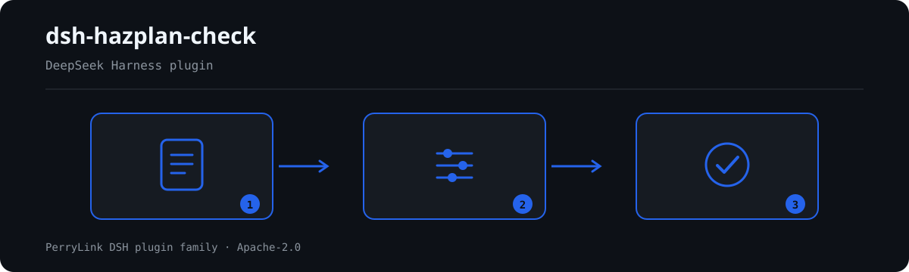

# dsh-hazplan-check — Verificação da completude dos elementos de uma folha de trabalho HAZOP e da coerência na derivação dos desvios

[English](README.md) · [简体中文](README-zh.md) · [Español](README-es.md) · [Português](README-pt.md) · [हिन्दी](README-hi.md)

```sh
dsh plugin --profile <name> add dsh-hazplan-check
```


[](https://dsh.market/)
[](https://dshfind.com/en/plugins/PerryLink/dsh-hazplan-check?ref=badge)

`dsh-hazplan-check` lê uma folha de trabalho HAZOP —linhas organizadas pelos próprios nomes de coluna da folha, em chinês ou em inglês, mais um cabeçalho opcional que declara o 分析对象— e verifica a completude e a rastreabilidade interna dessa mesma folha: se cada linha preenche as colunas exigidas pelo seu modelo (`偏差` e `原因` por omissão), se cada linha regista o seu `节点`, se os `引导词` vêm das tabelas 1 e 2 da norma ou da lista que o estudo declarou antecipadamente, se cada linha deixa ver de que elemento veio o desvio, se o `风险等级` sai do vocabulário de risco da sua organização, se a folha identifica o objeto de análise e se cada `偏差` é literalmente o `工艺参数` lido através do seu `引导词`; qualquer verificação que não possa correr por falta de uma coluna é reportada em `skipped` em vez de passar em silêncio.

## Install

```sh
dsh plugin --profile <name> add dsh-hazplan-check
dsh --profile <name> --dump-config | grep 'dsh-hazplan-check'
```

## Como é a saída



*Visão geral do fluxo: documento → regras → achados. Os exemplos abaixo usam a superfície real de comandos.*


Saída real deste plugin sobre o seu próprio fixture de teste `HZ-004` — não é uma simulação. O pacote de regras não inventa citações, por isso cada achado nomeia a cláusula aplicada e avisa que o seu texto não foi obtido.

## O que ele responde

### Exemplos

A tabela abaixo é o conjunto de exemplos: a primeira linha é o caso detalhado e as demais são casos curtos.


#### Saída detalhada

**Ferramenta** `hazplan_check`

**Entrada**

~~~json
{"rows":[{"节点":"进料单元","工艺参数":"流量","引导词":"无","偏差":"无流量","原因":""}]}
~~~
 
**Saída**

~~~json
{
  "id": "dsh-hazplan-check.HZ-001.de09b5a6",
  "ruleId": "HZ-001",
  "severity": "warn",
  "locator": {
    "row": 1
  },
  "found": "第 1 行缺少 原因",
  "expected": "每一个危险和可操作性问题都应作为单项记录，并与其原因一起记录；本机构配置的必填项为 偏差、原因",
  "fix": "补齐栏目；本条只核对是否填写，不判断该问题是否找全"
}
~~~

*Observado em `tests/fixtures/HZ-001/HZ-001-unsafe.json (cases.json expects HZ-001 count 1); run via lib/index.mjs rules/hazplan-check.yaml`*

| Você pergunta | O que ele responde |
|---|---|
| Uma linha regista o desvio mas deixa a causa em branco. Isso é reportado? | Sim. `HZ-001` exige os campos que cada linha tem de preencher; sem configuração, recorre ao par que a própria cláusula nomeia, `偏差` e `原因`, pelo que um `原因` em branco já é uma falha por si. Verifica que a coluna está preenchida, não que a lista de problemas esteja completa nem que a causa seja tecnicamente válida. |
| Três linhas não têm nó nenhum. Isso é dito, e avalia-se como os nós foram divididos? | `HZ-002` reporta essas linhas num único registo e enumera os números de linha, porque um registo sem nós não permite gerar a lista de nós que a cláusula pede. Só verifica que `节点` está preenchido; não julga se a granularidade do nó é adequada, porque a cláusula 4.2 não dá critério, nem decide se algum nó ficou por analisar. |
| O nosso estudo escreveu «相逆» na coluna `引导词`. Isso será assinalado? | `HZ-003` reporta-o como palavra-guia fora da lista: a norma escreve «相反», não «相逆», e as tabelas 1 e 2 fornecem 无/多/少/伴随/部分/相反/异常 e 早/晚/先/后. É um aviso e não um veredicto, porque uma palavra-guia definida e arquivada pelo estudo antes da análise é permitida — é por isso que a regra fica em `warn`. Uma instalação pode declarar a sua própria lista, e então só o que ficar fora dela é reportado. |
| A coluna `偏差` diz «无流量», mas `工艺参数` é «温度» e `引导词` é «无». Isso é detetado? | `HZ-007` reporta a linha quando o `偏差` escrito não contém o `工艺参数` lido através do seu `引导词` em nenhuma das duas ordens; espaços e os separadores habituais (por exemplo `+`, `、`, `/`, `-`, `—`, `的`, `：`) não contam, pelo que 流量无, 流量 + 无 e 无流量 coincidem. Só corre quando as três colunas existem —caso contrário aparece em `skipped`— e um achado costuma indicar um copiar-colar, não que o desvio seja tecnicamente inválido. |
| A coluna `风险等级` está preenchida com «中», mas nunca configurámos níveis de risco. O que vem na resposta? | `HZ-005` reporta-se a si própria em `skipped`, e não como aprovada: a norma não fixa uma escala de níveis de risco, por isso os níveis têm de vir dos critérios de risco da sua organização e a lista de origem está vazia. Depois de configurados, só verifica se o valor consta da lista, não se a classificação está correta, e a sua severidade está limitada a `info`. |
| A folha não tem nenhuma linha que nomeie a unidade analisada. É uma falha? | `HZ-006` reporta-o uma vez, ao nível superior: sem objeto de análise, as conclusões não se conseguem remontar à fronteira analisada. A lista de cabeçalho em que se apoia vem de um anexo informativo —uma sugestão, não uma obrigação—, por isso a regra fica em `warn` e `requireHeader: false` desativa-a para folhas que legitimamente não a tenham. |

## Normas que segue

| Documento | Número | Regras que o citam |
|---|---|---|
| 《危险与可操作性分析（HAZOP分析）应用指南》 | GB/T 35320-2017 | HZ-001, HZ-002, HZ-003, HZ-004, HZ-005, HZ-006, HZ-007 |
| 《风险管理 风险评估技术》 | GB/T 27921-2023 | HZ-005 |

**Boundary:** this plugin checks one **HAZOP worksheet** for what a sheet can be held to — that every row
records the analysis content your template requires, that each 偏差 actually follows from the 工艺参数 and
引导词 beside it, that risk levels come from your own vocabulary, that every node has rows, and that
recommendations carry their closure fields. It does **not** judge whether the causes are complete, whether
the consequences are analysed far enough, whether the safeguards are adequate, or whether a risk rating is
correct. **Those four judgements are the study team's, and they are where HAZOP's value lies.**

> ### ⚠️ Nothing here is `error`, and the clause wording is why
>
> **GB/T 35320-2017《危险与可操作性分析（HAZOP分析）应用指南》** is in force (published and effective
> 2017-12-29, identical to IEC 61882:2001), and its clause text was obtained verbatim.
>
> **The standard is a *recommended* one (the number carries "/T"), and every clause this pack cites uses
> 宜 — "should" — not 应.** That applies to the two clauses an earlier version of this pack rated as
> `error`: **6.6.4** reads 「每一个危险和可操作性性问题都**宜**作为单项记录」 and **6.6.3** opens
> 「HAZOP 分析输出**宜**包括：」. **A recommendation cannot support an error rating**, so both rules are
> now `warn` and **this plugin reports no error at all** — consistent with how the family treats every
> other recommended standard. A test pins this so a later edit cannot quietly re-escalate one.
>
> **Everything else is capped at `warn` or `info`, for three reasons the pack records:**
>
> 1. **Appendix A.2 — the one place a column list appears — is a 资料性附录.** Its wording is "表列的标题
>    **可为**以下各项", it adds "**也可记录**其他信息", and it says outright that "工作表的版面设计**各有不同**".
>    **There is no mandatory column list**, so a missing column can only ever be a suggestion.
> 2. **Clause 4.2 gives no criterion for node granularity.** It says the size of a node "取决于系统的
>    复杂性和危险的严重程度" and nothing quantitative follows. This plugin **does not** judge node size.
> 3. **The standard fixes no risk-level scale.** 6.5 mentions a risk matrix as useful and defers the method
>    to IEC 60300-3-9; GB/T 27921-2023's matrix description is likewise informative. Levels must come from
>    your own risk criteria, so the vocabulary ships **empty**.
>
> Two further honesty notes are in the pack. The guide-word vocabulary uses the standard's own wording —
> **「相反」, not the colloquial "相逆"** — and combines table 1 with table 2; a custom guide word is
> **not** non-compliant, because 6.4.3 permits one "只要在分析开始前进行了定义". And **SH/T 3240-2025**
> (the petrochemical HAZOP specification, in force 2025-11-01) had only its identity, status and glossary
> verified — **its clause text was not obtained, so this pack cites none of it**.
>
> The four judgements this plugin does not make: whether the causes are complete, whether the consequences
> are analysed far enough, whether the safeguards are adequate, whether a risk rating is correct.

## Compatibility

| Superfície | Estado |
|---|---|
| Harness | Faixa de peers `>=0.1.2-rc.1 <0.2.0 \|\| >=0.2.0-0 <0.3.0` — verificada para aceitar tanto `0.2.0-rc.2` quanto `0.2.1-rc.2`. **`engines.dsh` é declarado como `>=0.2.1-0 <0.3.0`** e o host o aplica desde 0.2.1 |
| Node | `^22.19.0 || >=24.0.0` |
| Plataformas | Todas (ESM puro; sem código nativo, sem rede, sem chamada ao modelo) |
| Modo de ferramenta | Funciona em `native` e `ptc`; para um diretório inteiro use `ptc` |

## What it does

A tabela de regras, os campos e o comportamento detalhado estão em [README.md](README.md#what-it-does) (versão principal em inglês). O plugin apenas lista divergências literais frente às cláusulas citadas e indica em `skipped` cada verificação que não pôde ser executada.

## Configuration

Todos os parâmetros ajustáveis ficam no esquema Schemastery de `src/config.ts`, portanto mudam pelo `cordis.yml` sem editar código; os limites por regra ficam no pacote de regras sob `rules/`.

| Chave | Tipo | Padrão | Descrição |
|---|---|---|---|
| `rulesFile` | string | `rules/hazplan-check.yaml` | Caminho do pacote de regras, relativo à raiz do pacote |
| `disabledRules` | string[] | `[]` | Ids de regras a desativar; cada uma aparece em `skipped` |
| `onlyRules` | string[] | `[]` | Executar apenas estas regras; vazio executa todas |
| `skipNotes` | string | `""` | Nota acrescentada a cada motivo de `skipped` |
| `timeoutMs` | number | `120000` | Orçamento de tempo limite cooperativo da ferramenta |

## Material format

Aceita JSON ou YAML. O exemplo completo de campos está em [README.md](README.md#material-format) (versão principal em inglês). Os campos são opcionais na camada de leitura e validados pelo motor, de modo que uma exportação parcial gera achados sobre o que falta em vez de falhar.

## Rule sources

Os dados das regras ficam separados do código: cada regra traz documento, número, cláusula na numeração própria da fonte, trecho literal e URL de origem. O carregador impõe que o trecho seja citação real de pelo menos oito caracteres e que uma verificação baseada apenas em princípio geral (`kind: derived-from-principle`, teto `warn`) ou em política local (`kind: institutional-configuration`, teto `info`) nunca seja declarada `error`.

Os limites verificados e as conclusões deliberadamente **não** afirmadas estão em [README.md](README.md#rule-sources) (versão principal em inglês) e em `rules/evidence/`.

## Troubleshooting

- **O plugin instala mas a ferramenta não aparece**: confirme que `main` resolve para `lib/index.mjs` e que `pnpm run build` o gerou.
- **`dsh plugin add` recusa o pacote**: a faixa de peers cobre `0.1.x` e `0.2.x`; fora dela, conceda isenção explícita com `dsh plugin --profile <name> allow-version <pkg@ver> --dsh-version <runtime> --accept-risk`.
- **Uma regra não executou**: leia o arranjo `skipped`.
- **`check` informa `manifest-peers` como falha**: problema conhecido do `dsh-plugin-dev`; o runtime aplica a compatibilidade na instalação.
- **Os horários parecem deslocados**: toda a aritmética é de hora local sobre as cadeias fornecidas.

## Development

```sh
pnpm install
pnpm run typecheck
pnpm test
pnpm run build
node ../scripts/sync-shared.mjs dsh-hazplan-check
```

O último comando copia o kit compartilhado de `../_shared` para `src/shared/`; execute-o novamente após cada alteração compartilhada.

## PerryLink DSH Plugin Family

Este projeto faz parte da família de plugins do DeepSeek Harness da [PerryLink](https://github.com/PerryLink). O registro fica recolhido abaixo para que cada README mantenha uma primeira tela curta; expanda para ver cada linha e seu status.

<details>
<summary>Expandir todos os plugins</summary>

| Plugin | Status |
|---|---|
| **[dsh-aqua-input-check](https://github.com/PerryLink/dsh-aqua-input-check)** |  |
| **[dsh-archive-check](https://github.com/PerryLink/dsh-archive-check)** |  |
| **[dsh-auto-review](https://github.com/PerryLink/dsh-auto-review)** |  |
| **[dsh-autotier](https://github.com/PerryLink/dsh-autotier)** |  |
| **[dsh-bid-ca-precheck](https://github.com/PerryLink/dsh-bid-ca-precheck)** |  |
| **[dsh-bid-qual-check](https://github.com/PerryLink/dsh-bid-qual-check)** |  |
| **[dsh-cert-mcp](https://github.com/PerryLink/dsh-cert-mcp)** |  |
| **[dsh-checkpoint-rewind](https://github.com/PerryLink/dsh-checkpoint-rewind)** |  |
| **[dsh-click](https://github.com/PerryLink/dsh-click)** |  |
| **[dsh-composer-history](https://github.com/PerryLink/dsh-composer-history)** |  |
| **[dsh-contract-stance](https://github.com/PerryLink/dsh-contract-stance)** |  |
| **[dsh-customs-doc-check](https://github.com/PerryLink/dsh-customs-doc-check)** |  |
| **[dsh-data-quality](https://github.com/PerryLink/dsh-data-quality)** |  |
| **[dsh-demurrage-ledger](https://github.com/PerryLink/dsh-demurrage-ledger)** |  |
| **[dsh-doublecheck](https://github.com/PerryLink/dsh-doublecheck)** |  |
| **[dsh-drill-script-check](https://github.com/PerryLink/dsh-drill-script-check)** |  |
| **[dsh-eia-guide-check](https://github.com/PerryLink/dsh-eia-guide-check)** |  |
| **[dsh-emergency-plan](https://github.com/PerryLink/dsh-emergency-plan)** |  |
| **[dsh-essay-rubric-check](https://github.com/PerryLink/dsh-essay-rubric-check)** |  |
| **[dsh-evidence-check](https://github.com/PerryLink/dsh-evidence-check)** |  |
| **[dsh-export-ctl-check](https://github.com/PerryLink/dsh-export-ctl-check)** |  |
| **[dsh-fast](https://github.com/PerryLink/dsh-fast)** |  |
| **[dsh-fmea-table-check](https://github.com/PerryLink/dsh-fmea-table-check)** |  |
| **[dsh-forecast-penalty](https://github.com/PerryLink/dsh-forecast-penalty)** |  |
| **[dsh-fund-research](https://github.com/PerryLink/dsh-fund-research)** |  |
| **[dsh-github](https://github.com/PerryLink/dsh-github)** |  |
| **[dsh-gongwen-flow-check](https://github.com/PerryLink/dsh-gongwen-flow-check)** |  |
| **[dsh-gongwen-word-check](https://github.com/PerryLink/dsh-gongwen-word-check)** |  |
| **[dsh-guard-plan-qc](https://github.com/PerryLink/dsh-guard-plan-qc)** |  |
| **[dsh-hazchem-check](https://github.com/PerryLink/dsh-hazchem-check)** |  |
| **[dsh-hazplan-check](https://github.com/PerryLink/dsh-hazplan-check)** |  |
| **[dsh-hidden-risk-map](https://github.com/PerryLink/dsh-hidden-risk-map)** |  |
| **[dsh-hs-classify](https://github.com/PerryLink/dsh-hs-classify)** |  |
| **[dsh-icd-rule-check](https://github.com/PerryLink/dsh-icd-rule-check)** |  |
| **[dsh-industry-research](https://github.com/PerryLink/dsh-industry-research)** |  |
| **[dsh-lawcite-adapter](https://github.com/PerryLink/dsh-lawcite-adapter)** |  |
| **[dsh-laya](https://github.com/PerryLink/dsh-laya)** |  |
| **[dsh-lc-doc-check](https://github.com/PerryLink/dsh-lc-doc-check)** |  |
| **[dsh-learning-gap-check](https://github.com/PerryLink/dsh-learning-gap-check)** |  |
| **[dsh-library](https://github.com/PerryLink/dsh-library)** |  |
| **[dsh-local-ai](https://github.com/PerryLink/dsh-local-ai)** |  |
| **[dsh-lsp-actions](https://github.com/PerryLink/dsh-lsp-actions)** |  |
| **[dsh-mask](https://github.com/PerryLink/dsh-mask)** |  |
| **[dsh-mcp-panel](https://github.com/PerryLink/dsh-mcp-panel)** |  |
| **[dsh-medrec-qc](https://github.com/PerryLink/dsh-medrec-qc)** |  |
| **[dsh-memento](https://github.com/PerryLink/dsh-memento)** |  |
| **[dsh-nsfc-form-check](https://github.com/PerryLink/dsh-nsfc-form-check)** |  |
| **[dsh-nurse-record-check](https://github.com/PerryLink/dsh-nurse-record-check)** |  |
| **[dsh-observe](https://github.com/PerryLink/dsh-observe)** |  |
| **[dsh-origin-rvc-check](https://github.com/PerryLink/dsh-origin-rvc-check)** |  |
| **[dsh-ota-review-check](https://github.com/PerryLink/dsh-ota-review-check)** |  |
| **[dsh-output-styles](https://github.com/PerryLink/dsh-output-styles)** |  |
| **[dsh-paper-doc-adapter](https://github.com/PerryLink/dsh-paper-doc-adapter)** |  |
| **[dsh-permission-rules](https://github.com/PerryLink/dsh-permission-rules)** |  |
| **[dsh-permit-report-check](https://github.com/PerryLink/dsh-permit-report-check)** |  |
| **[dsh-pipeline-check](https://github.com/PerryLink/dsh-pipeline-check)** |  |
| **[dsh-pleading-draft](https://github.com/PerryLink/dsh-pleading-draft)** |  |
| **[dsh-plugin-doctor](https://github.com/PerryLink/dsh-plugin-doctor)** |  |
| **[dsh-plugin-guide](https://github.com/PerryLink/dsh-plugin-guide)** |  |
| **[dsh-plugin-kit](https://github.com/PerryLink/dsh-plugin-kit)** |  |
| **[dsh-plugin-upgrade](https://github.com/PerryLink/dsh-plugin-upgrade)** |  |
| **[dsh-policy-brief-draft](https://github.com/PerryLink/dsh-policy-brief-draft)** |  |
| **[dsh-power-loss-split](https://github.com/PerryLink/dsh-power-loss-split)** |  |
| **[dsh-power-ticket-check](https://github.com/PerryLink/dsh-power-ticket-check)** |  |
| **[dsh-ppap-check](https://github.com/PerryLink/dsh-ppap-check)** |  |
| **[dsh-protest-deadline](https://github.com/PerryLink/dsh-protest-deadline)** |  |
| **[dsh-railway-window](https://github.com/PerryLink/dsh-railway-window)** |  |
| **[dsh-repair-order-qc](https://github.com/PerryLink/dsh-repair-order-qc)** |  |
| **[dsh-research-report](https://github.com/PerryLink/dsh-research-report)** |  |
| **[dsh-review-reply-check](https://github.com/PerryLink/dsh-review-reply-check)** |  |
| **[dsh-rulefile-check](https://github.com/PerryLink/dsh-rulefile-check)** |  |
| **[dsh-safety-brief-check](https://github.com/PerryLink/dsh-safety-brief-check)** |  |
| **[dsh-score](https://github.com/PerryLink/dsh-score)** |  |
| **[dsh-session-sync](https://github.com/PerryLink/dsh-session-sync)** |  |
| **[dsh-site-log-check](https://github.com/PerryLink/dsh-site-log-check)** |  |
| **[dsh-skill-pack-security](https://github.com/PerryLink/dsh-skill-pack-security)** |  |
| **[dsh-soe-decision-check](https://github.com/PerryLink/dsh-soe-decision-check)** |  |
| **[dsh-soilwater-check](https://github.com/PerryLink/dsh-soilwater-check)** |  |
| **[dsh-sop-sync-check](https://github.com/PerryLink/dsh-sop-sync-check)** |  |
| **[dsh-spc-gbt-adapter](https://github.com/PerryLink/dsh-spc-gbt-adapter)** |  |
| **[dsh-talk](https://github.com/PerryLink/dsh-talk)** |  |
| **[dsh-tender-extract](https://github.com/PerryLink/dsh-tender-extract)** |  |
| **[dsh-tender-matrix](https://github.com/PerryLink/dsh-tender-matrix)** |  |
| **[dsh-test-drive](https://github.com/PerryLink/dsh-test-drive)** |  |
| **[dsh-ticktick](https://github.com/PerryLink/dsh-ticktick)** |  |
| **[dsh-translate](https://github.com/PerryLink/dsh-translate)** |  |
| **[dsh-warranty-calc](https://github.com/PerryLink/dsh-warranty-calc)** |  |
| **[dsh-budget](https://github.com/PerryLink/dsh-budget)** | 🧊 CONGELADO — ver o README do repositório |
| **[dsh-claude-move](https://github.com/PerryLink/dsh-claude-move)** | 🧊 CONGELADO — ver o README do repositório |
| **[dsh-defend](https://github.com/PerryLink/dsh-defend)** | 🧊 CONGELADO — ver o README do repositório |
| **[dsh-draw](https://github.com/PerryLink/dsh-draw)** | 🧊 CONGELADO — ver o README do repositório |
| **[dsh-reach](https://github.com/PerryLink/dsh-reach)** | 🧊 CONGELADO — ver o README do repositório |
| **[dsh-background-agents](https://github.com/PerryLink/dsh-background-agents)** | 🚫 RETIRADO — ver o README do repositório |
| **[dsh-session-pin](https://github.com/PerryLink/dsh-session-pin)** | 🚫 RETIRADO — ver o README do repositório |
| **[dsh-team-rooms](https://github.com/PerryLink/dsh-team-rooms)** | 🚫 RETIRADO — ver o README do repositório |

</details>

## License

[Apache License 2.0](LICENSE) © 2026 dsh-hazplan-check contributors.
