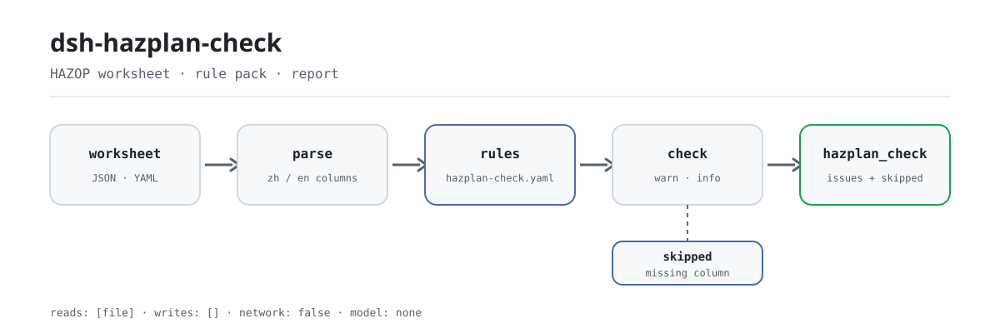

<div align="center">

<picture>
  <source media="(prefers-color-scheme: dark)" srcset="docs/assets/dsh-hazplan-check-flow-dark.svg">
  
</picture>

# dsh-hazplan-check

**Check a HAZOP worksheet line by line: which row, which column, what is missing — in one list.**

A worksheet checker for process-safety and HAZOP teams: read one sheet, run a versioned rule pack over its completeness and deviation derivation, and list differences only — never a compliance verdict.

[Install](#three-step-setup) · [Configuration](#configuration) · [FAQ](#faq) · [简体中文](README.md) · [English](README.en.md) · [Español](README.es.md) · [Português](README.pt.md) · [हिन्दी](README.hi.md)

[](LICENSE)
[](#compatibility)
[](https://www.npmjs.com/package/dsh-hazplan-check)
[](https://github.com/PerryLink/dsh-hazplan-check/actions/workflows/ci.yml)
[](#compatibility)

[](https://github.com/PerryLink/dsh-hazplan-check/stargazers)
[](https://www.npmjs.com/package/dsh-hazplan-check)
[](https://dshfind.com/plugins/PerryLink/dsh-hazplan-check?ref=badge)
[](https://securityscorecards.dev/viewer/?uri=github.com/PerryLink/dsh-hazplan-check)
[](https://dsh.market/)
[](https://gitee.com/perrylink/dsh-hazplan-check)

```sh
dsh plugin --profile <name> add dsh-hazplan-check
```

</div>

<sub>Community plugin, not affiliated with DeepSeek. Canonical repository: <https://github.com/PerryLink/dsh-hazplan-check> (Gitee is a mirror).</sub>

## What it is

`dsh-hazplan-check` reads one HAZOP worksheet — rows keyed by the sheet's own column names (Chinese or English), plus an optional header naming the analysis subject — and checks that same sheet: whether every row fills the fields your template requires (deviation and cause by default), whether each row records its node, whether guide words come from the standard's tables 1 and 2 or from the list the study declared beforehand, whether each row shows which element its deviation came from, whether risk levels come from your own risk vocabulary, whether the sheet names its analysis subject, and whether every deviation literally contains the parameter read through its guide word. A check that cannot run for want of a column is reported in `skipped` rather than passing silently.

It registers one `hazplan_check` tool. The check core is a pure function: no network, no model call, no file writes; the worksheet is read-only.

## Three-step setup

1. **Install**:

   ```sh
   dsh plugin --profile web add dsh-hazplan-check
   ```

2. **Minimal config** (optional; without it `HZ-005` and a custom `HZ-003` list stay skipped):

```yaml
- insert:
    - id: dsh-hazplan-check
      name: dsh-hazplan-check
      config:
        riskLevels: [高, 中, 低]
        guideWords: [无, 多, 少, 伴随, 部分, 相反, 异常]
```

3. **Verify it mounts**:

   ```sh
   dsh --profile web --dump-config | grep 'dsh-hazplan-check'
   ```

   In this repository you can also run the shipped quickstart (after `pnpm install && pnpm run build`):

   ```sh
   node samples/quickstart/run.mjs
   ```

   ```text
   $ node samples/quickstart/run.mjs
   hazplan_check: 1 issue(s) — error 0, warn 1, info 0
   skipped: 6
   ```

   The same expected output is stored in `samples/quickstart/expected/result.json`.

**Uninstall**: `dsh plugin --profile web remove dsh-hazplan-check` (or remove the row from the profile patch).

<details>
<summary>Using it from WorkBuddy / Coze</summary>

Search for “Safety Compliance Suite” in WorkBuddy / Coze (this check is one part of it; availability as listed in the marketplace).

</details>

## Core capabilities

- **The rule pack is data** — rules live in `rules/hazplan-check.yaml`; each carries a document, a document number, a clause in the source's own numbering, a verbatim excerpt and the URL it was read from. Replace the YAML to switch rule sets; the pack is validated on load, not trusted.
- **Chinese and English column names** — matching is case-insensitive and ignores spaces, underscores and hyphens, so `Guide Word`, `guide_word` and `guideword` resolve to the same field; exports from commercial HAZOP tools load without editing.
- **Deviation derivation** — the written deviation must contain the parameter read through its guide word; both word orders, the usual separators and whitespace are normalised. A hit flags a likely copy-paste artefact, not a technically invalid deviation.
- **No silent pass** — every check that cannot run is listed in `skipped` with its reason; a rule whose required list is unset reports itself in `skipped` instead of passing silently.
- **Differences only** — the report never pronounces on compliance, liability or correctness; a wording guard rejects adjudicating language and every report carries the disclaimer.
- **One tool face** — only `hazplan_check` is registered; it works in `native` and `ptc` mode, and `ptc` is the better choice for several worksheets at once.

### The seven rules

| Rule | Check | Severity | Basis |
|---|---|---|---|
| `HZ-001` | every problem is its own row, with its cause | warn | 6.6.4 |
| `HZ-002` | every analysed node is recorded on the sheet | warn | 6.6.3 |
| `HZ-003` | guide words come from table 1 + table 2, or were declared first | warn | tables 1 + 2 + 6.4.3 |
| `HZ-004` | the row shows which element the deviation came from | warn | 3.3 + 6.4.3 |
| `HZ-005` | risk levels come from your risk criteria (off by default) | info | 6.5 + GB/T 27921 |
| `HZ-006` | the sheet names its analysis subject | warn | appendix A.2 (informative) |
| `HZ-007` | the deviation contains the parameter read through its guide word | warn | 6.4.3 |

### Rule Q&A

| You ask | What it answers |
|---|---|
| A row records the deviation but leaves the cause blank. Is that reported? | Yes. `HZ-001` requires the fields every row must fill; shipped unset, it falls back to the pair the clause itself names — the deviation and cause columns — so a blank cause is a gap on its own. It checks that the column is filled, not that the problem list is complete or the cause technically sound. |
| Three rows carry no node at all. Does the check say anything, and does it judge how the nodes were divided? | `HZ-002` reports those rows together and lists their row numbers, because a record without nodes cannot produce the node list the clause asks for. It checks only that the node column is filled; it does not judge whether the node granularity is right, since clause 4.2 gives no criterion for it, and it does not decide whether any node was left unanalysed. |
| Our study wrote the colloquial word for “opposite” in the guide-word column. Will that be flagged? | `HZ-003` reports it as a guide word outside the list: the standard's own wording for “opposite” is not the colloquial variant, and tables 1 and 2 supply the standard terms. The finding is a prompt rather than a verdict, because a guide word the study defined and archived before the analysis is permitted — which is why the rule sits at `warn`. A deployment can declare its own list instead, and then only words outside that list are reported. |
| The deviation reads “no flow”, while the parameter says “temperature” and the guide word says “none”. Is that caught? | `HZ-007` reports the row when the written deviation does not contain the parameter read through its guide word in either word order; blanks and the usual separators (listed in the block below) are ignored, so the three natural spellings all agree. It runs only when all three columns are present — otherwise it appears in `skipped` — and a hit means a likely copy-paste artefact, not that the deviation is technically wrong. |
| The risk-level column is filled with “medium”, but we never configured a risk vocabulary. What comes back? | `HZ-005` reports itself in `skipped`, not as a pass: the standard fixes no risk-level scale, so the levels have to come from your own risk criteria and the shipped list is empty. Once levels are configured it only checks that the value is in the list, not whether the rating is correct, and its severity is capped at `info`. |
| The worksheet has no line naming the unit it analyses. Is that a gap? | `HZ-006` reports it once, at the top level: without an analysis subject the conclusions cannot be traced back to the boundary that was analysed. The header list it rests on comes from an informative appendix — a suggestion, not a requirement — so the rule stays at `warn`, and `requireHeader: false` turns it off for sheets that legitimately carry none. |

Exact source tokens for the guide-word and deviation cases:

```text
Guide words, tables 1 + 2:
  无  多  少  伴随  部分  相反  异常
  早  晚  先  后

Example agreement (all pass HZ-007):
  流量无 · 流量 + 无 · 无流量

Standard vs colloquial term:
  相反  (standard)   相逆  (colloquial)

Separators ignored by HZ-007:
  +  、  /  -  —  的  ：
```

### Real output

This call is the plugin's real output on its own `HZ-001` fixture, not a mock-up.

**Tool** `hazplan_check`

**Input**

~~~json
{"rows":[{"节点":"进料单元","工艺参数":"流量","引导词":"无","偏差":"无流量","原因":""}]}
~~~

**Output**

~~~json
{
  "id": "dsh-hazplan-check.HZ-001.de09b5a6",
  "ruleId": "HZ-001",
  "severity": "warn",
  "locator": {
    "row": 1
  },
  "found": "第 1 行缺少 原因",
  "expected": "每一个危险和可操作性问题都应作为单项记录，并与其原因一起记录；本机构配置的必填项为 偏差、原因",
  "fix": "补齐栏目；本条只核对是否填写，不判断该问题是否找全"
}
~~~

*Observed from `tests/fixtures/HZ-001/HZ-001-unsafe.json (cases.json expects HZ-001 count 1); run via lib/index.mjs rules/hazplan-check.yaml`*

## Configuration

Every tunable is a Schemastery field in `src/config.ts`, changeable from `cordis.yml` without touching code; per-rule thresholds live in the rule pack under `rules/`. An id-targeted override replaces the whole row — restate every key you need.

Most-used keys:

| Key | Type | Default | Description |
|---|---|---|---|
| `rulesFile` | string | `rules/hazplan-check.yaml` | Rule-pack path, relative to the package root |
| `disabledRules` | string[] | `[]` | Rule ids to stop running; each appears in `skipped` |
| `onlyRules` | string[] | `[]` | Run only these rule ids; empty runs every rule |
| `skipNotes` | string | `""` | Note appended to every `skipped` reason |
| `timeoutMs` | number | `120000` | Cooperative tool timeout budget in milliseconds |

<details>
<summary>Full configuration table (7 keys)</summary>

| Key | Type | Default | Description |
|---|---|---|---|
| `rulesFile` | string | `rules/hazplan-check.yaml` | Rule-pack path, relative to the package root |
| `disabledRules` | string[] | `[]` | Rule ids to stop running; each appears in `skipped` |
| `onlyRules` | string[] | `[]` | Run only these rule ids; empty runs every rule |
| `skipNotes` | string | `""` | Note appended to every `skipped` reason |
| `riskLevels` | string[] | `[]` | Your risk criteria's levels; empty means the risk-level check does not run |
| `guideWords` | string[] | `[]` | Guide words the study declared before the analysis; empty uses the standard's tables |
| `timeoutMs` | number | `120000` | Cooperative tool timeout budget in milliseconds |

</details>

<details>
<summary>Rule-level parameters (4 keys)</summary>

| Key | Default | Description |
|---|---|---|
| `HZ-001` `requiredFields` | the clause-named pair | Columns every row must fill; empty falls back to the pair the clause itself names |
| `HZ-003` `guideWords` | `[]` | Guide words declared for this study; empty uses the standard's tables 1 and 2 |
| `HZ-005` `riskLevels` | `[]` | Your risk vocabulary; empty means this rule does not run |
| `HZ-006` `requireHeader` | `true` | Set to `false` when the sheet legitimately carries no subject line |

</details>

Effective rule-level defaults (the pack ships empty lists; the code falls back to these):

```text
HZ-001.requiredFields = [偏差, 原因]
HZ-003.guideWords     = []
HZ-005.riskLevels     = []
HZ-006.requireHeader  = true
```

Example override in your profile patch:

```yaml
- insert:
    - id: dsh-hazplan-check
      name: dsh-hazplan-check
      config:
        onlyRules: [HZ-001, HZ-002, HZ-003, HZ-007]
        riskLevels: [高, 中, 低]
        requireHeader: false
```

## FAQ

<details>
<summary>Is the worksheet stored or sent anywhere?</summary>

No. The plugin reads the supplied `file` or `material` and checks it in memory; `package.json#dsh.demo` declares the user's material file under `reads`, `writes: []`, `network: false`, and the runtime makes no network request, no model call and no file write. The original worksheet is never modified; the report returns to the current session only.

</details>

<details>
<summary>What happens when a column is missing or a list is unset — silent pass?</summary>

No. Every check that cannot run is listed in `skipped` with its reason; `HZ-001`, `HZ-003` and `HZ-005` report themselves in `skipped` when their lists are empty rather than returning a pass. "No issues found" only covers every rule when `skipped` is empty.

</details>

<details>
<summary>Does it fight other plugins over tool names, commands or slots?</summary>

No. It only registers the `hazplan_check` tool under `tools`; it registers no client slot, command, HTTP route or service key, and `inject` contains only `tools`, so the registration is removed with its Cordis effect on unload. It reads no other plugin's state and mutates no globals.

</details>

<details>
<summary>How big is the performance overhead?</summary>

The check is an in-memory rule match: no network request, no model call, no external process; the cost of one worksheet scales with its row count and the number of rules. The tool carries a cooperative timeout budget, `timeoutMs` (default `120000` ms); use `ptc` mode when checking several worksheets at once.

</details>

<details>
<summary>Does it produce a compliance verdict or allocate liability?</summary>

No. The report lists differences that can be pointed at inside the material; it does not judge compliance, allocate liability or replace the reviewer. A wording guard rejects adjudicating language and every report carries the disclaimer. Whether the causes are complete, the consequences analysed far enough, the safeguards adequate or a risk rating correct is for the study team to decide.

</details>

## Standards it follows

| Document | Number | Cited by rules |
|---|---|---|
| Guidelines for hazard and operability analysis (HAZOP) | GB/T 35320-2017 | HZ-001, HZ-002, HZ-003, HZ-004, HZ-005, HZ-006, HZ-007 |
| Risk management — risk assessment techniques | GB/T 27921-2023 | HZ-005 |

The source titles, verbatim:

```text
《危险与可操作性分析（HAZOP分析）应用指南》  GB/T 35320-2017
《风险管理 风险评估技术》                  GB/T 27921-2023
```

### ⚠️ Nothing here is `error`, and the clause wording is why

> **GB/T 35320-2017 (the HAZOP application guide)** is in force (published and effective 2017-12-29, identical to IEC 61882:2001), and its clause text was obtained verbatim.
>
> **The standard is a *recommended* one (the number carries "/T"), and every clause this pack cites uses the recommended "should" modal, not the mandatory "shall" modal.** That applies to the two clauses an earlier version of this pack rated as `error`: **6.6.4** says every hazard and operability problem **should** be recorded as a separate item, and **6.6.3** opens with "HAZOP analysis output **should** include:". **A recommendation cannot support an error rating**, so both rules are now `warn` and **this plugin reports no error at all** — consistent with how the family treats every other recommended standard. A test pins this so a later edit cannot quietly re-escalate one.

The verbatim clause lines this reasoning rests on:

```text
6.6.4  每一个危险和可操作性性问题都宜作为单项记录
6.6.3  HAZOP 分析输出宜包括：
```

> **Everything else is capped at `warn` or `info`, for three reasons the pack records:**
>
> 1. **Appendix A.2 — the one place a column list appears — is an informative annex.** Its wording is "the headings listed in the table **may be** the following", it adds "**other information may also be recorded**", and it says outright that "the worksheet layout **differs from study to study**". **There is no mandatory column list**, so a missing column can only ever be a suggestion.
> 2. **Clause 4.2 gives no criterion for node granularity.** It says the size of a node "depends on the complexity of the system and the severity of the hazard" and nothing quantitative follows. This plugin **does not** judge node size.
> 3. **The standard fixes no risk-level scale.** 6.5 mentions a risk matrix as useful and defers the method to IEC 60300-3-9; GB/T 27921-2023's matrix description is likewise informative. Levels must come from your own risk criteria, so the vocabulary ships **empty**.
>
> Two further honesty notes are in the pack. The guide-word vocabulary uses the standard's own term for "opposite", **not the colloquial variant** many sheets write — the difference is recorded in the pack — and combines table 1 with table 2; a custom guide word is **not** non-compliant, because 6.4.3 permits one "as long as it was defined before the analysis began". And **SH/T 3240-2025** (the petrochemical HAZOP specification, in force 2025-11-01) had only its identity, status and glossary verified — **its clause text was not obtained, so this pack cites none of it**.
>
> The four judgements this plugin does not make: whether the causes are complete, whether the consequences are analysed far enough, whether the safeguards are adequate, whether a risk rating is correct.

## Security boundaries

- **It checks only what a sheet can be held to.** Whether every row records the analysis content your template requires (including the required fields you configure), whether each deviation follows from the parameter and guide word beside it, whether risk levels come from your own vocabulary, and whether every node has rows — those are what the sheet can attest to.
- **Four judgements stay with the study team.** This plugin does **not** judge whether the causes are complete, whether the consequences are analysed far enough, whether the safeguards are adequate, or whether a risk rating is correct. **Those four judgements are the study team's, and they are where HAZOP's value lies.**
- **No compliance verdict, no liability finding.** The report lists differences that can be pointed at inside the material, always carries the disclaimer, and a wording guard rejects adjudicating language.
- **No silent pass.** Every check that cannot run is listed in `skipped` with its reason; a rule whose required list is unset reports itself in `skipped` rather than passing silently.
- **A fabricated citation fails on load.** The loader enforces that an excerpt is a real quotation of at least eight characters; a rule resting only on a general principle (`kind: derived-from-principle`) is capped at `warn`, and one resting only on local policy (`kind: institutional-configuration`) at `info`. A pack that overstates its evidence fails to load rather than producing a confident-looking report.
- **Read-only input.** The plugin reads the supplied worksheet or file; it writes no file, makes no network request and calls no model; the original is never modified.

## Material format

JSON or YAML. Excel can be converted to JSON/YAML first; the chat can do that for you where the platform supports it. Rows are keyed by the sheet's own column names; **Chinese and English names both work**, so an export from a commercial HAZOP tool loads without editing:

```yaml
subject: 某装置 HAZOP 分析
revision: V1.0
rows:
  - { 节点: 进料单元, 设计意图: 将原料按设计流量送入反应器, 工艺参数: 流量, 引导词: 无,
      偏差: 无流量, 原因: 进料泵故障, 后果: 反应器液位下降, 现有安全措施: 液位低报警,
      建议措施: 增加进料泵备用泵, 风险等级: 中, 责任人: 张工, 完成期限: 2026-06-30 }
  - { Node: N2, Parameter: Temperature, "Guide Word": High, Deviation: High temperature,
      Causes: Cooling failure, Consequences: Runaway, Safeguards: High-temp trip }
```

Column names are matched case-insensitively and ignoring spaces, underscores and hyphens, so `Guide Word`, `guide_word` and `guideword` all resolve to the same field. Fields are optional at the reader layer and validated by the engine, so a partial export produces "missing field" findings instead of a crash.

`HZ-007` compares the deviation against the parameter+guide-word combination over a fixed separator set (the exact set is listed in the Rule Q&A block) and in both word orders, so all three natural spellings pass. It reports a mismatch as a likely copy-paste artefact — not as a claim that the deviation is technically wrong.

## Rule sources

Rule data is separate from code and lives in `rules/hazplan-check.yaml`. Every rule carries a document, a document number, a clause in the source's own numbering, a verbatim excerpt and the URL the excerpt was read from.

The clauses quoted come from **GB/T 35320-2017** — 3.3, 4.2, 6.4.3, 6.5, 6.6.3, 6.6.4, tables 1 and 2, and appendix A.2 — plus **GB/T 27921-2023** appendix B.10.3 for the risk-matrix description. The clause text was read from a full-text transcription whose structure cross-checks against the standard's official metadata; the pack records that the source is a transcription.

Four findings shaped this pack and are recorded in its header:

1. **Appendix A.2 is informative**, so its column list is a suggestion and never a requirement.
2. **Clause 4.2 gives no criterion for node size**, so node granularity is not automatically judged.
3. **The standard fixes no risk-level scale**, so levels are yours and the vocabulary ships empty.
4. **SH/T 3240-2025 exists but its clause text was not obtained**, so no article of it is cited — only its identity is noted, in the pack header.

The full clause-verification report, including the sources that were checked and rejected, is in [`rules/evidence/clause-verification.md`](rules/evidence/clause-verification.md).

## Compatibility

| Surface | Status |
|---|---|
| Harness | Peer range `>=0.1.2-rc.1 <0.2.0 \|\| >=0.2.0-0 <0.3.0` — verified to accept both `0.2.0-rc.2` and `0.2.1-rc.2`. `engines.dsh` is declared as `>=0.2.1-0 <0.3.0` and is enforced by the host since 0.2.1 |
| Node | `^22.19.0 \|\| >=24.0.0` |
| Platforms | All (plain ESM; no native code, no network, no model call) |
| Tool mode | Works in `native` and `ptc`; for several worksheets use `ptc` |

## Troubleshooting

- **`HZ-001`, `HZ-003` or `HZ-005` report themselves as skipped.** Their lists are empty. Fill in the ones your template uses.
- **`HZ-007` fires on a row that reads fine to me.** Your sheet may write a fuller deviation than the parameter+guide-word form. The rule says "likely a copy-paste artefact"; either normalise the column or accept it as noise. It never blocks anything.
- **`HZ-007` reports nothing.** The sheet does not carry all three of the parameter, guide-word and deviation columns — the rule says so in `skipped` rather than guessing.
- **The reader refuses a worksheet it used to accept.** It found none of the known column names; the error names the columns it saw. Rename one column or add the name to `COLUMNS` in `src/model.ts`.
- **The plugin installs but the tool never appears.** Check that `main` resolves to `lib/index.mjs` and that `pnpm run build` produced it; a wrong `main` makes the loader skip the entry silently.
- **`dsh plugin add` refuses the package as incompatible.** The peer range covers `0.1.x` and `0.2.x`; if your runtime sits outside it, grant an explicit exemption: `dsh plugin --profile <name> allow-version dsh-hazplan-check@0.1.0 --dsh-version <runtime> --accept-risk`.
- **`check` reports `manifest-peers` as failed.** The static checker compares against a hard-coded peer range that predates the 0.2 line. The runtime enforces peer compatibility at install time, so the declared range is the correct one; this is a known upstream issue in `dsh-plugin-dev`.
- **Times look shifted.** All arithmetic is wall-clock over the strings you supply; no timezone conversion is performed.

## Ecosystem & quality

- [Gitee mirror](https://gitee.com/perrylink/dsh-hazplan-check) (sync mirror; GitHub is canonical)
- [dshfind plugin page](https://dshfind.com/plugins/PerryLink/dsh-hazplan-check) (installs and ranking)
- [OpenSSF Scorecard report](https://securityscorecards.dev/viewer/?uri=github.com/PerryLink/dsh-hazplan-check) (driven by [.github/workflows/scorecard.yml](.github/workflows/scorecard.yml))
- [DSH Market](https://dsh.market/) (listed)
- [Choose a checker by material](https://perrylink.github.io/zh/checkers/choose/) (62 checkers plus general plugins in one selection index)
- [Ecosystem knowledge base](https://perrylink.github.io/dsh-plugin-guide/) — measured data, not marketing: plugin development guide · plugin-selection data · maintenance criteria

## Development

```sh
pnpm install
pnpm run typecheck   # tsc --noEmit
pnpm test            # vitest, paired compliant/violating fixtures per rule
pnpm run build       # tsdown -> lib/index.mjs + lib/index.d.mts
pnpm run check:readmes
node ../scripts/sync-shared.mjs dsh-hazplan-check
```

The last command copies the shared kit from `../_shared` into `src/shared/`; re-run it after every shared change.

The check core `src/check.ts` is a pure function `(input, ruleset, options) => Report` with no plugin context, I/O, clock or model access, so the whole rule set is unit-testable without credentials; the rule pack `rules/hazplan-check.yaml` is data, and replacing it switches the rule set. Quick run: `node samples/quickstart/run.mjs`. The README images are generated programmatically by [`scripts/gen-readme-assets.py`](scripts/gen-readme-assets.py) (Python + Pillow, vector SVG, light and dark), and are safe to re-run.

Topics: `deepseek-harness`, `dsh`, `dsh-plugin`, `cordis`, `hazplan`

## Family & thanks

This project is part of the DeepSeek Harness plugin family from [PerryLink](https://github.com/PerryLink) (all Apache-2.0). If it is useful, **a star helps the next person find it** — nothing is gated behind it.

- [@PerryLink](https://github.com/PerryLink) — creator and maintainer: the rule pack (`HZ-001`…`HZ-007`), the material reader and report view, the clause-verification record and the five-language docs.

<details>
<summary>Expand all plugins</summary>

| Plugin | Status |
|---|---|
| **[dsh-aqua-input-check](https://github.com/PerryLink/dsh-aqua-input-check)** |  |
| **[dsh-archive-check](https://github.com/PerryLink/dsh-archive-check)** |  |
| **[dsh-auto-review](https://github.com/PerryLink/dsh-auto-review)** |  |
| **[dsh-autotier](https://github.com/PerryLink/dsh-autotier)** | 🧊 FROZEN — see the repo README |
| **[dsh-bid-ca-precheck](https://github.com/PerryLink/dsh-bid-ca-precheck)** |  |
| **[dsh-bid-qual-check](https://github.com/PerryLink/dsh-bid-qual-check)** |  |
| **[dsh-cert-mcp](https://github.com/PerryLink/dsh-cert-mcp)** | 🧊 FROZEN — see the repo README |
| **[dsh-checkpoint-rewind](https://github.com/PerryLink/dsh-checkpoint-rewind)** |  |
| **[dsh-click](https://github.com/PerryLink/dsh-click)** |  |
| **[dsh-composer-history](https://github.com/PerryLink/dsh-composer-history)** |  |
| **[dsh-contract-stance](https://github.com/PerryLink/dsh-contract-stance)** |  |
| **[dsh-customs-doc-check](https://github.com/PerryLink/dsh-customs-doc-check)** |  |
| **[dsh-data-quality](https://github.com/PerryLink/dsh-data-quality)** |  |
| **[dsh-demurrage-ledger](https://github.com/PerryLink/dsh-demurrage-ledger)** |  |
| **[dsh-doublecheck](https://github.com/PerryLink/dsh-doublecheck)** |  |
| **[dsh-drill-script-check](https://github.com/PerryLink/dsh-drill-script-check)** |  |
| **[dsh-eia-guide-check](https://github.com/PerryLink/dsh-eia-guide-check)** |  |
| **[dsh-emergency-plan](https://github.com/PerryLink/dsh-emergency-plan)** |  |
| **[dsh-essay-rubric-check](https://github.com/PerryLink/dsh-essay-rubric-check)** |  |
| **[dsh-evidence-check](https://github.com/PerryLink/dsh-evidence-check)** |  |
| **[dsh-export-ctl-check](https://github.com/PerryLink/dsh-export-ctl-check)** |  |
| **[dsh-fast](https://github.com/PerryLink/dsh-fast)** |  |
| **[dsh-fmea-table-check](https://github.com/PerryLink/dsh-fmea-table-check)** |  |
| **[dsh-forecast-penalty](https://github.com/PerryLink/dsh-forecast-penalty)** |  |
| **[dsh-fund-research](https://github.com/PerryLink/dsh-fund-research)** |  |
| **[dsh-github](https://github.com/PerryLink/dsh-github)** |  |
| **[dsh-gongwen-flow-check](https://github.com/PerryLink/dsh-gongwen-flow-check)** |  |
| **[dsh-gongwen-word-check](https://github.com/PerryLink/dsh-gongwen-word-check)** |  |
| **[dsh-guard-plan-qc](https://github.com/PerryLink/dsh-guard-plan-qc)** |  |
| **[dsh-hazchem-check](https://github.com/PerryLink/dsh-hazchem-check)** |  |
| **[dsh-hazplan-check](https://github.com/PerryLink/dsh-hazplan-check)** |  |
| **[dsh-hidden-risk-map](https://github.com/PerryLink/dsh-hidden-risk-map)** |  |
| **[dsh-hs-classify](https://github.com/PerryLink/dsh-hs-classify)** |  |
| **[dsh-icd-rule-check](https://github.com/PerryLink/dsh-icd-rule-check)** |  |
| **[dsh-industry-research](https://github.com/PerryLink/dsh-industry-research)** |  |
| **[dsh-lawcite-adapter](https://github.com/PerryLink/dsh-lawcite-adapter)** |  |
| **[dsh-laya](https://github.com/PerryLink/dsh-laya)** |  |
| **[dsh-lc-doc-check](https://github.com/PerryLink/dsh-lc-doc-check)** |  |
| **[dsh-learning-gap-check](https://github.com/PerryLink/dsh-learning-gap-check)** |  |
| **[dsh-library](https://github.com/PerryLink/dsh-library)** |  |
| **[dsh-local-ai](https://github.com/PerryLink/dsh-local-ai)** |  |
| **[dsh-lsp-actions](https://github.com/PerryLink/dsh-lsp-actions)** |  |
| **[dsh-mask](https://github.com/PerryLink/dsh-mask)** |  |
| **[dsh-mcp-panel](https://github.com/PerryLink/dsh-mcp-panel)** |  |
| **[dsh-medrec-qc](https://github.com/PerryLink/dsh-medrec-qc)** |  |
| **[dsh-memento](https://github.com/PerryLink/dsh-memento)** |  |
| **[dsh-nsfc-form-check](https://github.com/PerryLink/dsh-nsfc-form-check)** |  |
| **[dsh-nurse-record-check](https://github.com/PerryLink/dsh-nurse-record-check)** |  |
| **[dsh-observe](https://github.com/PerryLink/dsh-observe)** |  |
| **[dsh-origin-rvc-check](https://github.com/PerryLink/dsh-origin-rvc-check)** |  |
| **[dsh-ota-review-check](https://github.com/PerryLink/dsh-ota-review-check)** |  |
| **[dsh-output-styles](https://github.com/PerryLink/dsh-output-styles)** |  |
| **[dsh-paper-doc-adapter](https://github.com/PerryLink/dsh-paper-doc-adapter)** |  |
| **[dsh-permission-rules](https://github.com/PerryLink/dsh-permission-rules)** |  |
| **[dsh-permit-report-check](https://github.com/PerryLink/dsh-permit-report-check)** |  |
| **[dsh-pipeline-check](https://github.com/PerryLink/dsh-pipeline-check)** |  |
| **[dsh-pleading-draft](https://github.com/PerryLink/dsh-pleading-draft)** |  |
| **[dsh-plugin-doctor](https://github.com/PerryLink/dsh-plugin-doctor)** | 🚫 RETIRED (repo archived) |
| **[dsh-plugin-guide](https://github.com/PerryLink/dsh-plugin-guide)** |  |
| **[dsh-plugin-kit](https://github.com/PerryLink/dsh-plugin-kit)** | 🚫 RETIRED (repo archived) |
| **[dsh-plugin-upgrade](https://github.com/PerryLink/dsh-plugin-upgrade)** | 🚫 RETIRED (repo archived) |
| **[dsh-policy-brief-draft](https://github.com/PerryLink/dsh-policy-brief-draft)** |  |
| **[dsh-power-loss-split](https://github.com/PerryLink/dsh-power-loss-split)** |  |
| **[dsh-power-ticket-check](https://github.com/PerryLink/dsh-power-ticket-check)** |  |
| **[dsh-ppap-check](https://github.com/PerryLink/dsh-ppap-check)** |  |
| **[dsh-protest-deadline](https://github.com/PerryLink/dsh-protest-deadline)** |  |
| **[dsh-railway-window](https://github.com/PerryLink/dsh-railway-window)** |  |
| **[dsh-repair-order-qc](https://github.com/PerryLink/dsh-repair-order-qc)** |  |
| **[dsh-research-report](https://github.com/PerryLink/dsh-research-report)** |  |
| **[dsh-review-reply-check](https://github.com/PerryLink/dsh-review-reply-check)** |  |
| **[dsh-rulefile-check](https://github.com/PerryLink/dsh-rulefile-check)** |  |
| **[dsh-safety-brief-check](https://github.com/PerryLink/dsh-safety-brief-check)** |  |
| **[dsh-score](https://github.com/PerryLink/dsh-score)** |  |
| **[dsh-session-sync](https://github.com/PerryLink/dsh-session-sync)** |  |
| **[dsh-site-log-check](https://github.com/PerryLink/dsh-site-log-check)** |  |
| **[dsh-skill-pack-security](https://github.com/PerryLink/dsh-skill-pack-security)** |  |
| **[dsh-soe-decision-check](https://github.com/PerryLink/dsh-soe-decision-check)** |  |
| **[dsh-soilwater-check](https://github.com/PerryLink/dsh-soilwater-check)** |  |
| **[dsh-sop-sync-check](https://github.com/PerryLink/dsh-sop-sync-check)** |  |
| **[dsh-spc-gbt-adapter](https://github.com/PerryLink/dsh-spc-gbt-adapter)** |  |
| **[dsh-talk](https://github.com/PerryLink/dsh-talk)** |  |
| **[dsh-tender-extract](https://github.com/PerryLink/dsh-tender-extract)** |  |
| **[dsh-tender-matrix](https://github.com/PerryLink/dsh-tender-matrix)** |  |
| **[dsh-test-drive](https://github.com/PerryLink/dsh-test-drive)** |  |
| **[dsh-ticktick](https://github.com/PerryLink/dsh-ticktick)** | 🚫 RETIRED (repo archived) |
| **[dsh-translate](https://github.com/PerryLink/dsh-translate)** |  |
| **[dsh-warranty-calc](https://github.com/PerryLink/dsh-warranty-calc)** |  |
| **[dsh-budget](https://github.com/PerryLink/dsh-budget)** | 🧊 FROZEN — see the repo README |
| **[dsh-claude-move](https://github.com/PerryLink/dsh-claude-move)** | 🧊 FROZEN — see the repo README |
| **[dsh-defend](https://github.com/PerryLink/dsh-defend)** | 🧊 FROZEN — see the repo README |
| **[dsh-draw](https://github.com/PerryLink/dsh-draw)** | 🧊 FROZEN — see the repo README |
| **[dsh-reach](https://github.com/PerryLink/dsh-reach)** | 🧊 FROZEN — see the repo README |
| **[dsh-background-agents](https://github.com/PerryLink/dsh-background-agents)** | 🚫 RETIRED (repo archived) |
| **[dsh-session-pin](https://github.com/PerryLink/dsh-session-pin)** | 🚫 RETIRED (repo archived) |
| **[dsh-team-rooms](https://github.com/PerryLink/dsh-team-rooms)** | 🚫 RETIRED (repo archived) |

</details>

## License

[Apache License 2.0](LICENSE) © 2026 dsh-hazplan-check contributors

<p align="center"><sub>Apache-2.0 · Community plugin, not affiliated with DeepSeek.</sub></p>
