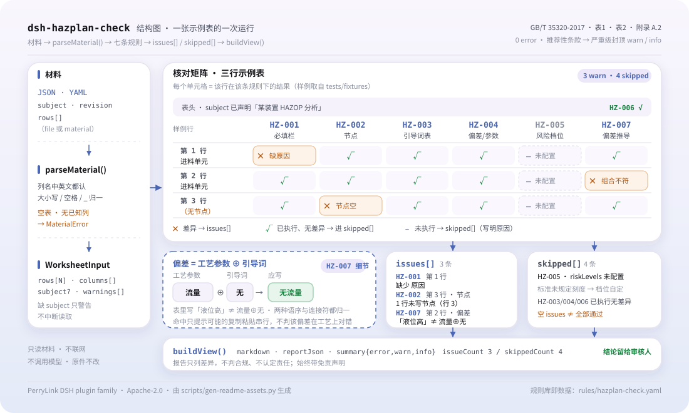

<div align="center">

<picture>
  <source media="(prefers-color-scheme: dark)" srcset="docs/assets/dsh-hazplan-check-hero-en-dark.webp">
  
</picture>

# dsh-hazplan-check

**Verifique una hoja de trabajo HAZOP línea por línea: qué fila, qué columna, qué falta — en una sola lista.**

Una herramienta de verificación de hojas de trabajo para equipos de seguridad de procesos y HAZOP: lee una hoja, aplica un paquete de reglas versionado a su completitud y a la derivación de desviaciones, y solo enumera diferencias — nunca un veredicto de cumplimiento.

[Instalar](#instalación-en-tres-pasos) · [Configuración](#configuración) · [FAQ](#faq) · [简体中文](README.md) · [English](README.en.md) · [Español](README.es.md) · [Português](README.pt.md) · [हिन्दी](README.hi.md)

[](LICENSE)
[](#compatibilidad)
[](https://www.npmjs.com/package/dsh-hazplan-check)
[](https://github.com/PerryLink/dsh-hazplan-check/actions/workflows/ci.yml)
[](#compatibilidad)

[](https://github.com/PerryLink/dsh-hazplan-check/stargazers)
[](https://www.npmjs.com/package/dsh-hazplan-check)
[](https://dshfind.com/plugins/PerryLink/dsh-hazplan-check?ref=badge)
[](https://securityscorecards.dev/viewer/?uri=github.com/PerryLink/dsh-hazplan-check)
[](https://dsh.market/)
[](https://gitee.com/perrylink/dsh-hazplan-check)

```sh
dsh plugin --profile <name> add dsh-hazplan-check
```

</div>

<sub>Plugin de la comunidad, no afiliado a DeepSeek. Repositorio canónico: <https://github.com/PerryLink/dsh-hazplan-check> (Gitee es un espejo).</sub>

## Qué es

`dsh-hazplan-check` lee una hoja de trabajo HAZOP —filas organizadas según los propios nombres de columna de la hoja (en chino o en inglés), más una cabecera opcional que declara el objeto de análisis— y comprueba esa misma hoja: que cada fila rellene los campos que exige su plantilla (desviación y causa por defecto), que cada fila registre su nodo, que las palabras guía procedan de las tablas 1 y 2 de la norma o de la lista que el estudio declaró de antemano, que cada fila deje ver de qué elemento proviene la desviación, que el nivel de riesgo salga del vocabulario de riesgo de su organización, que la hoja identifique el objeto de análisis y que cada desviación contenga literalmente el parámetro leído a través de su palabra guía. Toda comprobación que no pueda ejecutarse por falta de una columna se informa en `skipped` en lugar de pasar en silencio.

Registra una única herramienta `hazplan_check`. El núcleo de verificación es una función pura: sin red, sin llamadas al modelo, sin escritura de archivos; la hoja de trabajo es de solo lectura.

<picture>
  <source media="(prefers-color-scheme: dark)" srcset="docs/assets/dsh-hazplan-check-flow-v5-dark.svg">
  
</picture>

## Instalación en tres pasos

1. **Instalar**:

   ```sh
   dsh plugin --profile web add dsh-hazplan-check
   ```

2. **Configuración mínima** (opcional; sin ella `HZ-005` y una lista propia de `HZ-003` quedan en `skipped`):

   ```yaml
   - insert:
       - id: dsh-hazplan-check
         name: dsh-hazplan-check
         config:
           riskLevels: [高, 中, 低]
           guideWords: [无, 多, 少, 伴随, 部分, 相反, 异常]
   ```

3. **Verificar que se monta**:

   ```sh
   dsh --profile web --dump-config | grep 'dsh-hazplan-check'
   ```

   En este repositorio también puede ejecutar el quickstart incluido (antes `pnpm install && pnpm run build`):

   ```sh
   node samples/quickstart/run.mjs
   ```

   ```text
   $ node samples/quickstart/run.mjs
   hazplan_check: 1 issue(s) — error 0, warn 1, info 0
   skipped: 6
   ```

   La misma salida esperada está en `samples/quickstart/expected/result.json`.

**Desinstalar**: `dsh plugin --profile web remove dsh-hazplan-check` (o elimine la fila del patch del perfil).

<details>
<summary>Usarlo desde WorkBuddy / Coze</summary>

Busque «Safety Compliance Suite» en WorkBuddy / Coze (esta comprobación es una de sus partes; disponibilidad según el catálogo del mercado).

</details>

## Capacidades clave

- **El paquete de reglas es dato** — las reglas viven en `rules/hazplan-check.yaml`; cada una lleva documento, número, cláusula en la numeración propia de la fuente, extracto literal y URL de origen. Sustituir el YAML cambia el juego de reglas; el paquete se valida al cargar, no se confía en él.
- **Nombres de columna en chino e inglés** — la coincidencia no distingue mayúsculas y ignora espacios, guiones bajos y guiones, así que `Guide Word`, `guide_word` y `guideword` resuelven al mismo campo; las exportaciones de herramientas HAZOP comerciales se cargan sin editar.
- **Derivación de la desviación** — la desviación escrita debe contener el parámetro leído a través de su palabra guía; se normalizan ambos órdenes, los separadores habituales y los espacios. Un hallazgo señala un probable artefacto de copiar y pegar, no una desviación técnicamente inválida.
- **Sin aprobación silenciosa** — toda comprobación que no pueda ejecutarse se enumera en `skipped` con su motivo; una regla cuya lista requerida está sin configurar se informa a sí misma en `skipped` en lugar de pasar en silencio.
- **Solo diferencias** — el informe nunca se pronuncia sobre cumplimiento, responsabilidad o corrección; un guardián de redacción rechaza el lenguaje adjudicativo y todo informe lleva el descargo de responsabilidad.
- **Una sola herramienta** — solo se registra `hazplan_check`; funciona en modo `native` y `ptc`, y `ptc` es la mejor opción para varias hojas a la vez.

### Las siete reglas

| Regla | Comprobación | Severidad | Base |
|---|---|---|---|
| `HZ-001` | cada problema es su propia fila, con su causa | warn | 6.6.4 |
| `HZ-002` | cada nodo analizado queda registrado en la hoja | warn | 6.6.3 |
| `HZ-003` | las palabras guía vienen de las tablas 1 + 2, o se declararon antes | warn | tablas 1 + 2 + 6.4.3 |
| `HZ-004` | la fila muestra de qué elemento proviene la desviación | warn | 3.3 + 6.4.3 |
| `HZ-005` | los niveles de riesgo vienen de sus criterios de riesgo (desactivada por defecto) | info | 6.5 + GB/T 27921 |
| `HZ-006` | la hoja nombra su objeto de análisis | warn | anexo A.2 (informativo) |
| `HZ-007` | la desviación contiene el parámetro leído a través de su palabra guía | warn | 6.4.3 |

### Preguntas sobre las reglas

| Usted pregunta | Qué responde |
|---|---|
| Una fila registra la desviación pero deja vacía la causa. ¿Se informa de ello? | Sí. `HZ-001` exige los campos que debe rellenar cada fila; sin configurar, recurre al par que la propia cláusula nombra —las columnas de desviación y causa—, de modo que una causa vacía ya es una falta por sí sola. Comprueba que la columna esté rellena, no que la lista de problemas esté completa ni que la causa sea técnicamente válida. |
| Tres filas no llevan nodo alguno. ¿Se dice algo y se juzga cómo se dividieron los nodos? | `HZ-002` informa de esas filas en una sola entrada y enumera sus números de fila, porque un registro sin nodos no permite generar la lista de nodos que pide la cláusula. Solo comprueba que la columna de nodo esté rellena; no juzga si el grano del nodo es adecuado, porque la cláusula 4.2 no da criterio, ni decide si algún nodo quedó sin analizar. |
| Nuestro estudio escribió la variante coloquial de «opuesto» en la columna de palabras guía. ¿Se señalará? | `HZ-003` lo informa como palabra guía fuera de la lista: la redacción propia de la norma no es la variante coloquial, y las tablas 1 y 2 aportan los términos estándar. Es un aviso y no un veredicto, porque una palabra guía definida y archivada por el estudio antes del análisis está permitida — por eso la regla se queda en `warn`. Una implantación puede declarar su propia lista y entonces solo se informa de lo que quede fuera de ella. |
| La desviación dice «sin caudal», pero el parámetro es «temperatura» y la palabra guía es «ninguno». ¿Se detecta? | `HZ-007` informa de la fila cuando la desviación escrita no contiene el parámetro leído a través de su palabra guía en ninguno de los dos órdenes; los espacios y los separadores habituales (en el bloque inferior) no cuentan, así que las tres grafías naturales coinciden. Solo se ejecuta si están las tres columnas —si no, figura en `skipped`— y un hallazgo suele indicar un copiado y pegado, no que la desviación sea técnicamente inválida. |
| La columna de nivel de riesgo está rellena con «medio», pero nunca configuramos un vocabulario de riesgo. ¿Qué devuelve? | `HZ-005` se informa a sí misma en `skipped`, no como un aprobado: la norma no fija escala de niveles de riesgo, así que los niveles deben venir de los criterios de riesgo de su organización y la lista de origen está vacía. Una vez configurados, solo comprueba que el valor figure en la lista, no si la calificación es correcta, y su severidad está topada en `info`. |
| La hoja no tiene ninguna línea que nombre la unidad analizada. ¿Es una falta? | `HZ-006` lo informa una vez, en el nivel superior: sin objeto de análisis, las conclusiones no se pueden remontar al límite que se analizó. La lista de cabecera en que se apoya procede de un anexo informativo —una sugerencia, no una obligación—, por eso la regla se queda en `warn` y `requireHeader: false` la desactiva para hojas que legítimamente no la llevan. |

Tokens exactos de origen para los casos de palabras guía y desviación:

```text
Palabras guía, tablas 1 + 2:
  无  多  少  伴随  部分  相反  异常
  早  晚  先  后

Ejemplos que HZ-007 acepta:
  流量无 · 流量 + 无 · 无流量

Separadores que HZ-007 ignora:
  +  、  /  -  —  的  ：
```

### Salida real

Esta llamada es la salida real del plugin sobre su propio fixture `HZ-001`, no un montaje.

**Herramienta** `hazplan_check`

**Entrada**

~~~json
{"rows":[{"节点":"进料单元","工艺参数":"流量","引导词":"无","偏差":"无流量","原因":""}]}
~~~

**Salida**

~~~json
{
  "id": "dsh-hazplan-check.HZ-001.de09b5a6",
  "ruleId": "HZ-001",
  "severity": "warn",
  "locator": {
    "row": 1
  },
  "found": "第 1 行缺少 原因",
  "expected": "每一个危险和可操作性问题都应作为单项记录，并与其原因一起记录；本机构配置的必填项为 偏差、原因",
  "fix": "补齐栏目；本条只核对是否填写，不判断该问题是否找全"
}
~~~

*Observed from `tests/fixtures/HZ-001/HZ-001-unsafe.json (cases.json expects HZ-001 count 1); run via lib/index.mjs rules/hazplan-check.yaml`*

## Configuración

Todos los parámetros ajustables son campos Schemastery en `src/config.ts`, modificables desde `cordis.yml` sin tocar el código; los umbrales por regla están en el paquete de reglas bajo `rules/`. Una sobrescritura por id reemplaza la fila entera: repita cada clave que necesite.

Claves más usadas:

| Clave | Tipo | Predeterminado | Descripción |
|---|---|---|---|
| `rulesFile` | string | `rules/hazplan-check.yaml` | Ruta del paquete de reglas, relativa a la raíz del paquete |
| `disabledRules` | string[] | `[]` | Ids de reglas que se dejan de ejecutar; cada una aparece en `skipped` |
| `onlyRules` | string[] | `[]` | Ejecutar solo estas reglas; vacío ejecuta todas |
| `skipNotes` | string | `""` | Nota añadida a cada motivo de `skipped` |
| `timeoutMs` | number | `120000` | Presupuesto de tiempo de espera cooperativo de la herramienta |

<details>
<summary>Tabla de configuración completa (7 claves)</summary>

| Clave | Tipo | Predeterminado | Descripción |
|---|---|---|---|
| `rulesFile` | string | `rules/hazplan-check.yaml` | Ruta del paquete de reglas, relativa a la raíz del paquete |
| `disabledRules` | string[] | `[]` | Ids de reglas que se dejan de ejecutar; cada una aparece en `skipped` |
| `onlyRules` | string[] | `[]` | Ejecutar solo estas reglas; vacío ejecuta todas |
| `skipNotes` | string | `""` | Nota añadida a cada motivo de `skipped` |
| `riskLevels` | string[] | `[]` | Niveles de sus criterios de riesgo; vacío significa que la comprobación de nivel no se ejecuta |
| `guideWords` | string[] | `[]` | Palabras guía declaradas por el estudio antes del análisis; vacío usa las tablas de la norma |
| `timeoutMs` | number | `120000` | Presupuesto de tiempo de espera cooperativo de la herramienta |

</details>

<details>
<summary>Parámetros por regla (4 claves)</summary>

| Clave | Predeterminado | Descripción |
|---|---|---|
| `HZ-001` `requiredFields` | el par que nombra la cláusula | Columnas que debe rellenar cada fila; vacío recurre al par que la propia cláusula nombra |
| `HZ-003` `guideWords` | `[]` | Palabras guía declaradas para este estudio; vacío usa las tablas 1 y 2 de la norma |
| `HZ-005` `riskLevels` | `[]` | Su vocabulario de riesgo; vacío significa que esta regla no se ejecuta |
| `HZ-006` `requireHeader` | `true` | Poner `false` cuando la hoja legítimamente no lleva línea de objeto |

</details>

Valores efectivos por regla (el paquete entrega listas vacías; el código recurre a estos):

```text
HZ-001.requiredFields = [偏差, 原因]
HZ-003.guideWords     = []
HZ-005.riskLevels     = []
HZ-006.requireHeader  = true
```

Ejemplo de sobrescritura en su patch de perfil:

```yaml
- insert:
    - id: dsh-hazplan-check
      name: dsh-hazplan-check
      config:
        onlyRules: [HZ-001, HZ-002, HZ-003, HZ-007]
        riskLevels: [高, 中, 低]
        requireHeader: false
```

## FAQ

<details>
<summary>¿La hoja de trabajo se guarda o se envía a algún sitio?</summary>

No. El plugin lee el `file` o `material` suministrado y lo comprueba en memoria; `package.json#dsh.demo` declara `reads` del archivo de material del usuario, `writes: []`, `network: false`, y el runtime no hace peticiones de red, ni llamadas al modelo, ni escrituras de archivos. La hoja original nunca se modifica; el informe vuelve solo a la sesión actual.

</details>

<details>
<summary>¿Qué pasa si falta una columna o una lista está sin configurar? ¿Aprobación silenciosa?</summary>

No. Toda comprobación que no pueda ejecutarse se enumera en `skipped` con su motivo; `HZ-001`, `HZ-003` y `HZ-005` se informan a sí mismas en `skipped` cuando sus listas están vacías en lugar de devolver un aprobado. «No se encontraron problemas» solo cubre todas las reglas cuando `skipped` está vacío.

</details>

<details>
<summary>¿Pelea con otros plugins por nombres de herramienta, comandos o slots?</summary>

No. Solo registra la herramienta `hazplan_check` bajo `tools`; no registra slots de cliente, comandos, rutas HTTP ni claves de servicio, e `inject` solo contiene `tools`, así que el registro se retira con su efecto Cordis al descargar. No lee el estado de otros plugins ni muta globales.

</details>

<details>
<summary>¿Cuánto coste de rendimiento supone?</summary>

La comprobación es una coincidencia de reglas en memoria: sin peticiones de red, sin llamadas al modelo, sin procesos externos; el coste de una hoja escala con su número de filas y de reglas. La herramienta lleva un presupuesto de tiempo de espera cooperativo, `timeoutMs` (predeterminado `120000` ms); use el modo `ptc` para comprobar varias hojas a la vez.

</details>

<details>
<summary>¿Produce un veredicto de cumplimiento o atribuye responsabilidades?</summary>

No. El informe enumera diferencias señalables dentro del material; no juzga cumplimiento, no atribuye responsabilidad ni sustituye al revisor. Un guardián de redacción rechaza el lenguaje adjudicativo y todo informe lleva el descargo de responsabilidad. Si las causas son completas, si las consecuencias se analizan lo suficiente, si las medidas son adecuadas o si una calificación de riesgo es correcta corresponde al equipo de estudio.

</details>

## Normas que sigue

| Documento | Número | Reglas que lo citan |
|---|---|---|
| Guía de aplicación del análisis de peligros y operabilidad (HAZOP) | GB/T 35320-2017 | HZ-001, HZ-002, HZ-003, HZ-004, HZ-005, HZ-006, HZ-007 |
| Gestión del riesgo — técnicas de evaluación del riesgo | GB/T 27921-2023 | HZ-005 |

Títulos de origen, literales:

```text
《危险与可操作性分析（HAZOP分析）应用指南》  GB/T 35320-2017
《风险管理 风险评估技术》                  GB/T 27921-2023
```

### ⚠️ Aquí no hay ningún `error`, y la razón está en la redacción de las cláusulas

> **GB/T 35320-2017《危险与可操作性分析（HAZOP分析）应用指南》** está en vigor (publicada y efectiva el 2017-12-29, idéntica a IEC 61882:2001), y su texto de cláusulas se obtuvo literalmente.
>
> **La norma es *recomendada* (el número lleva «/T»), y cada cláusula que cita este paquete usa «宜» —«debería»— y no «应».** Esto se aplica a las dos cláusulas que una versión anterior de este paquete calificaba como `error`: **6.6.4** dice que cada problema de peligro y operabilidad **debería** registrarse como partida separada, y **6.6.3** empieza por «La salida del análisis HAZOP **debería** incluir:». **Una recomendación no puede sostener una calificación de error**, así que ambas reglas son ahora `warn` y **este plugin no informa de ningún error** — en coherencia con cómo la familia trata cualquier otra norma recomendada. Una prueba fija esto para que una edición posterior no pueda volver a escalar una de ellas en silencio.
>
> **Todo lo demás está topado en `warn` o `info`, por tres razones que el paquete registra:**
>
> 1. **El anexo A.2 —el único lugar donde aparece una lista de columnas— es un anexo informativo.** Su redacción es «los títulos enumerados en la tabla **pueden ser** los siguientes», añade «**también puede registrarse** otra información» y dice sin rodeos que «la maquetación de la hoja **varía de un estudio a otro**». **No hay lista obligatoria de columnas**, así que una columna ausente solo puede ser una sugerencia.
> 2. **La cláusula 4.2 no da criterio para el grano del nodo.** Dice que el tamaño de un nodo «depende de la complejidad del sistema y de la gravedad del peligro» y no sigue nada cuantitativo. Este plugin **no** juzga el tamaño del nodo.
> 3. **La norma no fija escala de niveles de riesgo.** 6.5 menciona una matriz de riesgo como útil y remite el método a IEC 60300-3-9; la descripción de la matriz de GB/T 27921-2023 es igualmente informativa. Los niveles deben venir de sus propios criterios de riesgo, por eso el vocabulario se entrega **vacío**.
>
> El paquete recoge dos notas más de honestidad. El vocabulario de palabras guía usa el término propio de la norma para «opuesto» —**no la variante coloquial** que muchos talleres escriben, y el paquete registra la diferencia— y combina la tabla 1 con la tabla 2; una palabra guía propia **no** es incumplimiento, porque 6.4.3 la permite «siempre que se haya definido antes de iniciar el análisis». Y **SH/T 3240-2025** (la especificación HAZOP petroquímica, en vigor desde 2025-11-01) solo tuvo verificados su identidad, estado y glosario — **su texto de cláusulas no se obtuvo, así que este paquete no cita nada de ella**.
>
> Las cuatro valoraciones que este plugin no hace: si las causas son completas, si las consecuencias se analizan lo suficiente, si las medidas existentes son adecuadas y si una calificación de riesgo es correcta.

## Límites de seguridad

- **Solo comprueba lo que una hoja puede acreditar.** Que cada fila registre el contenido de análisis que exige su plantilla (incluidos los campos obligatorios que usted configure), que cada desviación se siga del parámetro y la palabra guía que tiene al lado, que los niveles de riesgo salgan de su vocabulario y que cada nodo tenga filas: eso es lo que la hoja puede atestiguar.
- **Las cuatro valoraciones quedan en el equipo de estudio.** Este plugin **no** juzga si las causas son completas, si las consecuencias se analizan lo suficiente, si las medidas de seguridad existentes son adecuadas o si una calificación de riesgo es correcta. **Esas cuatro valoraciones son del equipo de estudio, y ahí reside el valor del HAZOP.**
- **Sin veredicto de cumplimiento ni atribución de responsabilidad.** El informe enumera diferencias señalables dentro del material, siempre lleva el descargo y un guardián de redacción rechaza el lenguaje adjudicativo.
- **Sin aprobación silenciosa.** Toda comprobación que no pueda ejecutarse se enumera en `skipped` con su motivo; una regla cuya lista requerida está sin configurar se informa a sí misma en `skipped` en lugar de pasar en silencio.
- **Una cita fabricada falla al cargar.** El cargador impone que el extracto sea una cita real de al menos ocho caracteres; una regla basada solo en un principio general (`kind: derived-from-principle`) queda topada en `warn`, y una basada solo en política local (`kind: institutional-configuration`) en `info`. Un paquete que exagera su evidencia no carga, en lugar de producir un informe de aspecto seguro.
- **Entrada de solo lectura.** El plugin lee la hoja o el archivo suministrado; no escribe archivos, no hace peticiones de red y no llama a ningún modelo; el original nunca se modifica.

## Formato del material

JSON o YAML. Excel puede convertirse antes a JSON/YAML; el chat puede hacerlo por usted cuando la plataforma lo permita. Las filas se organizan según los propios nombres de columna de la hoja; **los nombres en chino y en inglés funcionan**, así que una exportación de una herramienta HAZOP comercial se carga sin editar:

```yaml
subject: 某装置 HAZOP 分析
revision: V1.0
rows:
  - { 节点: 进料单元, 设计意图: 将原料按设计流量送入反应器, 工艺参数: 流量, 引导词: 无,
      偏差: 无流量, 原因: 进料泵故障, 后果: 反应器液位下降, 现有安全措施: 液位低报警,
      建议措施: 增加进料泵备用泵, 风险等级: 中, 责任人: 张工, 完成期限: 2026-06-30 }
  - { Node: N2, Parameter: Temperature, "Guide Word": High, Deviation: High temperature,
      Causes: Cooling failure, Consequences: Runaway, Safeguards: High-temp trip }
```

Los nombres de columna se comparan sin distinguir mayúsculas e ignorando espacios, guiones bajos y guiones, por lo que `Guide Word`, `guide_word` y `guideword` resuelven al mismo campo. Los campos son opcionales en la capa de lectura y los valida el motor, así que una exportación parcial produce hallazgos de «campo ausente» en lugar de un fallo.

`HZ-007` compara la desviación con la combinación parámetro+palabra guía sobre un conjunto fijo de separadores (el conjunto exacto figura en el bloque de «Preguntas sobre las reglas») y en ambos órdenes, así que las tres grafías naturales pasan. Reporta una discrepancia como probable artefacto de copiar y pegar — no como una afirmación de que la desviación sea técnicamente incorrecta.

## Fuentes de las reglas

Los datos de las reglas están separados del código y viven en `rules/hazplan-check.yaml`. Cada regla lleva documento, número, cláusula en la numeración propia de la fuente, extracto literal y URL de origen.

Las cláusulas citadas proceden de **GB/T 35320-2017** — 3.3, 4.2, 6.4.3, 6.5, 6.6.3, 6.6.4, tablas 1 y 2, y anexo A.2 — más el anexo B.10.3 de **GB/T 27921-2023** para la descripción de la matriz de riesgo. El texto de las cláusulas se leyó de una transcripción completa cuya estructura se cruza con los metadatos oficiales de la norma; el paquete registra que la fuente es una transcripción.

Cuatro hallazgos dieron forma a este paquete y quedan registrados en su cabecera:

1. **El anexo A.2 es informativo**, así que su lista de columnas es una sugerencia y nunca un requisito.
2. **La cláusula 4.2 no da criterio para el tamaño del nodo**, así que el grano del nodo no se juzga automáticamente.
3. **La norma no fija escala de niveles de riesgo**, así que los niveles son suyos y el vocabulario se entrega vacío.
4. **SH/T 3240-2025 existe pero su texto de cláusulas no se obtuvo**, así que no se cita ningún artículo suyo — solo se anota su identidad, en la cabecera del paquete.

El informe completo de verificación de cláusulas, incluidas las fuentes que se comprobaron y rechazaron, está en [`rules/evidence/clause-verification.md`](rules/evidence/clause-verification.md).

## Compatibilidad

| Superficie | Estado |
|---|---|
| Harness | Rango de peers `>=0.1.2-rc.1 <0.2.0 \|\| >=0.2.0-0 <0.3.0` — verificado para aceptar tanto `0.2.0-rc.2` como `0.2.1-rc.2`. `engines.dsh` se declara como `>=0.2.1-0 <0.3.0` y el host lo aplica desde 0.2.1 |
| Node | `^22.19.0 \|\| >=24.0.0` |
| Plataformas | Todas (ESM puro; sin código nativo, sin red, sin llamada al modelo) |
| Modo de herramienta | Funciona en `native` y `ptc`; para varias hojas use `ptc` |

## Solución de problemas

- **`HZ-001`, `HZ-003` o `HZ-005` se informan como omitidas.** Sus listas están vacías. Rellene las que use su plantilla.
- **`HZ-007` salta en una fila que a mí me parece correcta.** Su hoja puede escribir una desviación más completa que la forma parámetro+palabra guía. La regla dice «probable artefacto de copiar y pegar»; normalice la columna o acéptelo como ruido. Nunca bloquea nada.
- **`HZ-007` no informa de nada.** La hoja no lleva las tres columnas de parámetro, palabra guía y desviación — la regla lo dice en `skipped` en lugar de adivinar.
- **El lector rechaza una hoja que antes aceptaba.** No encontró ninguno de los nombres de columna conocidos; el error nombra las columnas que vio. Cambie un nombre de columna o añada el nombre a `COLUMNS` en `src/model.ts`.
- **El plugin se instala pero la herramienta no aparece.** Compruebe que `main` resuelve a `lib/index.mjs` y que `pnpm run build` lo generó; un `main` erróneo hace que el cargador omita la entrada en silencio.
- **`dsh plugin add` rechaza el paquete como incompatible.** El rango de peers cubre `0.1.x` y `0.2.x`; si su runtime queda fuera, conceda una exención explícita: `dsh plugin --profile <name> allow-version dsh-hazplan-check@0.1.0 --dsh-version <runtime> --accept-risk`.
- **`check` informa `manifest-peers` como fallo.** El verificador estático compara con un rango de peers codificado que es anterior a la línea 0.2. El runtime aplica la compatibilidad de peers al instalar, así que el rango declarado es el correcto; es un problema conocido de `dsh-plugin-dev`.
- **Los horarios parecen desplazados.** Toda la aritmética es de hora local sobre las cadenas que usted entrega; no se hace conversión de zona horaria.

## Ecosistema y calidad

- [Espejo de Gitee](https://gitee.com/perrylink/dsh-hazplan-check) (espejo sincronizado; GitHub es el canónico)
- [Página del plugin en dshfind](https://dshfind.com/plugins/PerryLink/dsh-hazplan-check) (instalaciones y ranking)
- [Informe de OpenSSF Scorecard](https://securityscorecards.dev/viewer/?uri=github.com/PerryLink/dsh-hazplan-check) (impulsado por [.github/workflows/scorecard.yml](.github/workflows/scorecard.yml))
- [DSH Market](https://dsh.market/) (en el catálogo)
- [Elija un verificador por material](https://perrylink.github.io/zh/checkers/choose/) (62 verificadores más plugins generales en un solo índice de selección)
- [Base de conocimiento del ecosistema](https://perrylink.github.io/dsh-plugin-guide/) — datos medidos, no marketing: guía de desarrollo de plugins · datos de selección · criterios de mantenimiento

## Desarrollo

```sh
pnpm install
pnpm run typecheck   # tsc --noEmit
pnpm test            # vitest, pares de fixtures conforme/infractor por regla
pnpm run build       # tsdown -> lib/index.mjs + lib/index.d.mts
pnpm run check:readmes
node ../scripts/sync-shared.mjs dsh-hazplan-check
```

El último comando copia el kit compartido de `../_shared` a `src/shared/`; vuelva a ejecutarlo tras cada cambio compartido.

El núcleo de comprobación `src/check.ts` es una función pura `(input, ruleset, options) => Report` sin contexto de plugin, E/S, reloj ni acceso a modelo, así que todo el juego de reglas es unit-testeable sin credenciales; el paquete de reglas `rules/hazplan-check.yaml` es dato, y sustituirlo cambia el juego de reglas. Prueba rápida: `node samples/quickstart/run.mjs`. Las imágenes del README se generan programáticamente con [`scripts/gen-readme-assets.py`](scripts/gen-readme-assets.py) (Python + Pillow, SVG vectorial, claro y oscuro), y se pueden reejecutar sin riesgo.

Topics: `deepseek-harness`, `dsh`, `dsh-plugin`, `cordis`, `hazplan`

## Familia y agradecimientos

Este proyecto forma parte de la familia de plugins de DeepSeek Harness de [PerryLink](https://github.com/PerryLink) (todos Apache-2.0). Si te resulta útil, **una estrella ayuda a que la siguiente persona lo encuentre** — no hay nada bloqueado tras ella.

- [@PerryLink](https://github.com/PerryLink) — creador y mantenedor: el paquete de reglas (`HZ-001`…`HZ-007`), el lector de materiales y la vista del informe, el registro de verificación de cláusulas y la documentación en cinco idiomas.

<details>
<summary>Expandir todos los plugins</summary>

| Plugin | Estado |
|---|---|
| **[dsh-aqua-input-check](https://github.com/PerryLink/dsh-aqua-input-check)** |  |
| **[dsh-archive-check](https://github.com/PerryLink/dsh-archive-check)** |  |
| **[dsh-auto-review](https://github.com/PerryLink/dsh-auto-review)** |  |
| **[dsh-autotier](https://github.com/PerryLink/dsh-autotier)** | 🧊 CONGELADO — ver el README del repo |
| **[dsh-bid-ca-precheck](https://github.com/PerryLink/dsh-bid-ca-precheck)** |  |
| **[dsh-bid-qual-check](https://github.com/PerryLink/dsh-bid-qual-check)** |  |
| **[dsh-cert-mcp](https://github.com/PerryLink/dsh-cert-mcp)** | 🧊 CONGELADO — ver el README del repo |
| **[dsh-checkpoint-rewind](https://github.com/PerryLink/dsh-checkpoint-rewind)** |  |
| **[dsh-click](https://github.com/PerryLink/dsh-click)** |  |
| **[dsh-composer-history](https://github.com/PerryLink/dsh-composer-history)** |  |
| **[dsh-contract-stance](https://github.com/PerryLink/dsh-contract-stance)** |  |
| **[dsh-customs-doc-check](https://github.com/PerryLink/dsh-customs-doc-check)** |  |
| **[dsh-data-quality](https://github.com/PerryLink/dsh-data-quality)** |  |
| **[dsh-demurrage-ledger](https://github.com/PerryLink/dsh-demurrage-ledger)** |  |
| **[dsh-doublecheck](https://github.com/PerryLink/dsh-doublecheck)** |  |
| **[dsh-drill-script-check](https://github.com/PerryLink/dsh-drill-script-check)** |  |
| **[dsh-eia-guide-check](https://github.com/PerryLink/dsh-eia-guide-check)** |  |
| **[dsh-emergency-plan](https://github.com/PerryLink/dsh-emergency-plan)** |  |
| **[dsh-essay-rubric-check](https://github.com/PerryLink/dsh-essay-rubric-check)** |  |
| **[dsh-evidence-check](https://github.com/PerryLink/dsh-evidence-check)** |  |
| **[dsh-export-ctl-check](https://github.com/PerryLink/dsh-export-ctl-check)** |  |
| **[dsh-fast](https://github.com/PerryLink/dsh-fast)** |  |
| **[dsh-fmea-table-check](https://github.com/PerryLink/dsh-fmea-table-check)** |  |
| **[dsh-forecast-penalty](https://github.com/PerryLink/dsh-forecast-penalty)** |  |
| **[dsh-fund-research](https://github.com/PerryLink/dsh-fund-research)** |  |
| **[dsh-github](https://github.com/PerryLink/dsh-github)** |  |
| **[dsh-gongwen-flow-check](https://github.com/PerryLink/dsh-gongwen-flow-check)** |  |
| **[dsh-gongwen-word-check](https://github.com/PerryLink/dsh-gongwen-word-check)** |  |
| **[dsh-guard-plan-qc](https://github.com/PerryLink/dsh-guard-plan-qc)** |  |
| **[dsh-hazchem-check](https://github.com/PerryLink/dsh-hazchem-check)** |  |
| **[dsh-hazplan-check](https://github.com/PerryLink/dsh-hazplan-check)** |  |
| **[dsh-hidden-risk-map](https://github.com/PerryLink/dsh-hidden-risk-map)** |  |
| **[dsh-hs-classify](https://github.com/PerryLink/dsh-hs-classify)** |  |
| **[dsh-icd-rule-check](https://github.com/PerryLink/dsh-icd-rule-check)** |  |
| **[dsh-industry-research](https://github.com/PerryLink/dsh-industry-research)** |  |
| **[dsh-lawcite-adapter](https://github.com/PerryLink/dsh-lawcite-adapter)** |  |
| **[dsh-laya](https://github.com/PerryLink/dsh-laya)** |  |
| **[dsh-lc-doc-check](https://github.com/PerryLink/dsh-lc-doc-check)** |  |
| **[dsh-learning-gap-check](https://github.com/PerryLink/dsh-learning-gap-check)** |  |
| **[dsh-library](https://github.com/PerryLink/dsh-library)** |  |
| **[dsh-local-ai](https://github.com/PerryLink/dsh-local-ai)** |  |
| **[dsh-lsp-actions](https://github.com/PerryLink/dsh-lsp-actions)** |  |
| **[dsh-mask](https://github.com/PerryLink/dsh-mask)** |  |
| **[dsh-mcp-panel](https://github.com/PerryLink/dsh-mcp-panel)** |  |
| **[dsh-medrec-qc](https://github.com/PerryLink/dsh-medrec-qc)** |  |
| **[dsh-memento](https://github.com/PerryLink/dsh-memento)** |  |
| **[dsh-nsfc-form-check](https://github.com/PerryLink/dsh-nsfc-form-check)** |  |
| **[dsh-nurse-record-check](https://github.com/PerryLink/dsh-nurse-record-check)** |  |
| **[dsh-observe](https://github.com/PerryLink/dsh-observe)** |  |
| **[dsh-origin-rvc-check](https://github.com/PerryLink/dsh-origin-rvc-check)** |  |
| **[dsh-ota-review-check](https://github.com/PerryLink/dsh-ota-review-check)** |  |
| **[dsh-output-styles](https://github.com/PerryLink/dsh-output-styles)** |  |
| **[dsh-paper-doc-adapter](https://github.com/PerryLink/dsh-paper-doc-adapter)** |  |
| **[dsh-permission-rules](https://github.com/PerryLink/dsh-permission-rules)** |  |
| **[dsh-permit-report-check](https://github.com/PerryLink/dsh-permit-report-check)** |  |
| **[dsh-pipeline-check](https://github.com/PerryLink/dsh-pipeline-check)** |  |
| **[dsh-pleading-draft](https://github.com/PerryLink/dsh-pleading-draft)** |  |
| **[dsh-plugin-doctor](https://github.com/PerryLink/dsh-plugin-doctor)** | 🚫 RETIRADO (repo archivado) |
| **[dsh-plugin-guide](https://github.com/PerryLink/dsh-plugin-guide)** |  |
| **[dsh-plugin-kit](https://github.com/PerryLink/dsh-plugin-kit)** | 🚫 RETIRADO (repo archivado) |
| **[dsh-plugin-upgrade](https://github.com/PerryLink/dsh-plugin-upgrade)** | 🚫 RETIRADO (repo archivado) |
| **[dsh-policy-brief-draft](https://github.com/PerryLink/dsh-policy-brief-draft)** |  |
| **[dsh-power-loss-split](https://github.com/PerryLink/dsh-power-loss-split)** |  |
| **[dsh-power-ticket-check](https://github.com/PerryLink/dsh-power-ticket-check)** |  |
| **[dsh-ppap-check](https://github.com/PerryLink/dsh-ppap-check)** |  |
| **[dsh-protest-deadline](https://github.com/PerryLink/dsh-protest-deadline)** |  |
| **[dsh-railway-window](https://github.com/PerryLink/dsh-railway-window)** |  |
| **[dsh-repair-order-qc](https://github.com/PerryLink/dsh-repair-order-qc)** |  |
| **[dsh-research-report](https://github.com/PerryLink/dsh-research-report)** |  |
| **[dsh-review-reply-check](https://github.com/PerryLink/dsh-review-reply-check)** |  |
| **[dsh-rulefile-check](https://github.com/PerryLink/dsh-rulefile-check)** |  |
| **[dsh-safety-brief-check](https://github.com/PerryLink/dsh-safety-brief-check)** |  |
| **[dsh-score](https://github.com/PerryLink/dsh-score)** |  |
| **[dsh-session-sync](https://github.com/PerryLink/dsh-session-sync)** |  |
| **[dsh-site-log-check](https://github.com/PerryLink/dsh-site-log-check)** |  |
| **[dsh-skill-pack-security](https://github.com/PerryLink/dsh-skill-pack-security)** |  |
| **[dsh-soe-decision-check](https://github.com/PerryLink/dsh-soe-decision-check)** |  |
| **[dsh-soilwater-check](https://github.com/PerryLink/dsh-soilwater-check)** |  |
| **[dsh-sop-sync-check](https://github.com/PerryLink/dsh-sop-sync-check)** |  |
| **[dsh-spc-gbt-adapter](https://github.com/PerryLink/dsh-spc-gbt-adapter)** |  |
| **[dsh-talk](https://github.com/PerryLink/dsh-talk)** |  |
| **[dsh-tender-extract](https://github.com/PerryLink/dsh-tender-extract)** |  |
| **[dsh-tender-matrix](https://github.com/PerryLink/dsh-tender-matrix)** |  |
| **[dsh-test-drive](https://github.com/PerryLink/dsh-test-drive)** |  |
| **[dsh-ticktick](https://github.com/PerryLink/dsh-ticktick)** | 🚫 RETIRADO (repo archivado) |
| **[dsh-translate](https://github.com/PerryLink/dsh-translate)** |  |
| **[dsh-warranty-calc](https://github.com/PerryLink/dsh-warranty-calc)** |  |
| **[dsh-budget](https://github.com/PerryLink/dsh-budget)** | 🧊 CONGELADO — ver el README del repo |
| **[dsh-claude-move](https://github.com/PerryLink/dsh-claude-move)** | 🧊 CONGELADO — ver el README del repo |
| **[dsh-defend](https://github.com/PerryLink/dsh-defend)** | 🧊 CONGELADO — ver el README del repo |
| **[dsh-draw](https://github.com/PerryLink/dsh-draw)** | 🧊 CONGELADO — ver el README del repo |
| **[dsh-reach](https://github.com/PerryLink/dsh-reach)** | 🧊 CONGELADO — ver el README del repo |
| **[dsh-background-agents](https://github.com/PerryLink/dsh-background-agents)** | 🚫 RETIRADO (repo archivado) |
| **[dsh-session-pin](https://github.com/PerryLink/dsh-session-pin)** | 🚫 RETIRADO (repo archivado) |
| **[dsh-team-rooms](https://github.com/PerryLink/dsh-team-rooms)** | 🚫 RETIRADO (repo archivado) |

</details>

## Licencia

[Apache License 2.0](LICENSE) © 2026 dsh-hazplan-check contributors

<p align="center"><sub>Apache-2.0 · Plugin de la comunidad, no afiliado a DeepSeek.</sub></p>
