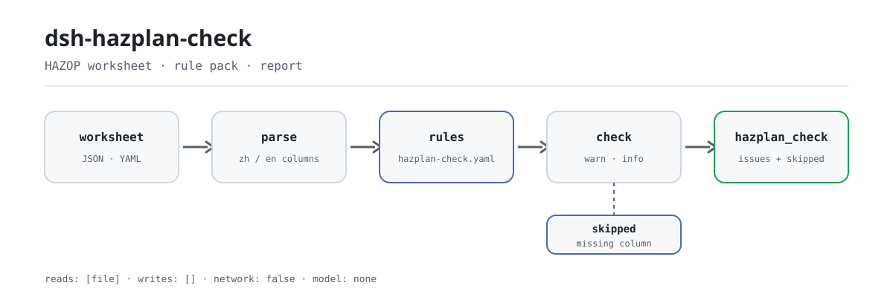

<div align="center">

<picture>
  <source media="(prefers-color-scheme: dark)" srcset="docs/assets/dsh-hazplan-check-flow-dark.svg">
  
</picture>

# dsh-hazplan-check

**HAZOP वर्कशीट की हर पंक्ति जाँचें: कौन-सी पंक्ति, कौन-सा कॉलम, क्या छूटा — एक ही सूची में।**

प्रक्रिया-सुरक्षा और HAZOP टीमों के लिए वर्कशीट जाँच उपकरण: एक शीट पढ़ता है, संस्करणबद्ध नियम-पैक से उसकी पूर्णता और विचलन-व्युत्पत्ति की जाँच करता है, और केवल अंतर सूचीबद्ध करता है — अनुपालन का निर्णय कभी नहीं।

[इंस्टॉल](#तीन-चरणों-में-शुरुआत) · [कॉन्फ़िगरेशन](#कॉन्फ़िगरेशन) · [FAQ](#faq) · [简体中文](README.md) · [English](README.en.md) · [Español](README.es.md) · [Português](README.pt.md) · [हिन्दी](README.hi.md)

[](LICENSE)
[](#संगतता)
[](https://www.npmjs.com/package/dsh-hazplan-check)
[](https://github.com/PerryLink/dsh-hazplan-check/actions/workflows/ci.yml)
[](#संगतता)

[](https://github.com/PerryLink/dsh-hazplan-check/stargazers)
[](https://www.npmjs.com/package/dsh-hazplan-check)
[](https://dshfind.com/plugins/PerryLink/dsh-hazplan-check?ref=badge)
[](https://securityscorecards.dev/viewer/?uri=github.com/PerryLink/dsh-hazplan-check)
[](https://dsh.market/)
[](https://gitee.com/perrylink/dsh-hazplan-check)

```sh
dsh plugin --profile <name> add dsh-hazplan-check
```

</div>

<sub>सामुदायिक प्लगइन, DeepSeek से संबद्ध नहीं। आधिकारिक रेपो: <https://github.com/PerryLink/dsh-hazplan-check> (Gitee प्रतिबिंब है)।</sub>

## यह क्या है

`dsh-hazplan-check` एक HAZOP वर्कशीट पढ़ता है — पंक्तियाँ शीट के अपने कॉलम-नामों के अनुसार (चीनी या अंग्रेज़ी), साथ में विश्लेषण-वस्तु बताने वाला वैकल्पिक हेडर — और उसी शीट की जाँच करता है: क्या हर पंक्ति टेम्पलेट के अनिवार्य कॉलम भरती है (डिफ़ॉल्ट में `偏差` और `原因`), क्या हर पंक्ति अपना `节点` दर्ज करती है, क्या `引导词` मानक की तालिका 1 व 2 से या अध्ययन द्वारा पहले घोषित सूची से आते हैं, क्या हर पंक्ति से दिखता है कि विचलन किस तत्व से आया, क्या `风险等级` आपके संस्थान की जोखिम-श्रेणियों से है, क्या शीट विश्लेषण-वस्तु बताती है, और क्या हर `偏差` में शाब्दिक रूप से `工艺参数` का उसके `引导词` के माध्यम से पढ़ा गया रूप है। जो जाँच किसी कॉलम के अभाव में नहीं चल सकती, वह `skipped` में दर्ज होती है, चुपचाप पास नहीं होती।

यह एक `hazplan_check` उपकरण पंजीकृत करता है। जाँच का मूल एक शुद्ध फ़ंक्शन है: कोई नेटवर्क नहीं, कोई मॉडल कॉल नहीं, कोई फ़ाइल लेखन नहीं; वर्कशीट केवल पढ़ी जाती है।

## तीन चरणों में शुरुआत

1. **इंस्टॉल करें**:

   ```sh
   dsh plugin --profile web add dsh-hazplan-check
   ```

2. **न्यूनतम कॉन्फ़िगरेशन** (वैकल्पिक; इसके बिना `HZ-005` और `HZ-003` की अपनी सूची `skipped` में रहती है):

   ```yaml
   - insert:
       - id: dsh-hazplan-check
         name: dsh-hazplan-check
         config:
           riskLevels: [高, 中, 低]
           guideWords: [无, 多, 少, 伴随, 部分, 相反, 异常]
   ```

3. **जाँचें कि माउंट हुआ**:

   ```sh
   dsh --profile web --dump-config | grep 'dsh-hazplan-check'
   ```

   इस रेपो में साथ आया quickstart भी चला सकते हैं (पहले `pnpm install && pnpm run build`):

   ```sh
   node samples/quickstart/run.mjs
   ```

   ```text
   $ node samples/quickstart/run.mjs
   hazplan_check: 1 issue(s) — error 0, warn 1, info 0
   skipped: 6
   ```

   वही अपेक्षित आउटपुट `samples/quickstart/expected/result.json` में भी है।

**अनइंस्टॉल**: `dsh plugin --profile web remove dsh-hazplan-check` (या प्रोफ़ाइल पैच से वह पंक्ति हटाएँ)।

<details>
<summary>WorkBuddy / Coze से उपयोग करना</summary>

WorkBuddy / Coze में «Safety Compliance Suite» खोजें (यह जाँच उसका एक हिस्सा है; उपलब्धता मार्केटप्लेस के अनुसार)।

</details>

## मुख्य क्षमताएँ

- **नियम-पैक डेटा है** — नियम `rules/hazplan-check.yaml` में रहते हैं; हर नियम में दस्तावेज़, संख्यांक, स्रोत की अपनी क्रमांकन-प्रणाली के अनुसार धारा, शब्दशः उद्धरण और स्रोत URL होता है। YAML बदलने से नियम-समुच्चय बदल जाता है; पैक लोड के समय सत्यापित होता है, पर भरोसे पर नहीं लिया जाता।
- **चीनी और अंग्रेज़ी कॉलम-नाम** — मिलान केस-असंवेदी है और खाली स्थान, अंडरस्कोर व हाइफ़न नज़रअंदाज़ करता है, इसलिए `Guide Word`, `guide_word` और `guideword` एक ही फ़ील्ड पर जाते हैं; व्यावसायिक HAZOP उपकरणों के निर्यात बिना संपादन लोड होते हैं।
- **विचलन-व्युत्पत्ति** — लिखे हुए विचलन में वह रूप होना चाहिए जो पैरामीटर को उसके गाइड-शब्द से पढ़ने पर बनता है; दोनों क्रम, सामान्य संयोजक और खाली स्थान सामान्यीकृत होते हैं। मेल मिलना संभावित कॉपी-पेस्ट की गड़बड़ बताता है, यह नहीं कि विचलन तकनीकी रूप से अमान्य है।
- **कोई चुपचाप पास नहीं** — हर जाँच जो नहीं चल सकती, कारण के साथ `skipped` में दर्ज होती है; जिस नियम की आवश्यक सूची सेट नहीं है, वह चुपचाप पास होने के बजाय स्वयं को `skipped` में दर्ज करता है।
- **केवल अंतर** — रिपोर्ट अनुपालन, दायित्व या शुद्धता पर कभी निर्णय नहीं देती; शब्दावली-रक्षक निर्णायक भाषा रोकता है और हर रिपोर्ट के साथ अस्वीकरण रहता है।
- **एक ही उपकरण सतह** — केवल `hazplan_check` पंजीकृत होता है; यह `native` और `ptc` दोनों मोड में चलता है, और कई शीट एक साथ जाँचने के लिए `ptc` बेहतर है।

### सात नियम

| नियम | जाँच | गंभीरता | आधार |
|---|---|---|---|
| `HZ-001` | हर समस्या अपनी अलग पंक्ति, अपने कारण के साथ | warn | 6.6.4 |
| `HZ-002` | हर विश्लेषित नोड शीट पर दर्ज है | warn | 6.6.3 |
| `HZ-003` | गाइड-शब्द तालिका 1 + 2 से हैं, या पहले घोषित हुए थे | warn | तालिकाएँ 1 + 2 + 6.4.3 |
| `HZ-004` | पंक्ति से दिखता है कि विचलन किस तत्व से आया | warn | 3.3 + 6.4.3 |
| `HZ-005` | जोखिम-स्तर आपके जोखिम-मानदंड से हैं (डिफ़ॉल्ट में बंद) | info | 6.5 + GB/T 27921 |
| `HZ-006` | शीट अपनी विश्लेषण-वस्तु बताती है | warn | परिशिष्ट A.2 (सूचनात्मक) |
| `HZ-007` | विचलन में वह रूप है जो पैरामीटर को गाइड-शब्द से पढ़ने पर बनता है | warn | 6.4.3 |

### नियमों पर सवाल

| आपका सवाल | इसका जवाब |
|---|---|
| एक पंक्ति में विचलन दर्ज है पर कारण खाली है। क्या यह दर्ज होता है? | हाँ। `HZ-001` हर पंक्ति में अनिवार्य कॉलम भरे होने की अपेक्षा करता है; बिना कॉन्फ़िगर किए यह उसी जोड़ी पर लौट आता है जिसे धारा स्वयं नाम देती है — विचलन और कारण के कॉलम — इसलिए खाली कारण अपने आप में एक कमी है। यह केवल देखता है कि कॉलम भरा है, यह नहीं कि समस्याओं की सूची पूरी है या कारण तकनीकी रूप से सही है। |
| तीन पंक्तियों में नोड ही नहीं है। क्या कुछ बताया जाता है, और नोड का बँटवारा कैसा है यह भी आँका जाता है? | `HZ-002` उन पंक्तियों को एक ही प्रविष्टि में दर्ज करता है और पंक्ति-संख्या गिनाता है, क्योंकि नोड रहित रिकॉर्ड से धारा में माँगी गई नोड-सूची बन ही नहीं सकती। यह केवल देखता है कि नोड कॉलम भरा है; नोड की बारीकी उचित है या नहीं, यह नहीं आँकता क्योंकि धारा 4.2 कोई कसौटी नहीं देती, और यह भी तय नहीं करता कि कोई नोड विश्लेषण से छूट गया है। |
| हमारे अध्ययन ने गाइड-शब्द कॉलम में «विपरीत» का बोलचाल वाला रूप लिखा है। क्या यह दर्ज होगा? | `HZ-003` इसे सूची से बाहर का गाइड-शब्द बताकर दर्ज करता है: मानक का अपना शब्द बोलचाल वाला रूप नहीं है, और तालिका 1 व 2 मानक के पद देती हैं। यह एक सूचना है, निर्णय नहीं, क्योंकि विश्लेषण से पहले परिभाषित और संग्रहित अपना गाइड-शब्द मान्य होता है — इसीलिए नियम `warn` पर रहता है। तैनाती अपनी सूची घोषित कर सकती है, और तब केवल उससे बाहर के शब्द दर्ज होते हैं। |
| विचलन «प्रवाह नहीं» कहता है, पर पैरामीटर «तापमान» है और गाइड-शब्द «कोई नहीं»। क्या यह पकड़ में आता है? | `HZ-007` उस पंक्ति को दर्ज करता है जब लिखा हुआ विचलन अपने गाइड-शब्द के माध्यम से पढ़े गए पैरामीटर को किसी भी क्रम में नहीं रखता; खाली स्थान और सामान्य संयोजक (नीचे ब्लॉक में) नहीं गिने जाते, इसलिए तीनों स्वाभाविक रूप मेल खाते हैं। यह केवल तब चलता है जब तीनों कॉलम मौजूद हों — वरना यह `skipped` में दिखता है — और मेल मिलना आम तौर पर कॉपी-पेस्ट की गड़बड़ बताता है, यह नहीं कि विचलन तकनीकी रूप से गलत है। |
| जोखिम-स्तर कॉलम में «मध्यम» भरा है, पर हमने कोई जोखिम-श्रेणी कॉन्फ़िगर नहीं की। जवाब में क्या आएगा? | `HZ-005` स्वयं को `skipped` में दर्ज करता है, पास के रूप में नहीं: मानक जोखिम-स्तर का कोई पैमाना तय नहीं करता, इसलिए स्तर आपके संस्थान के जोखिम-मानदंड से आने चाहिए और छोड़ी गई सूची खाली है। कॉन्फ़िगर करने के बाद यह केवल देखता है कि मान सूची में है, यह नहीं कि वर्गीकरण सही है, और इसकी गंभीरता `info` तक सीमित है। |
| शीट में कहीं भी विश्लेषण-वस्तु (इकाई) का नाम नहीं है। क्या यह कमी है? | `HZ-006` इसे एक बार, शीर्ष स्तर पर दर्ज करता है: विश्लेषण-वस्तु के बिना निष्कर्ष उस सीमा तक वापस नहीं जोड़े जा सकते जिसका विश्लेषण हुआ। जिस हेडर-सूची पर यह टिका है वह सूचनात्मक परिशिष्ट से आती है — सुझाव, बाध्यता नहीं — इसीलिए नियम `warn` पर रहता है, और जिन शीटों में वह वस्तुतः नहीं होती उनके लिए `requireHeader: false` इसे बंद कर देता है। |

गाइड-शब्द और विचलन के मामलों के लिए स्रोत के शाब्दिक टोकन:

```text
गाइड-शब्द, तालिकाएँ 1 + 2:
  无  多  少  伴随  部分  相反  异常
  早  晚  先  后

HZ-007 जिन्हें स्वीकार करता है:
  流量无 · 流量 + 无 · 无流量

HZ-007 जिन संयोजकों को नज़रअंदाज़ करता है:
  +  、  /  -  —  的  ：
```

### वास्तविक आउटपुट

यह कॉल प्लगइन का अपने ही `HZ-001` फ़िक्स्चर पर वास्तविक आउटपुट है, कोई नकली चित्र नहीं।

**उपकरण** `hazplan_check`

**इनपुट**

~~~json
{"rows":[{"节点":"进料单元","工艺参数":"流量","引导词":"无","偏差":"无流量","原因":""}]}
~~~

**आउटपुट**

~~~json
{
  "id": "dsh-hazplan-check.HZ-001.de09b5a6",
  "ruleId": "HZ-001",
  "severity": "warn",
  "locator": {
    "row": 1
  },
  "found": "第 1 行缺少 原因",
  "expected": "每一个危险和可操作性性问题都应作为单项记录，并与其原因一起记录；本机构配置的必填项为 偏差、原因",
  "fix": "补齐栏目；本条只核对是否填写，不判断该问题是否找全"
}
~~~

*Observed from `tests/fixtures/HZ-001/HZ-001-unsafe.json (cases.json expects HZ-001 count 1); run via lib/index.mjs rules/hazplan-check.yaml`*

## कॉन्फ़िगरेशन

सभी समायोज्य पैरामीटर `src/config.ts` की Schemastery स्कीमा में हैं, इसलिए कोड बदले बिना `cordis.yml` से बदले जा सकते हैं; प्रति-नियम सीमाएँ `rules/` के नियम-पैक में हैं। id के अनुसार ओवरराइड पूरी पंक्ति बदल देता है — जिन कुंजियों की ज़रूरत हो, सब दोहराएँ।

सबसे अधिक उपयोग होने वाली कुंजियाँ:

| कुंजी | प्रकार | डिफ़ॉल्ट | विवरण |
|---|---|---|---|
| `rulesFile` | string | `rules/hazplan-check.yaml` | नियम-पैक का पथ, पैकेज रूट के सापेक्ष |
| `disabledRules` | string[] | `[]` | बंद करने वाले नियम id; प्रत्येक `skipped` में दिखता है |
| `onlyRules` | string[] | `[]` | केवल ये नियम चलाएँ; खाली होने पर सभी नियम चलते हैं |
| `skipNotes` | string | `""` | हर `skipped` कारण के आगे जोड़ी जाने वाली टिप्पणी |
| `timeoutMs` | number | `120000` | उपकरण का सहकारी समय-सीमा बजट |

<details>
<summary>पूरी कॉन्फ़िगरेशन तालिका (7 कुंजियाँ)</summary>

| कुंजी | प्रकार | डिफ़ॉल्ट | विवरण |
|---|---|---|---|
| `rulesFile` | string | `rules/hazplan-check.yaml` | नियम-पैक का पथ, पैकेज रूट के सापेक्ष |
| `disabledRules` | string[] | `[]` | बंद करने वाले नियम id; प्रत्येक `skipped` में दिखता है |
| `onlyRules` | string[] | `[]` | केवल ये नियम चलाएँ; खाली होने पर सभी नियम चलते हैं |
| `skipNotes` | string | `""` | हर `skipped` कारण के आगे जोड़ी जाने वाली टिप्पणी |
| `riskLevels` | string[] | `[]` | आपके जोखिम-मानदंड के स्तर; खाली होने पर जोखिम-स्तर जाँच नहीं चलती |
| `guideWords` | string[] | `[]` | विश्लेषण से पहले अध्ययन द्वारा घोषित गाइड-शब्द; खाली होने पर मानक की तालिकाएँ |
| `timeoutMs` | number | `120000` | उपकरण का सहकारी समय-सीमा बजट |

</details>

<details>
<summary>प्रति-नियम पैरामीटर (4 कुंजियाँ)</summary>

| कुंजी | डिफ़ॉल्ट | विवरण |
|---|---|---|
| `HZ-001` `requiredFields` | धारा द्वारा नामित जोड़ी | हर पंक्ति में भरने वाले कॉलम; खाली होने पर धारा द्वारा नामित जोड़ी |
| `HZ-003` `guideWords` | `[]` | इस अध्ययन के लिए घोषित गाइड-शब्द; खाली होने पर मानक की तालिकाएँ 1 और 2 |
| `HZ-005` `riskLevels` | `[]` | आपकी जोखिम-शब्दावली; खाली होने पर यह नियम नहीं चलता |
| `HZ-006` `requireHeader` | `true` | जब शीट में वस्तुतः विश्लेषण-वस्तु पंक्ति न हो तो `false` करें |

</details>

प्रभावी प्रति-नियम डिफ़ॉल्ट (पैक खाली सूचियाँ भेजता है; कोड इन्हीं पर लौटता है):

```text
HZ-001.requiredFields = [偏差, 原因]
HZ-003.guideWords     = []
HZ-005.riskLevels     = []
HZ-006.requireHeader  = true
```

प्रोफ़ाइल पैच में ओवरराइड का उदाहरण:

```yaml
- insert:
    - id: dsh-hazplan-check
      name: dsh-hazplan-check
      config:
        onlyRules: [HZ-001, HZ-002, HZ-003, HZ-007]
        riskLevels: [高, 中, 低]
        requireHeader: false
```

## FAQ

<details>
<summary>वर्कशीट कहीं सहेजी या भेजी जाती है?</summary>

नहीं। प्लगइन दिया गया `file` या `material` पढ़ता है और स्मृति में जाँचता है; `package.json#dsh.demo` उपयोगकर्ता की सामग्री-फ़ाइल के `reads`, `writes: []`, `network: false` घोषित करता है, और रनटाइम कोई नेटवर्क अनुरोध, कोई मॉडल कॉल और कोई फ़ाइल लेखन नहीं करता। मूल वर्कशीट कभी नहीं बदलती; रिपोर्ट केवल वर्तमान सत्र में लौटती है।

</details>

<details>
<summary>कॉलम छूट जाए या सूची सेट न हो तो क्या चुपचाप पास हो जाता है?</summary>

नहीं। हर जाँच जो नहीं चल सकती, कारण के साथ `skipped` में दर्ज होती है; `HZ-001`, `HZ-003` और `HZ-005` अपनी सूचियाँ खाली होने पर पास लौटाने के बजाय स्वयं को `skipped` में दर्ज करते हैं। «कोई समस्या नहीं मिली» तभी सभी नियमों को कवर करता है जब `skipped` खाली हो।

</details>

<details>
<summary>क्या यह अन्य प्लगइनों से उपकरण-नाम, कमांड या स्लॉट पर टकराता है?</summary>

नहीं। यह `tools` के अंतर्गत केवल `hazplan_check` उपकरण पंजीकृत करता है; कोई क्लाइंट स्लॉट, कमांड, HTTP रूट या सेवा-कुंजी पंजीकृत नहीं करता, और `inject` में केवल `tools` है, इसलिए अनलोड पर पंजीकरण अपने Cordis effect के साथ हट जाता है। यह किसी अन्य प्लगइन की स्थिति नहीं पढ़ता और कोई ग्लोबल नहीं बदलता।

</details>

<details>
<summary>प्रदर्शन पर कितना खर्च है?</summary>

जाँच स्मृति में नियम-मिलान है: कोई नेटवर्क अनुरोध नहीं, कोई मॉडल कॉल नहीं, कोई बाहरी प्रक्रिया नहीं; एक शीट का खर्च उसकी पंक्तियों और नियमों की संख्या के साथ बढ़ता है। उपकरण के पास सहकारी समय-सीमा बजट `timeoutMs` (डिफ़ॉल्ट `120000` मिलीसेकंड) है; कई शीट एक साथ जाँचने के लिए `ptc` मोड चुनें।

</details>

<details>
<summary>क्या यह अनुपालन का निर्णय देता है या दायित्व तय करता है?</summary>

नहीं। रिपोर्ट सामग्री के भीतर इंगित की जा सकने वाली भिन्नताएँ सूचीबद्ध करती है; अनुपालन का निर्णय नहीं देती, दायित्व नहीं तय करती और समीक्षक का स्थान नहीं लेती। शब्दावली-रक्षक निर्णायक भाषा रोकता है और हर रिपोर्ट के साथ अस्वीकरण रहता है। कारण पूरे हैं या नहीं, परिणाम पर्याप्त विश्लेषित हैं या नहीं, सुरक्षा-उपाय पर्याप्त हैं या नहीं, और जोखिम-वर्गीकरण सही है या नहीं — यह अध्ययन दल का निर्णय है।

</details>

## यह किन मानकों पर आधारित है

| दस्तावेज़ | संख्यांक | इन्हें उद्धृत करने वाले नियम |
|---|---|---|
| खतरा और संचालनीयता विश्लेषण (HAZOP) अनुप्रयोग मार्गदर्शिका | GB/T 35320-2017 | HZ-001, HZ-002, HZ-003, HZ-004, HZ-005, HZ-006, HZ-007 |
| जोखिम प्रबंधन — जोखिम मूल्यांकन तकनीकें | GB/T 27921-2023 | HZ-005 |

स्रोत शीर्षक, शाब्दिक:

```text
《危险与可操作性分析（HAZOP分析）应用指南》  GB/T 35320-2017
《风险管理 风险评估技术》                  GB/T 27921-2023
```

### ⚠️ यहाँ कोई `error` नहीं है, और कारण धाराओं की शब्दावली में है

> **GB/T 35320-2017《危险与可操作性分析（HAZOP分析）应用指南》** प्रभावी है (2017-12-29 को प्रकाशित और प्रभावी, IEC 61882:2001 के समान), और इसका धारा-पाठ शब्दशः प्राप्त किया गया है।
>
> **मानक *सिफ़ारिशी* है (संख्यांक में «/T» है), और इस पैक द्वारा उद्धृत हर धारा «宜» — «चाहिए» — का प्रयोग करती है, «应» का नहीं।** यह उन दो धाराओं पर लागू होता है जिन्हें इस पैक का पुराना संस्करण `error` मानता था: **6.6.4** कहती है कि हर खतरा-और-संचालनीयता समस्या **अलग प्रविष्टि** के रूप में दर्ज होनी चाहिए, और **6.6.3** शुरू होती है «HAZOP विश्लेषण आउटपुट में **शामिल होना चाहिए**:»। **सिफ़ारिश त्रुटि-वर्गीकरण को सहारा नहीं दे सकती**, इसलिए दोनों नियम अब `warn` हैं और **यह प्लगइन कोई त्रुटि नहीं दर्ज करता** — जैसे परिवार किसी भी अन्य सिफ़ारिशी मानक के साथ करता है। एक परीक्षण इसे स्थिर रखता है ताकि बाद का संपादन चुपचाप किसी को फिर न बढ़ा सके।
>
> **बाकी सब `warn` या `info` तक सीमित है, तीन कारणों से जो पैक दर्ज करता है:**
>
> 1. **परिशिष्ट A.2 — जहाँ कॉलम-सूची दिखती है, वहाँ — सूचनात्मक परिशिष्ट है।** इसकी शब्दावली है «तालिका में सूचीबद्ध शीर्षक **ये हो सकते हैं**», यह जोड़ता है «**अन्य जानकारी भी दर्ज की जा सकती है**», और सीधे कहता है कि «वर्कशीट का लेआउट **अध्ययन-दर-अध्ययन भिन्न** होता है»। **कोई अनिवार्य कॉलम-सूची नहीं है**, इसलिए छूटा कॉलम केवल सुझाव हो सकता है।
> 2. **धारा 4.2 नोड की बारीकी का कोई मानदंड नहीं देती।** यह कहती है कि नोड का आकार «प्रणाली की जटिलता और खतरे की गंभीरता पर निर्भर» है और उसके बाद कुछ मात्रात्मक नहीं आता। यह प्लगइन नोड के आकार का **निर्णय नहीं** करता।
> 3. **मानक जोखिम-स्तर का कोई पैमाना तय नहीं करता।** 6.5 जोखिम-मैट्रिक्स को उपयोगी बताती है और विधि IEC 60300-3-9 को सौंपती है; GB/T 27921-2023 का मैट्रिक्स-विवरण भी सूचनात्मक है। स्तर आपके अपने जोखिम-मानदंड से आने चाहिए, इसलिए शब्दावली **खाली** आती है।
>
> पैक में ईमानदारी के दो और नोट हैं। गाइड-शब्द शब्दावली मानक के अपने «विपरीत» पद का उपयोग करती है — **बोलचाल वाला रूप नहीं** जो कई शीट लिखती हैं, और पैक अंतर दर्ज करता है — और तालिका 1 को तालिका 2 के साथ जोड़ती है; अपना गाइड-शब्द **गैर-अनुपालन नहीं** है, क्योंकि 6.4.3 उसे «जब तक विश्लेषण शुरू होने से पहले परिभाषित किया गया हो» की अनुमति देती है। और **SH/T 3240-2025** (पेट्रोरसायन HAZOP विनिर्देश, 2025-11-01 से प्रभावी) की केवल पहचान, स्थिति और शब्दावली सत्यापित हुई — **इसका धारा-पाठ प्राप्त नहीं हुआ, इसलिए यह पैक उसका कोई अंश उद्धृत नहीं करता**।
>
> वे चार निर्णय जो यह प्लगइन नहीं करता: कारण पूरे हैं या नहीं, परिणाम पर्याप्त विश्लेषित हैं या नहीं, मौजूदा सुरक्षा-उपाय पर्याप्त हैं या नहीं, और जोखिम-वर्गीकरण सही है या नहीं।

## सुरक्षा सीमाएँ

- **यह केवल वही जाँचता है जो एक शीट प्रमाणित कर सकती है।** हर पंक्ति टेम्पलेट के माँगे विश्लेषण-सामग्री (आपके कॉन्फ़िगर किए अनिवार्य कॉलम सहित) को दर्ज करती है या नहीं, हर विचलन अपने बगल के पैरामीटर और गाइड-शब्द से निकलता है या नहीं, जोखिम-स्तर आपकी शब्दावली से हैं या नहीं, और हर नोड की पंक्तियाँ हैं या नहीं — यही शीट प्रमाणित कर सकती है।
- **चार निर्णय अध्ययन दल के पास रहते हैं।** यह प्लगइन **नहीं** आँकता कि कारण पूरे हैं, परिणाम पर्याप्त विश्लेषित हैं, मौजूदा सुरक्षा-उपाय पर्याप्त हैं, या जोखिम-वर्गीकरण सही है। **वे चार निर्णय अध्ययन दल के हैं, और HAZOP का मूल्य वहीं है।**
- **कोई अनुपालन-निर्णय नहीं, कोई दायित्व-निर्धारण नहीं।** रिपोर्ट सामग्री के भीतर इंगित की जा सकने वाली भिन्नताएँ सूचीबद्ध करती है, हमेशा अस्वीकरण रखती है, और शब्दावली-रक्षक निर्णायक भाषा रोकता है।
- **कोई चुपचाप पास नहीं।** हर जाँच जो नहीं चल सकती, कारण के साथ `skipped` में दर्ज होती है; जिस नियम की आवश्यक सूची सेट नहीं है, वह चुपचाप पास होने के बजाय स्वयं को `skipped` में दर्ज करता है।
- **गढ़ा हुआ उद्धरण लोड पर विफल होता है।** लोडर लागू करता है कि उद्धरण कम से कम आठ अक्षरों का वास्तविक उद्धरण हो; केवल सामान्य सिद्धांत पर टिका नियम (`kind: derived-from-principle`) `warn` तक सीमित है, और केवल स्थानीय नीति पर टिका (`kind: institutional-configuration`) `info` तक। जो पैक अपने प्रमाण बढ़ा-चढ़ाकर बताता है वह लोड ही नहीं होता, भरोसेमंद दिखने वाली रिपोर्ट नहीं बनाता।
- **केवल-पठन इनपुट।** प्लगइन दी गई शीट या फ़ाइल पढ़ता है; कोई फ़ाइल नहीं लिखता, कोई नेटवर्क अनुरोध नहीं करता और किसी मॉडल को नहीं बुलाता; मूल कभी नहीं बदलता।

## सामग्री का प्रारूप

JSON या YAML। Excel को पहले JSON/YAML में बदला जा सकता है; जहाँ प्लेटफ़ॉर्म सक्षम हो, चैट यह आपके लिए कर सकता है। पंक्तियाँ शीट के अपने कॉलम-नामों के अनुसार होती हैं; **चीनी और अंग्रेज़ी दोनों नाम चलते हैं**, इसलिए व्यावसायिक HAZOP उपकरण का निर्यात बिना संपादन लोड होता है:

```yaml
subject: 某装置 HAZOP 分析
revision: V1.0
rows:
  - { 节点: 进料单元, 设计意图: 将原料按设计流量送入反应器, 工艺参数: 流量, 引导词: 无,
      偏差: 无流量, 原因: 进料泵故障, 后果: 反应器液位下降, 现有安全措施: 液位低报警,
      建议措施: 增加进料泵备用泵, 风险等级: 中, 责任人: 张工, 完成期限: 2026-06-30 }
  - { Node: N2, Parameter: Temperature, "Guide Word": High, Deviation: High temperature,
      Causes: Cooling failure, Consequences: Runaway, Safeguards: High-temp trip }
```

कॉलम-नाम केस-असंवेदी रूप से मिलाए जाते हैं और खाली स्थान, अंडरस्कोर व हाइफ़न नज़रअंदाज़ करते हैं, इसलिए `Guide Word`, `guide_word` और `guideword` एक ही फ़ील्ड पर जाते हैं। फ़ील्ड पढ़ने की परत में वैकल्पिक हैं और जाँच इंजन उन्हें सत्यापित करता है, इसलिए आंशिक निर्यात क्रैश के बजाय «फ़ील्ड अनुपस्थित» श्रेणी के निष्कर्ष देता है।

`HZ-007` विचलन को पैरामीटर+गाइड-शब्द के जोड़ से संयोजकों के एक निश्चित समुच्चय पर (सटीक समुच्चय «नियमों पर सवाल» ब्लॉक में है) और दोनों क्रमों में तुलना करता है, इसलिए तीनों स्वाभाविक रूप पास होते हैं। अंतर मिलने पर इसे संभावित कॉपी-पेस्ट की गड़बड़ बताता है — यह दावा नहीं कि विचलन तकनीकी रूप से गलत है।

## नियमों के स्रोत

नियम-डेटा कोड से अलग है और `rules/hazplan-check.yaml` में रहता है। प्रत्येक नियम में दस्तावेज़, संख्या, स्रोत की अपनी क्रमांकन-प्रणाली के अनुसार धारा, शब्दशः उद्धरण और स्रोत URL होता है।

उद्धृत धाराएँ **GB/T 35320-2017** से हैं — 3.3, 4.2, 6.4.3, 6.5, 6.6.3, 6.6.4, तालिकाएँ 1 और 2, और परिशिष्ट A.2 — साथ में जोखिम-मैट्रिक्स विवरण के लिए **GB/T 27921-2023** का परिशिष्ट B.10.3। धारा-पाठ एक पूर्ण-पाठ प्रतिलेख से पढ़ा गया जिसकी संरचना मानक के आधिकारिक मेटाडेटा से मिलती है; पैक दर्ज करता है कि स्रोत एक प्रतिलेख है।

चार निष्कर्षों ने इस पैक को आकार दिया और उसके हेडर में दर्ज हैं:

1. **परिशिष्ट A.2 सूचनात्मक है**, इसलिए उसकी कॉलम-सूची सुझाव है, कभी अनिवार्यता नहीं।
2. **धारा 4.2 नोड के आकार का मानदंड नहीं देती**, इसलिए नोड की बारीकी स्वतः नहीं आँकी जाती।
3. **मानक जोखिम-स्तर का पैमाना तय नहीं करता**, इसलिए स्तर आपके हैं और शब्दावली खाली आती है।
4. **SH/T 3240-2025 मौजूद है पर उसका धारा-पाठ प्राप्त नहीं हुआ**, इसलिए उसका कोई अंश उद्धृत नहीं — केवल उसकी पहचान पैक हेडर में दर्ज है।

पूरी धारा-सत्यापन रिपोर्ट, उन स्रोतों सहित जो जाँचे और अस्वीकार किए गए, [`rules/evidence/clause-verification.md`](rules/evidence/clause-verification.md) में है।

## संगतता

| सतह | स्थिति |
|---|---|
| Harness | peer रेंज `>=0.1.2-rc.1 <0.2.0 \|\| >=0.2.0-0 <0.3.0` — `0.2.0-rc.2` और `0.2.1-rc.2` दोनों को स्वीकार करने के लिए सत्यापित। `engines.dsh` `>=0.2.1-0 <0.3.0` के रूप में घोषित है और 0.2.1 से होस्ट इसे लागू करता है |
| Node | `^22.19.0 \|\| >=24.0.0` |
| प्लेटफ़ॉर्म | सभी (शुद्ध ESM; कोई नेटिव कोड नहीं, कोई नेटवर्क नहीं, कोई मॉडल कॉल नहीं) |
| टूल मोड | `native` और `ptc` में काम करता है; कई शीट के लिए `ptc` चुनें |

## समस्या-निवारण

- **`HZ-001`, `HZ-003` या `HZ-005` स्वयं को skipped बताते हैं।** उनकी सूचियाँ खाली हैं। जो आपका टेम्पलेट उपयोग करता है वे भरें।
- **`HZ-007` ऐसी पंक्ति पर बजता है जो मुझे ठीक लगती है।** आपकी शीट पैरामीटर+गाइड-शब्द रूप से अधिक पूरा विचलन लिख सकती है। नियम कहता है «संभावित कॉपी-पेस्ट गड़बड़»; कॉलम सामान्यीकृत करें या इसे शोर मान लें। यह कभी कुछ नहीं रोकता।
- **`HZ-007` कुछ नहीं बताता।** शीट में पैरामीटर, गाइड-शब्द और विचलन तीनों कॉलम नहीं हैं — नियम अनुमान लगाने के बजाय `skipped` में यह बता देता है।
- **पाठक उस शीट को अस्वीकार करता है जिसे पहले स्वीकार करता था।** उसे कोई भी ज्ञात कॉलम-नाम नहीं मिला; त्रुटि देखे गए कॉलम बताती है। एक कॉलम का नाम बदलें या नाम को `src/model.ts` के `COLUMNS` में जोड़ें।
- **प्लगइन इंस्टॉल हो गया पर उपकरण दिखता नहीं।** जाँचें कि `main` `lib/index.mjs` पर जाता है और `pnpm run build` ने उसे बनाया है; गलत `main` लोडर को प्रविष्टि चुपचाप छोड़ने देता है।
- **`dsh plugin add` पैकेज को असंगत बताकर मना करता है।** peer रेंज `0.1.x` और `0.2.x` को कवर करती है; यदि आपका रनटाइम उससे बाहर है तो स्पष्ट छूट दें: `dsh plugin --profile <name> allow-version dsh-hazplan-check@0.1.0 --dsh-version <runtime> --accept-risk`।
- **`check` में `manifest-peers` विफल दिखता है।** स्थिर जाँचकर्ता 0.2 पंक्ति से पहले की हार्डकोडेड peer रेंज से तुलना करता है। रनटाइम इंस्टॉल के समय peer-संगतता लागू करता है, इसलिए घोषित रेंज सही है; यह `dsh-plugin-dev` की ज्ञात अपस्ट्रीम समस्या है।
- **समय खिसका हुआ लगता है।** सारी गणना आपके दिए स्ट्रिंग पर वॉल-क्लॉक है; कोई समय-क्षेत्र रूपांतरण नहीं होता।

## इकोसिस्टम और गुणवत्ता

- [Gitee प्रतिबिंब](https://gitee.com/perrylink/dsh-hazplan-check) (समन्वित प्रतिबिंब; GitHub आधिकारिक है)
- [dshfind प्लगइन पृष्ठ](https://dshfind.com/plugins/PerryLink/dsh-hazplan-check) (इंस्टॉल और रैंकिंग)
- [OpenSSF Scorecard रिपोर्ट](https://securityscorecards.dev/viewer/?uri=github.com/PerryLink/dsh-hazplan-check) ([.github/workflows/scorecard.yml](.github/workflows/scorecard.yml) से संचालित)
- [DSH Market](https://dsh.market/) (सूचीबद्ध)
- [सामग्री के अनुसार जाँचकर्ता चुनें](https://perrylink.github.io/zh/checkers/choose/) (62 जाँचकर्ता और सामान्य प्लगइन, एक चयन-सूचकांक में)
- [इकोसिस्टम ज्ञान-आधार](https://perrylink.github.io/dsh-plugin-guide/) — मापे गए आँकड़े, विपणन नहीं: प्लगइन विकास मार्गदर्शिका · चयन-आँकड़े · रखरखाव के मानदंड

## डेवलपमेंट

```sh
pnpm install
pnpm run typecheck   # tsc --noEmit
pnpm test            # vitest, प्रति नियम अनुरूप/उल्लंघन फ़िक्स्चर जोड़े
pnpm run build       # tsdown -> lib/index.mjs + lib/index.d.mts
pnpm run check:readmes
node ../scripts/sync-shared.mjs dsh-hazplan-check
```

अंतिम कमांड `../_shared` का साझा किट `src/shared/` में कॉपी करता है; हर साझा बदलाव के बाद इसे दोबारा चलाएँ।

जाँच का मूल `src/check.ts` एक शुद्ध फ़ंक्शन `(input, ruleset, options) => Report` है, जिसमें प्लगइन-संदर्भ, I/O, घड़ी या मॉडल-पहुँच नहीं है, इसलिए पूरा नियम-समुच्चय बिना क्रेडेंशियल के इकाई-परीक्षण योग्य है; नियम-पैक `rules/hazplan-check.yaml` डेटा है, और उसे बदलने से नियम-समुच्चय बदल जाता है। तेज़ परीक्षण: `node samples/quickstart/run.mjs`। README की छवियाँ [`scripts/gen-readme-assets.py`](scripts/gen-readme-assets.py) से क्रमादेशित रूप से बनती हैं (Python + Pillow, सदिश SVG, हल्का और गहरा), और बिना जोखिम दोबारा चलाई जा सकती हैं।

Topics: `deepseek-harness`, `dsh`, `dsh-plugin`, `cordis`, `hazplan`

## परिवार और आभार

यह परियोजना [PerryLink](https://github.com/PerryLink) द्वारा रखरखाव किए जाने वाले DeepSeek Harness प्लगइन परिवार का हिस्सा है (सभी Apache-2.0)। अगर यह उपयोगी हो, तो **एक स्टार अगले व्यक्ति को इसे खोजने में मदद करता है** — इसके पीछे कुछ भी बंद नहीं है।

- [@PerryLink](https://github.com/PerryLink) — निर्माता और रखरखावकर्ता: नियम-पैक (`HZ-001`…`HZ-007`), सामग्री-पाठक और रिपोर्ट-दृश्य, धारा-सत्यापन रिकॉर्ड और पाँच-भाषी दस्तावेज़।

<details>
<summary>सभी प्लगइन विस्तारित करें</summary>

| प्लगइन | स्थिति |
|---|---|
| **[dsh-aqua-input-check](https://github.com/PerryLink/dsh-aqua-input-check)** |  |
| **[dsh-archive-check](https://github.com/PerryLink/dsh-archive-check)** |  |
| **[dsh-auto-review](https://github.com/PerryLink/dsh-auto-review)** |  |
| **[dsh-autotier](https://github.com/PerryLink/dsh-autotier)** | 🧊 फ़्रोज़न — रेपो README देखें |
| **[dsh-bid-ca-precheck](https://github.com/PerryLink/dsh-bid-ca-precheck)** |  |
| **[dsh-bid-qual-check](https://github.com/PerryLink/dsh-bid-qual-check)** |  |
| **[dsh-cert-mcp](https://github.com/PerryLink/dsh-cert-mcp)** | 🧊 फ़्रोज़न — रेपो README देखें |
| **[dsh-checkpoint-rewind](https://github.com/PerryLink/dsh-checkpoint-rewind)** |  |
| **[dsh-click](https://github.com/PerryLink/dsh-click)** |  |
| **[dsh-composer-history](https://github.com/PerryLink/dsh-composer-history)** |  |
| **[dsh-contract-stance](https://github.com/PerryLink/dsh-contract-stance)** |  |
| **[dsh-customs-doc-check](https://github.com/PerryLink/dsh-customs-doc-check)** |  |
| **[dsh-data-quality](https://github.com/PerryLink/dsh-data-quality)** |  |
| **[dsh-demurrage-ledger](https://github.com/PerryLink/dsh-demurrage-ledger)** |  |
| **[dsh-doublecheck](https://github.com/PerryLink/dsh-doublecheck)** |  |
| **[dsh-drill-script-check](https://github.com/PerryLink/dsh-drill-script-check)** |  |
| **[dsh-eia-guide-check](https://github.com/PerryLink/dsh-eia-guide-check)** |  |
| **[dsh-emergency-plan](https://github.com/PerryLink/dsh-emergency-plan)** |  |
| **[dsh-essay-rubric-check](https://github.com/PerryLink/dsh-essay-rubric-check)** |  |
| **[dsh-evidence-check](https://github.com/PerryLink/dsh-evidence-check)** |  |
| **[dsh-export-ctl-check](https://github.com/PerryLink/dsh-export-ctl-check)** |  |
| **[dsh-fast](https://github.com/PerryLink/dsh-fast)** |  |
| **[dsh-fmea-table-check](https://github.com/PerryLink/dsh-fmea-table-check)** |  |
| **[dsh-forecast-penalty](https://github.com/PerryLink/dsh-forecast-penalty)** |  |
| **[dsh-fund-research](https://github.com/PerryLink/dsh-fund-research)** |  |
| **[dsh-github](https://github.com/PerryLink/dsh-github)** |  |
| **[dsh-gongwen-flow-check](https://github.com/PerryLink/dsh-gongwen-flow-check)** |  |
| **[dsh-gongwen-word-check](https://github.com/PerryLink/dsh-gongwen-word-check)** |  |
| **[dsh-guard-plan-qc](https://github.com/PerryLink/dsh-guard-plan-qc)** |  |
| **[dsh-hazchem-check](https://github.com/PerryLink/dsh-hazchem-check)** |  |
| **[dsh-hazplan-check](https://github.com/PerryLink/dsh-hazplan-check)** |  |
| **[dsh-hidden-risk-map](https://github.com/PerryLink/dsh-hidden-risk-map)** |  |
| **[dsh-hs-classify](https://github.com/PerryLink/dsh-hs-classify)** |  |
| **[dsh-icd-rule-check](https://github.com/PerryLink/dsh-icd-rule-check)** |  |
| **[dsh-industry-research](https://github.com/PerryLink/dsh-industry-research)** |  |
| **[dsh-lawcite-adapter](https://github.com/PerryLink/dsh-lawcite-adapter)** |  |
| **[dsh-laya](https://github.com/PerryLink/dsh-laya)** |  |
| **[dsh-lc-doc-check](https://github.com/PerryLink/dsh-lc-doc-check)** |  |
| **[dsh-learning-gap-check](https://github.com/PerryLink/dsh-learning-gap-check)** |  |
| **[dsh-library](https://github.com/PerryLink/dsh-library)** |  |
| **[dsh-local-ai](https://github.com/PerryLink/dsh-local-ai)** |  |
| **[dsh-lsp-actions](https://github.com/PerryLink/dsh-lsp-actions)** |  |
| **[dsh-mask](https://github.com/PerryLink/dsh-mask)** |  |
| **[dsh-mcp-panel](https://github.com/PerryLink/dsh-mcp-panel)** |  |
| **[dsh-medrec-qc](https://github.com/PerryLink/dsh-medrec-qc)** |  |
| **[dsh-memento](https://github.com/PerryLink/dsh-memento)** |  |
| **[dsh-nsfc-form-check](https://github.com/PerryLink/dsh-nsfc-form-check)** |  |
| **[dsh-nurse-record-check](https://github.com/PerryLink/dsh-nurse-record-check)** |  |
| **[dsh-observe](https://github.com/PerryLink/dsh-observe)** |  |
| **[dsh-origin-rvc-check](https://github.com/PerryLink/dsh-origin-rvc-check)** |  |
| **[dsh-ota-review-check](https://github.com/PerryLink/dsh-ota-review-check)** |  |
| **[dsh-output-styles](https://github.com/PerryLink/dsh-output-styles)** |  |
| **[dsh-paper-doc-adapter](https://github.com/PerryLink/dsh-paper-doc-adapter)** |  |
| **[dsh-permission-rules](https://github.com/PerryLink/dsh-permission-rules)** |  |
| **[dsh-permit-report-check](https://github.com/PerryLink/dsh-permit-report-check)** |  |
| **[dsh-pipeline-check](https://github.com/PerryLink/dsh-pipeline-check)** |  |
| **[dsh-pleading-draft](https://github.com/PerryLink/dsh-pleading-draft)** |  |
| **[dsh-plugin-doctor](https://github.com/PerryLink/dsh-plugin-doctor)** | 🚫 रिटायर्ड (रेपो संग्रहीत) |
| **[dsh-plugin-guide](https://github.com/PerryLink/dsh-plugin-guide)** |  |
| **[dsh-plugin-kit](https://github.com/PerryLink/dsh-plugin-kit)** | 🚫 रिटायर्ड (रेपो संग्रहीत) |
| **[dsh-plugin-upgrade](https://github.com/PerryLink/dsh-plugin-upgrade)** | 🚫 रिटायर्ड (रेपो संग्रहीत) |
| **[dsh-policy-brief-draft](https://github.com/PerryLink/dsh-policy-brief-draft)** |  |
| **[dsh-power-loss-split](https://github.com/PerryLink/dsh-power-loss-split)** |  |
| **[dsh-power-ticket-check](https://github.com/PerryLink/dsh-power-ticket-check)** |  |
| **[dsh-ppap-check](https://github.com/PerryLink/dsh-ppap-check)** |  |
| **[dsh-protest-deadline](https://github.com/PerryLink/dsh-protest-deadline)** |  |
| **[dsh-railway-window](https://github.com/PerryLink/dsh-railway-window)** |  |
| **[dsh-repair-order-qc](https://github.com/PerryLink/dsh-repair-order-qc)** |  |
| **[dsh-research-report](https://github.com/PerryLink/dsh-research-report)** |  |
| **[dsh-review-reply-check](https://github.com/PerryLink/dsh-review-reply-check)** |  |
| **[dsh-rulefile-check](https://github.com/PerryLink/dsh-rulefile-check)** |  |
| **[dsh-safety-brief-check](https://github.com/PerryLink/dsh-safety-brief-check)** |  |
| **[dsh-score](https://github.com/PerryLink/dsh-score)** |  |
| **[dsh-session-sync](https://github.com/PerryLink/dsh-session-sync)** |  |
| **[dsh-site-log-check](https://github.com/PerryLink/dsh-site-log-check)** |  |
| **[dsh-skill-pack-security](https://github.com/PerryLink/dsh-skill-pack-security)** |  |
| **[dsh-soe-decision-check](https://github.com/PerryLink/dsh-soe-decision-check)** |  |
| **[dsh-soilwater-check](https://github.com/PerryLink/dsh-soilwater-check)** |  |
| **[dsh-sop-sync-check](https://github.com/PerryLink/dsh-sop-sync-check)** |  |
| **[dsh-spc-gbt-adapter](https://github.com/PerryLink/dsh-spc-gbt-adapter)** |  |
| **[dsh-talk](https://github.com/PerryLink/dsh-talk)** |  |
| **[dsh-tender-extract](https://github.com/PerryLink/dsh-tender-extract)** |  |
| **[dsh-tender-matrix](https://github.com/PerryLink/dsh-tender-matrix)** |  |
| **[dsh-test-drive](https://github.com/PerryLink/dsh-test-drive)** |  |
| **[dsh-ticktick](https://github.com/PerryLink/dsh-ticktick)** | 🚫 रिटायर्ड (रेपो संग्रहीत) |
| **[dsh-translate](https://github.com/PerryLink/dsh-translate)** |  |
| **[dsh-warranty-calc](https://github.com/PerryLink/dsh-warranty-calc)** |  |
| **[dsh-budget](https://github.com/PerryLink/dsh-budget)** | 🧊 फ़्रोज़न — रेपो README देखें |
| **[dsh-claude-move](https://github.com/PerryLink/dsh-claude-move)** | 🧊 फ़्रोज़न — रेपो README देखें |
| **[dsh-defend](https://github.com/PerryLink/dsh-defend)** | 🧊 फ़्रोज़न — रेपो README देखें |
| **[dsh-draw](https://github.com/PerryLink/dsh-draw)** | 🧊 फ़्रोज़न — रेपो README देखें |
| **[dsh-reach](https://github.com/PerryLink/dsh-reach)** | 🧊 फ़्रोज़न — रेपो README देखें |
| **[dsh-background-agents](https://github.com/PerryLink/dsh-background-agents)** | 🚫 रिटायर्ड (रेपो संग्रहीत) |
| **[dsh-session-pin](https://github.com/PerryLink/dsh-session-pin)** | 🚫 रिटायर्ड (रेपो संग्रहीत) |
| **[dsh-team-rooms](https://github.com/PerryLink/dsh-team-rooms)** | 🚫 रिटायर्ड (रेपो संग्रहीत) |

</details>

## लाइसेंस

[Apache License 2.0](LICENSE) © 2026 dsh-hazplan-check contributors

<p align="center"><sub>Apache-2.0 · सामुदायिक प्लगइन, DeepSeek से संबद्ध नहीं।</sub></p>
