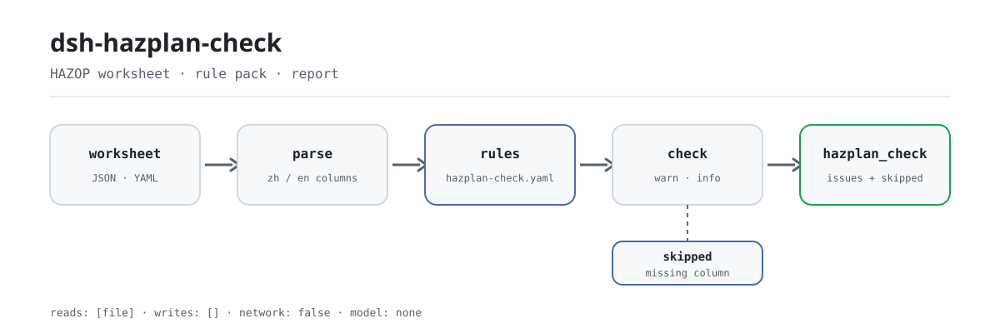

<div align="center">

<picture>
  <source media="(prefers-color-scheme: dark)" srcset="docs/assets/dsh-hazplan-check-flow-dark.svg">
  
</picture>

# dsh-hazplan-check

**逐行核对 HAZOP 分析表：哪一行、哪一栏、差什么，一次列清。**

面向工艺安全与 HAZOP 分析组的表格核对工具：读一份工作表，按版本化规则包检查齐备性与偏差推导的一致性——只列差异，不判合规。

[安装](#三步上手) · [配置](#配置) · [FAQ](#faq) · [简体中文](README.md) · [English](README.en.md) · [Español](README.es.md) · [Português](README.pt.md) · [हिन्दी](README.hi.md)

[](LICENSE)
[](#兼容性)
[](https://www.npmjs.com/package/dsh-hazplan-check)
[](https://github.com/PerryLink/dsh-hazplan-check/actions/workflows/ci.yml)
[](#兼容性)

[](https://github.com/PerryLink/dsh-hazplan-check/stargazers)
[](https://www.npmjs.com/package/dsh-hazplan-check)
[](https://dshfind.com/plugins/PerryLink/dsh-hazplan-check?ref=badge)
[](https://securityscorecards.dev/viewer/?uri=github.com/PerryLink/dsh-hazplan-check)
[](https://dsh.market/)
[](https://gitee.com/perrylink/dsh-hazplan-check)

```sh
dsh plugin --profile <name> add dsh-hazplan-check
```

</div>

<sub>社区插件，与 DeepSeek 官方无关。唯一仓库：<https://github.com/PerryLink/dsh-hazplan-check>（Gitee 为镜像）。</sub>

## 它是什么

`dsh-hazplan-check` 读取一份 HAZOP 分析表——行按表格自身的列名组织（中英文列名都认），表头可选地写明分析对象——核对的是这份表格自身：每行是否填了模板要求的栏目（默认 `偏差` 与 `原因`）、每行是否写明 `节点`、`引导词` 是否取自标准表1与表2或本次分析事先声明的清单、每行是否看得出偏差来自哪个要素、`风险等级` 是否出自本机构的风险档位、表头能否识别分析对象，以及每个 `偏差` 是否字面上包含 `工艺参数` 经 `引导词` 读出的组合。因缺列而无法执行的核对会进入 `skipped`，不会静默通过。

它注册一个 `hazplan_check` 工具，核对核心是纯函数：不联网、不调用模型、不写文件；传入的工作表只读。

## 三步上手

1. **安装**：

   ```sh
   dsh plugin --profile web add dsh-hazplan-check
   ```

2. **最小配置**（可选；不配也能跑，配上本机构的风险档位与已声明的引导词后 `HZ-005`/`HZ-003` 才按你的口径核对）：

   ```yaml
   - insert:
       - id: dsh-hazplan-check
         name: dsh-hazplan-check
         config:
           riskLevels: [高, 中, 低]
           guideWords: [无, 多, 少, 伴随, 部分, 相反, 异常]
   ```

3. **验证已生效**：

   ```sh
   dsh --profile web --dump-config | grep 'dsh-hazplan-check'
   ```

   在本仓另可用自带样例跑一次（先 `pnpm install && pnpm run build`）：

   ```sh
   node samples/quickstart/run.mjs
   ```

   ```text
   $ node samples/quickstart/run.mjs
   hazplan_check: 1 issue(s) — error 0, warn 1, info 0
   skipped: 6
   ```

   期望输出也存放在 `samples/quickstart/expected/result.json`。

**卸载**：`dsh plugin --profile web remove dsh-hazplan-check`（或从 profile patch 删掉该行）。

<details>
<summary>从 WorkBuddy / 扣子使用</summary>

在 WorkBuddy / 扣子搜索「安全合规核对包」（本检查是其中一项；上架以商城为准）。

</details>

## 核心能力

- **规则包即数据** —— 规则在 `rules/hazplan-check.yaml`；每条都带文件名、文号、按来源自身编号的条款号、逐字摘录与来源地址。替换 YAML 即切换规则集，加载期校验，不信任内容。
- **中英文列名都认** —— 列名匹配大小写不敏感，忽略空格、下划线与连字符，`Guide Word`、`guide_word`、`guideword` 指向同一字段；商业 HAZOP 工具导出的表可直接读。
- **偏差推导核对** —— 写下的偏差必须包含工艺参数经引导词读出的组合；两种语序、常见连接符与空白都归一。命中只提示可能的复制粘贴串行，不判定偏差在工艺上不成立。
- **不静默通过** —— 因缺列而无法执行的核对逐条进入 `skipped` 并写明原因；规则要求列表未配置时，规则把自己报进 `skipped`，不冒充通过。
- **只列差异** —— 报告不判合规、不认定责任、不替代审核人；措辞守卫拦截裁决性表述，每份报告都带免责声明。
- **单工具面** —— 只注册 `hazplan_check`；`native` 与 `ptc` 模式都能用，批量核对多份表时建议 `ptc`。

### 七条规则

| 规则 | 核对内容 | 级别 | 依据 |
|---|---|---|---|
| `HZ-001` | 每个问题单独成行，并连同其原因记录 | warn | 6.6.4 |
| `HZ-002` | 每个被分析的节点都在表上留痕 | warn | 6.6.3 |
| `HZ-003` | 引导词取自表1+表2，或分析前已声明 | warn | 表1、表2 + 6.4.3 |
| `HZ-004` | 该行看得出偏差来自哪个要素 | warn | 3.3 + 6.4.3 |
| `HZ-005` | 风险等级出自本机构的风险准则（默认不运行） | info | 6.5 + GB/T 27921 |
| `HZ-006` | 表头写明分析对象 | warn | 附录A.2（资料性） |
| `HZ-007` | 偏差包含工艺参数经引导词读出的组合 | warn | 6.4.3 |

### 规则问答

| 你会问 | 它怎么答 |
|---|---|
| 某行填了偏差，但原因栏空着，会被报出吗？ | 会。`HZ-001` 要求每行填写必填栏目；出厂未配置 `requiredFields` 时，回退到条款本身点名的一对：`偏差` 与 `原因`，所以 `原因` 空着本身就是缺项。它只核对栏目是否填写，不判断问题是否找全、原因是否成立。 |
| 有三行根本没有写节点，会被指出来吗？节点划分得粗或细，它会不会评价？ | `HZ-002` 会把这几行合并报出一条，并列出所在行号，因为记录没有节点就生成不了条款要求的节点清单。它只核对 `节点` 是否填写；节点划分粒度是否恰当，它不判断（4.2 没有判据），也不判断有没有节点被漏掉未作分析。 |
| 我们的分析在 `引导词` 栏里写了「相逆」，会被提示吗？ | `HZ-003` 会把它作为清单之外的引导词报出：国标自己的用词是「相反」而不是「相逆」，表1与表2给出的是 无/多/少/伴随/部分/相反/异常 与 早/晚/先/后。这条只是提示而不断定不合规——6.4.3 允许自定义引导词，只要分析前已定义并存档，所以本条为 `warn`。部署时也可以换成自己的清单，那时只有清单之外的词会被报出。 |
| `偏差` 栏写的是「无流量」，而 `工艺参数` 是「温度」、`引导词` 是「无」，这能查出来吗？ | 能。`HZ-007` 在写下的 `偏差` 不包含 `工艺参数` 与 `引导词` 的组合（两种语序都算）时报出该行；空白与常见连接符（如 `+`、`、`、`/`、`-`、`—`、`的`、`：`）忽略不计，所以「流量无」「流量 + 无」「无流量」都算相符。它只在三列同时具备时执行，否则出现在 `skipped` 里；命中通常意味着复制粘贴串行，不代表该偏差在工艺上不成立。 |
| `风险等级` 栏填了「中」，但我们没有配置任何风险档位，会怎样？ | `HZ-005` 会把自己报进 `skipped`，而不是当作通过：标准未规定风险等级的刻度，档位必须来自本机构的风险准则，出厂清单是空的。配置之后，它只核对所填值是否在册，不判断定级是否正确；本条严重级封顶为 `info`。 |
| 分析表里没有任何一行写明所分析的对象（装置或单元），算缺项吗？ | `HZ-006` 会在顶层报出一条：没有分析对象，结论就无法追溯到被分析的边界。它依据的表头项来自资料性附录——是建议而不是强制——所以本条停在 `warn`；确实不带表头的表格可用 `requireHeader: false` 停用本条。 |

### 真实输出

下面这次调用是插件对自带的 `HZ-001` 夹具的真实输出，不是示意图。

**工具** `hazplan_check`

**输入**

~~~json
{"rows":[{"节点":"进料单元","工艺参数":"流量","引导词":"无","偏差":"无流量","原因":""}]}
~~~

**输出**

~~~json
{
  "id": "dsh-hazplan-check.HZ-001.de09b5a6",
  "ruleId": "HZ-001",
  "severity": "warn",
  "locator": {
    "row": 1
  },
  "found": "第 1 行缺少 原因",
  "expected": "每一个危险和可操作性问题都应作为单项记录，并与其原因一起记录；本机构配置的必填项为 偏差、原因",
  "fix": "补齐栏目；本条只核对是否填写，不判断该问题是否找全"
}
~~~

*Observed from `tests/fixtures/HZ-001/HZ-001-unsafe.json (cases.json expects HZ-001 count 1); run via lib/index.mjs rules/hazplan-check.yaml`*

## 配置

全部可调参数都在 `src/config.ts` 的 Schemastery schema 中，只改 `cordis.yml` 即可生效，无需改代码；逐条阈值在 `rules/` 下的规则库文件里。按 id 覆盖会替换整行——请重述所有需要的键。

最常用键：

| 键 | 类型 | 默认值 | 说明 |
|---|---|---|---|
| `rulesFile` | string | `rules/hazplan-check.yaml` | 规则库文件路径，相对插件包根目录 |
| `disabledRules` | string[] | `[]` | 要停用的规则 id 列表；每条都会出现在 `skipped` 中 |
| `onlyRules` | string[] | `[]` | 只执行这些规则 id；留空表示执行全部规则 |
| `skipNotes` | string | `""` | 附加到每条 `skipped` 说明后的备注 |
| `timeoutMs` | number | `120000` | 工具协作式超时预算（毫秒） |

<details>
<summary>完整配置表（7 个键）</summary>

| 键 | 类型 | 默认值 | 说明 |
|---|---|---|---|
| `rulesFile` | string | `rules/hazplan-check.yaml` | 规则库文件路径，相对插件包根目录 |
| `disabledRules` | string[] | `[]` | 要停用的规则 id 列表；每条都会出现在 `skipped` 中 |
| `onlyRules` | string[] | `[]` | 只执行这些规则 id；留空表示执行全部规则 |
| `skipNotes` | string | `""` | 附加到每条 `skipped` 说明后的备注 |
| `riskLevels` | string[] | `[]` | 本机构风险准则的档位清单，如 `[高, 中, 低]`；留空表示不核对风险档位 |
| `guideWords` | string[] | `[]` | 分析前自定义并存档的引导词清单；留空时按标准表1、表2核对 |
| `timeoutMs` | number | `120000` | 工具协作式超时预算（毫秒） |

</details>

<details>
<summary>规则级参数（4 个键）</summary>

| 键 | 默认值 | 说明 |
|---|---|---|
| `HZ-001` `requiredFields` | `[偏差, 原因]` | 每行必须填写的栏目；留空时回退到条款点名的一对 |
| `HZ-003` `guideWords` | `[]` | 本次分析事先声明的引导词清单；留空时用标准表1、表2 |
| `HZ-005` `riskLevels` | `[]` | 本机构的风险档位；留空时本条不运行 |
| `HZ-006` `requireHeader` | `true` | 表头确实没有分析对象行时设为 `false` |

</details>

profile patch 覆盖示例：

```yaml
- insert:
    - id: dsh-hazplan-check
      name: dsh-hazplan-check
      config:
        onlyRules: [HZ-001, HZ-002, HZ-003, HZ-007]
        riskLevels: [高, 中, 低]
        requireHeader: false
```

## FAQ

<details>
<summary>工作表会被保存或外发吗？</summary>

不会外发。插件读取传入的 `file` 或 `material`，在内存里完成核对；`package.json#dsh.demo` 声明 `reads: [用户指定的材料文件]`、`writes: []`、`network: false`，运行时不发网络请求、不调用模型、不写文件。工作表原件不被修改；报告只回到当前会话。

</details>

<details>
<summary>缺列或没配置清单时，会不会静默通过？</summary>

不会。因缺列而无法执行的核对逐条进入 `skipped` 并写明原因；`HZ-001`、`HZ-003`、`HZ-005` 在对应清单为空时把自己报进 `skipped`，而不是给出“通过”。只有 `skipped` 为空，报告里的“未发现问题”才覆盖全部规则。

</details>

<details>
<summary>会和其他插件抢工具名、命令或 slot 吗？</summary>

不会。插件只向 `tools` 注册一个 `hazplan_check` 工具，不注册客户端 slot、命令、HTTP 路由或服务键；`inject` 只有 `tools`，卸载时注册随 Cordis effect 一起撤销。它不读别的插件的状态，也不改写全局对象。

</details>

<details>
<summary>性能开销多大？</summary>

核对是纯内存的规则匹配：无网络请求、无模型调用、无外部进程；一份工作表的开销取决于行数与规则数。工具带有协作式超时预算 `timeoutMs`（默认 `120000` 毫秒），批量核对多份表时建议用 `ptc` 模式。

</details>

<details>
<summary>它会给出合规结论或责任认定吗？</summary>

不会。报告只列材料内部能逐条指认的差异，不判合规、不认定责任、不替代审核人；措辞守卫拦截裁决性表述，报告始终带免责声明。原因是否完整、后果是否分析充分、措施是否足够、评级是否正确，这四项判断属于分析小组。

</details>

## 依据的标准

| 文件 | 文号 | 引用它的规则 |
|---|---|---|
| 《危险与可操作性分析（HAZOP分析）应用指南》 | GB/T 35320-2017 | HZ-001, HZ-002, HZ-003, HZ-004, HZ-005, HZ-006, HZ-007 |
| 《风险管理 风险评估技术》 | GB/T 27921-2023 | HZ-005 |

### ⚠️ 这里没有任何 `error`，原因在条款措辞

> **GB/T 35320-2017《危险与可操作性分析（HAZOP分析）应用指南》** 是现行标准（2017-12-29 发布并实施，与 IEC 61882:2001 等同），其条款原文已逐字取得。
>
> **该标准是*推荐性*标准（标准号带“/T”），本规则库引用的每一条条款用的都是“宜”——“should”——而不是“应”。** 这一点适用于本规则库早期版本评为 `error` 的那两条条款：**6.6.4** 写的是「每一个危险和可操作性性问题都**宜**作为单项记录」，**6.6.3** 开头是「HAZOP 分析输出**宜**包括：」。**推荐性要求不能支撑错误评级**，因此这两条规则现在都是 `warn`，**本插件根本不报告任何错误**——这与本系列插件对待其他每一部推荐性标准的方式一致。有测试固定这一点，使日后的修改无法悄悄把其中一条重新升级。
>
> **其余一切都封顶在 `warn` 或 `info`，理由有三条，规则库均有记录：**
>
> 1. **附录 A.2——唯一出现栏目清单的地方——是资料性附录。** 其措辞是“表列的标题**可为**以下各项”，还补充“**也可记录**其他信息”，并直说“工作表的版面设计**各有不同**”。**不存在强制性的栏目清单**，因此缺少某一栏最多只能算建议。
> 2. **第 4.2 条没有给出节点划分粒度的准则。** 它说节点的大小“取决于系统的复杂性和危险的严重程度”，其后没有任何量化规定。本插件**不**判断节点大小。
> 3. **标准没有规定风险等级刻度。** 6.5 提到风险矩阵有用，并把方法交由 IEC 60300-3-9；GB/T 27921-2023 对矩阵的描述同样属资料性。等级必须来自你自己的风险准则，因此词表出厂为**空**。
>
> 规则库中还有两条关于诚实性的说明。引导词词表采用标准自己的措辞——**「相反」，而不是俗写的“相逆”**——并合并表 1 与表 2；自定义引导词**并不**不合规，因为 6.4.3 允许自定义，条件是“只要在分析开始前进行了定义”。另外，**SH/T 3240-2025**（石油化工 HAZOP 规范，2025-11-01 实施）只核实了其名称、状态和术语表——**其条款原文本次未取得，因此本规则库不引用其中任何内容**。
>
> 本插件不作的四项判断：原因是否完整、后果分析是否深入充分、现有安全措施是否充分、风险评级是否正确。

## 安全边界

- **只核对表格自身能要求到的事。** 每行是否记录了模板要求的分析内容（含你配置的必填栏目）、每个偏差是否确实由旁边的工艺参数与引导词推出、风险等级是否取自你自己的取值口径、每个节点是否有对应行——这些是表格能自证的部分。
- **四项判断留给分析小组。** 本插件**不**判定原因是否完整、后果分析是否充分、现有安全措施是否足够、风险评级是否正确。**这四项判断属于分析小组，也正是 HAZOP 的价值所在。**
- **不判合规、不认定责任。** 报告只列材料内部能逐条指认的差异，始终带免责声明；裁决性措辞由措辞守卫拦截。
- **不静默通过。** 因缺列而无法执行的核对逐条进入 `skipped` 并写明原因；必填清单未配置时规则也把自己报进 `skipped`，不当作通过。
- **引文不实即加载失败。** 加载期强制摘录是真实引文且不少于八个字符；依据仅为原则性条款（`kind: derived-from-principle`）的规则严重级封顶 `warn`，仅依据本机构配置（`kind: institutional-configuration`）的封顶 `info`。夸大依据的规则库会在加载期失败，而不是产出一份看起来很有底气的报告。
- **只读输入。** 插件读取传入的工作表或文件，不写文件、不联网、不调用模型；原件不被修改。

## 材料格式

支持 JSON 与 YAML。Excel 可先转成 JSON/YAML，对话里也能代转。行按表格自身的列名组织；**中文与英文列名都能用**，商业 HAZOP 工具导出的表无需改列名即可载入：

```yaml
subject: 某装置 HAZOP 分析
revision: V1.0
rows:
  - { 节点: 进料单元, 设计意图: 将原料按设计流量送入反应器, 工艺参数: 流量, 引导词: 无,
      偏差: 无流量, 原因: 进料泵故障, 后果: 反应器液位下降, 现有安全措施: 液位低报警,
      建议措施: 增加进料泵备用泵, 风险等级: 中, 责任人: 张工, 完成期限: 2026-06-30 }
  - { Node: N2, Parameter: Temperature, "Guide Word": High, Deviation: High temperature,
      Causes: Cooling failure, Consequences: Runaway, Safeguards: High-temp trip }
```

列名匹配大小写不敏感，并忽略空格、下划线与连字符，所以 `Guide Word`、`guide_word`、`guideword` 指向同一字段。字段在读取层是可选的，由核对引擎校验，因此部分导出的材料会产生“缺项”类差异，而不是让程序崩溃。

`HZ-007` 在 `偏差`、`工艺参数`、`引导词` 三列同时具备时，把偏差与「参数+引导词」按一组连接符（`, `、`+`、`、`、`/`、`-`、`—`、`的`、`：`）和两种语序比对，所以 `流量无`、`流量 + 无`、`无流量` 都通过。命中只报告为可能的复制粘贴串行，不声称偏差在工艺上错误。

## 规则来源

规则数据与代码分离，位于 `rules/hazplan-check.yaml`。每条规则都带文件名、文号、按原文自身编号体系的条款号、逐字摘录与来源地址。

引用的条款来自 **GB/T 35320-2017**——3.3、4.2、6.4.3、6.5、6.6.3、6.6.4、表1与表2、附录 A.2——外加 **GB/T 27921-2023** 附录 B.10.3 对风险矩阵的描述。条款原文读自一份全文转录，其结构与标准官方元数据交叉核对；规则库记录了这一来源是转录件。

四条发现塑造了这个规则包，并记录在其头部：

1. **附录 A.2 是资料性附录**，其栏目清单只是建议，从不是强制要求。
2. **第 4.2 条没有给出节点大小的判据**，因此节点粒度不被自动评价。
3. **标准没有规定风险等级刻度**，等级属于你，词表出厂为空。
4. **SH/T 3240-2025 存在，但其条款原文本次未取得**，因此不引用其任何条文——只在规则包头记录了它的身份。

逐条条款核验报告（包括查过并否决的来源）在 [`rules/evidence/clause-verification.md`](rules/evidence/clause-verification.md)。

## 兼容性

| 项目 | 状态 |
|---|---|
| Harness | 对等版本范围 `>=0.1.2-rc.1 <0.2.0 \|\| >=0.2.0-0 <0.3.0` —— 已实测同时接受 `0.2.0-rc.2` 与 `0.2.1-rc.2`。**已声明 `engines.dsh`**：0.2.1 起由宿主单独裁决，范围为 `>=0.2.1-0 <0.3.0` |
| Node | `^22.19.0 \|\| >=24.0.0` |
| 平台 | 全平台（纯 ESM；无原生代码、无联网、不调用模型） |
| 工具模式 | `native` / `ptc` 均可；批量校验整个目录时建议 `ptc`，schema 成本只付一次 |

## 排查

- **`HZ-001`、`HZ-003` 或 `HZ-005` 把自己报进 `skipped`。** 它们的清单是空的；按本机构模板与风险准则填上。
- **`HZ-007` 对一行看起来没问题的表报警。** 你的表可能写了比「参数+引导词」更完整的偏差。规则只说“可能是复制粘贴串行”；要么把该列规范化，要么把它当噪声接受。它从不阻塞任何操作。
- **`HZ-007` 什么都不报。** 表里不同时具备 `工艺参数`、`引导词`、`偏差` 三列——规则会把自己写进 `skipped`，而不是猜。
- **读取器拒绝一份以前能读的表。** 它没找到任何已知列名，错误信息会列出它看到的列；改一个列名，或把该列名加入 `src/model.ts` 的 `COLUMNS`。
- **插件装上了但工具不出现。** 确认 `main` 指向 `lib/index.mjs` 且 `pnpm run build` 已生成该文件；`main` 写错会让加载器静默跳过该条目。
- **`dsh plugin add` 报版本不兼容。** peer 范围覆盖 `0.1.x` 与 `0.2.x`；若运行时在其之外，可显式豁免：`dsh plugin --profile <name> allow-version dsh-hazplan-check@0.1.0 --dsh-version <runtime> --accept-risk`。
- **`check` 报 `manifest-peers` 失败。** 静态检查器比对的是一份早于 0.2 世代的硬编码 peer 范围；安装期的 peer 校验以运行时为准。这是 `dsh-plugin-dev` 的已知上游问题。
- **时间看起来偏移。** 全部计算都是对输入字符串做墙上时钟运算，不做时区换算。

## 生态与质量

- [Gitee 镜像](https://gitee.com/perrylink/dsh-hazplan-check)（同步镜像，以 GitHub 为准）
- [dshfind 插件页](https://dshfind.com/plugins/PerryLink/dsh-hazplan-check)（安装量与排名）
- [OpenSSF Scorecard 报告](https://securityscorecards.dev/viewer/?uri=github.com/PerryLink/dsh-hazplan-check)（由 [.github/workflows/scorecard.yml](.github/workflows/scorecard.yml) 驱动）
- [DSH Market](https://dsh.market/)（已上架）
- [按材料选核查器](https://perrylink.github.io/zh/checkers/choose/)（62 个核查器 + 通用插件的选型索引）
- [生态实测知识库](https://perrylink.github.io/dsh-plugin-guide/)：插件开发指南 · 选型实测数据 · 维护取舍判据

## 开发

```sh
pnpm install
pnpm run typecheck   # tsc --noEmit
pnpm test            # vitest，每条规则一对合规/违规夹具
pnpm run build       # tsdown -> lib/index.mjs + lib/index.d.mts
pnpm run check:readmes
node ../scripts/sync-shared.mjs dsh-hazplan-check
```

最后一项把 `../_shared` 的共享件同步进 `src/shared/`；每次改动共享件后都要重跑。

核对核心 `src/check.ts` 是纯函数 `(input, ruleset, options) => Report`，不碰插件上下文、I/O、时钟与模型，因此整套规则可以脱离凭据单测；规则库 `rules/hazplan-check.yaml` 是数据，替换它即换规则集。快速试跑：`node samples/quickstart/run.mjs`。配图由 [`scripts/gen-readme-assets.py`](scripts/gen-readme-assets.py) 程序化生成（Python + Pillow，SVG 矢量、深浅双版），可重复执行。

Topics：`deepseek-harness`, `dsh`, `dsh-plugin`, `cordis`, `hazplan`

## 家族与致谢

本项目是 [PerryLink](https://github.com/PerryLink) 维护的 DeepSeek Harness 插件家族成员（全部 Apache-2.0）。如果这个插件帮到了你，**给个 star**——它不解锁任何功能，但会让下一个人更容易找到它。

- [@PerryLink](https://github.com/PerryLink) —— 创建者与维护者：规则包（`HZ-001`…`HZ-007`）、材料读取与报告视图、条款核验记录与五语文档。

<details>
<summary>展开全部插件</summary>

| 插件 | 状态 |
|---|---|
| **[dsh-aqua-input-check](https://github.com/PerryLink/dsh-aqua-input-check)** |  |
| **[dsh-archive-check](https://github.com/PerryLink/dsh-archive-check)** |  |
| **[dsh-auto-review](https://github.com/PerryLink/dsh-auto-review)** |  |
| **[dsh-autotier](https://github.com/PerryLink/dsh-autotier)** | 🧊 已冻结 — 见仓库 README |
| **[dsh-bid-ca-precheck](https://github.com/PerryLink/dsh-bid-ca-precheck)** |  |
| **[dsh-bid-qual-check](https://github.com/PerryLink/dsh-bid-qual-check)** |  |
| **[dsh-cert-mcp](https://github.com/PerryLink/dsh-cert-mcp)** | 🧊 已冻结 — 见仓库 README |
| **[dsh-checkpoint-rewind](https://github.com/PerryLink/dsh-checkpoint-rewind)** |  |
| **[dsh-click](https://github.com/PerryLink/dsh-click)** |  |
| **[dsh-composer-history](https://github.com/PerryLink/dsh-composer-history)** |  |
| **[dsh-contract-stance](https://github.com/PerryLink/dsh-contract-stance)** |  |
| **[dsh-customs-doc-check](https://github.com/PerryLink/dsh-customs-doc-check)** |  |
| **[dsh-data-quality](https://github.com/PerryLink/dsh-data-quality)** |  |
| **[dsh-demurrage-ledger](https://github.com/PerryLink/dsh-demurrage-ledger)** |  |
| **[dsh-doublecheck](https://github.com/PerryLink/dsh-doublecheck)** |  |
| **[dsh-drill-script-check](https://github.com/PerryLink/dsh-drill-script-check)** |  |
| **[dsh-eia-guide-check](https://github.com/PerryLink/dsh-eia-guide-check)** |  |
| **[dsh-emergency-plan](https://github.com/PerryLink/dsh-emergency-plan)** |  |
| **[dsh-essay-rubric-check](https://github.com/PerryLink/dsh-essay-rubric-check)** |  |
| **[dsh-evidence-check](https://github.com/PerryLink/dsh-evidence-check)** |  |
| **[dsh-export-ctl-check](https://github.com/PerryLink/dsh-export-ctl-check)** |  |
| **[dsh-fast](https://github.com/PerryLink/dsh-fast)** |  |
| **[dsh-fmea-table-check](https://github.com/PerryLink/dsh-fmea-table-check)** |  |
| **[dsh-forecast-penalty](https://github.com/PerryLink/dsh-forecast-penalty)** |  |
| **[dsh-fund-research](https://github.com/PerryLink/dsh-fund-research)** |  |
| **[dsh-github](https://github.com/PerryLink/dsh-github)** |  |
| **[dsh-gongwen-flow-check](https://github.com/PerryLink/dsh-gongwen-flow-check)** |  |
| **[dsh-gongwen-word-check](https://github.com/PerryLink/dsh-gongwen-word-check)** |  |
| **[dsh-guard-plan-qc](https://github.com/PerryLink/dsh-guard-plan-qc)** |  |
| **[dsh-hazchem-check](https://github.com/PerryLink/dsh-hazchem-check)** |  |
| **[dsh-hazplan-check](https://github.com/PerryLink/dsh-hazplan-check)** |  |
| **[dsh-hidden-risk-map](https://github.com/PerryLink/dsh-hidden-risk-map)** |  |
| **[dsh-hs-classify](https://github.com/PerryLink/dsh-hs-classify)** |  |
| **[dsh-icd-rule-check](https://github.com/PerryLink/dsh-icd-rule-check)** |  |
| **[dsh-industry-research](https://github.com/PerryLink/dsh-industry-research)** |  |
| **[dsh-lawcite-adapter](https://github.com/PerryLink/dsh-lawcite-adapter)** |  |
| **[dsh-laya](https://github.com/PerryLink/dsh-laya)** |  |
| **[dsh-lc-doc-check](https://github.com/PerryLink/dsh-lc-doc-check)** |  |
| **[dsh-learning-gap-check](https://github.com/PerryLink/dsh-learning-gap-check)** |  |
| **[dsh-library](https://github.com/PerryLink/dsh-library)** |  |
| **[dsh-local-ai](https://github.com/PerryLink/dsh-local-ai)** |  |
| **[dsh-lsp-actions](https://github.com/PerryLink/dsh-lsp-actions)** |  |
| **[dsh-mask](https://github.com/PerryLink/dsh-mask)** |  |
| **[dsh-mcp-panel](https://github.com/PerryLink/dsh-mcp-panel)** |  |
| **[dsh-medrec-qc](https://github.com/PerryLink/dsh-medrec-qc)** |  |
| **[dsh-memento](https://github.com/PerryLink/dsh-memento)** |  |
| **[dsh-nsfc-form-check](https://github.com/PerryLink/dsh-nsfc-form-check)** |  |
| **[dsh-nurse-record-check](https://github.com/PerryLink/dsh-nurse-record-check)** |  |
| **[dsh-observe](https://github.com/PerryLink/dsh-observe)** |  |
| **[dsh-origin-rvc-check](https://github.com/PerryLink/dsh-origin-rvc-check)** |  |
| **[dsh-ota-review-check](https://github.com/PerryLink/dsh-ota-review-check)** |  |
| **[dsh-output-styles](https://github.com/PerryLink/dsh-output-styles)** |  |
| **[dsh-paper-doc-adapter](https://github.com/PerryLink/dsh-paper-doc-adapter)** |  |
| **[dsh-permission-rules](https://github.com/PerryLink/dsh-permission-rules)** |  |
| **[dsh-permit-report-check](https://github.com/PerryLink/dsh-permit-report-check)** |  |
| **[dsh-pipeline-check](https://github.com/PerryLink/dsh-pipeline-check)** |  |
| **[dsh-pleading-draft](https://github.com/PerryLink/dsh-pleading-draft)** |  |
| **[dsh-plugin-doctor](https://github.com/PerryLink/dsh-plugin-doctor)** | 🚫 已退役（仓库已归档） |
| **[dsh-plugin-guide](https://github.com/PerryLink/dsh-plugin-guide)** |  |
| **[dsh-plugin-kit](https://github.com/PerryLink/dsh-plugin-kit)** | 🚫 已退役（仓库已归档） |
| **[dsh-plugin-upgrade](https://github.com/PerryLink/dsh-plugin-upgrade)** | 🚫 已退役（仓库已归档） |
| **[dsh-policy-brief-draft](https://github.com/PerryLink/dsh-policy-brief-draft)** |  |
| **[dsh-power-loss-split](https://github.com/PerryLink/dsh-power-loss-split)** |  |
| **[dsh-power-ticket-check](https://github.com/PerryLink/dsh-power-ticket-check)** |  |
| **[dsh-ppap-check](https://github.com/PerryLink/dsh-ppap-check)** |  |
| **[dsh-protest-deadline](https://github.com/PerryLink/dsh-protest-deadline)** |  |
| **[dsh-railway-window](https://github.com/PerryLink/dsh-railway-window)** |  |
| **[dsh-repair-order-qc](https://github.com/PerryLink/dsh-repair-order-qc)** |  |
| **[dsh-research-report](https://github.com/PerryLink/dsh-research-report)** |  |
| **[dsh-review-reply-check](https://github.com/PerryLink/dsh-review-reply-check)** |  |
| **[dsh-rulefile-check](https://github.com/PerryLink/dsh-rulefile-check)** |  |
| **[dsh-safety-brief-check](https://github.com/PerryLink/dsh-safety-brief-check)** |  |
| **[dsh-score](https://github.com/PerryLink/dsh-score)** |  |
| **[dsh-session-sync](https://github.com/PerryLink/dsh-session-sync)** |  |
| **[dsh-site-log-check](https://github.com/PerryLink/dsh-site-log-check)** |  |
| **[dsh-skill-pack-security](https://github.com/PerryLink/dsh-skill-pack-security)** |  |
| **[dsh-soe-decision-check](https://github.com/PerryLink/dsh-soe-decision-check)** |  |
| **[dsh-soilwater-check](https://github.com/PerryLink/dsh-soilwater-check)** |  |
| **[dsh-sop-sync-check](https://github.com/PerryLink/dsh-sop-sync-check)** |  |
| **[dsh-spc-gbt-adapter](https://github.com/PerryLink/dsh-spc-gbt-adapter)** |  |
| **[dsh-talk](https://github.com/PerryLink/dsh-talk)** |  |
| **[dsh-tender-extract](https://github.com/PerryLink/dsh-tender-extract)** |  |
| **[dsh-tender-matrix](https://github.com/PerryLink/dsh-tender-matrix)** |  |
| **[dsh-test-drive](https://github.com/PerryLink/dsh-test-drive)** |  |
| **[dsh-ticktick](https://github.com/PerryLink/dsh-ticktick)** | 🚫 已退役（仓库已归档） |
| **[dsh-translate](https://github.com/PerryLink/dsh-translate)** |  |
| **[dsh-warranty-calc](https://github.com/PerryLink/dsh-warranty-calc)** |  |
| **[dsh-budget](https://github.com/PerryLink/dsh-budget)** | 🧊 已冻结 — 见仓库 README |
| **[dsh-claude-move](https://github.com/PerryLink/dsh-claude-move)** | 🧊 已冻结 — 见仓库 README |
| **[dsh-defend](https://github.com/PerryLink/dsh-defend)** | 🧊 已冻结 — 见仓库 README |
| **[dsh-draw](https://github.com/PerryLink/dsh-draw)** | 🧊 已冻结 — 见仓库 README |
| **[dsh-reach](https://github.com/PerryLink/dsh-reach)** | 🧊 已冻结 — 见仓库 README |
| **[dsh-background-agents](https://github.com/PerryLink/dsh-background-agents)** | 🚫 已退役（仓库已归档） |
| **[dsh-session-pin](https://github.com/PerryLink/dsh-session-pin)** | 🚫 已退役（仓库已归档） |
| **[dsh-team-rooms](https://github.com/PerryLink/dsh-team-rooms)** | 🚫 已退役（仓库已归档） |

</details>

## License

[Apache License 2.0](LICENSE) © 2026 dsh-hazplan-check contributors

<p align="center"><sub>Apache-2.0 · 社区插件，与 DeepSeek 无关。</sub></p>
