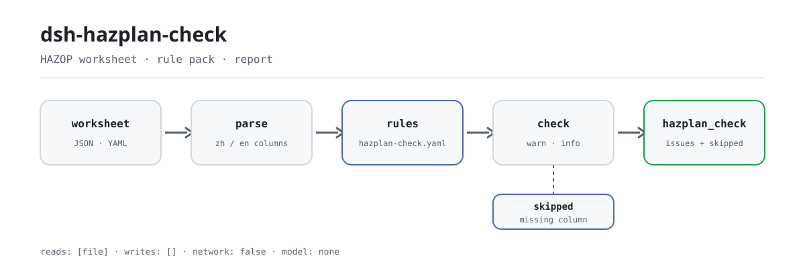

<div align="center">

<picture>
  <source media="(prefers-color-scheme: dark)" srcset="docs/assets/dsh-hazplan-check-flow-dark.svg">
  
</picture>

# dsh-hazplan-check

**Verifique uma folha de trabalho HAZOP linha a linha: qual linha, qual coluna, o que falta — numa única lista.**

Uma ferramenta de verificação de folhas de trabalho para equipas de segurança de processos e HAZOP: lê uma folha, aplica um pacote de regras versionado à sua completude e à derivação de desvios, e apenas lista diferenças — nunca um veredicto de conformidade.

[Instalar](#instalação-em-três-passos) · [Configuração](#configuração) · [FAQ](#faq) · [简体中文](README.md) · [English](README.en.md) · [Español](README.es.md) · [Português](README.pt.md) · [हिन्दी](README.hi.md)

[](LICENSE)
[](#compatibilidade)
[](https://www.npmjs.com/package/dsh-hazplan-check)
[](https://github.com/PerryLink/dsh-hazplan-check/actions/workflows/ci.yml)
[](#compatibilidade)

[](https://github.com/PerryLink/dsh-hazplan-check/stargazers)
[](https://www.npmjs.com/package/dsh-hazplan-check)
[](https://dshfind.com/plugins/PerryLink/dsh-hazplan-check?ref=badge)
[](https://securityscorecards.dev/viewer/?uri=github.com/PerryLink/dsh-hazplan-check)
[](https://dsh.market/)
[](https://gitee.com/perrylink/dsh-hazplan-check)

```sh
dsh plugin --profile <name> add dsh-hazplan-check
```

</div>

<sub>Plugin da comunidade, não afiliado à DeepSeek. Repositório canónico: <https://github.com/PerryLink/dsh-hazplan-check> (o Gitee é um espelho).</sub>

## O que é

`dsh-hazplan-check` lê uma folha de trabalho HAZOP — linhas organizadas pelos próprios nomes de coluna da folha (em chinês ou em inglês), mais um cabeçalho opcional que declara o objeto de análise — e verifica essa mesma folha: se cada linha preenche os campos exigidos pelo seu modelo (desvio e causa por omissão), se cada linha registra o seu nó, se as palavras-guia vêm das tabelas 1 e 2 da norma ou da lista que o estudo declarou de antemão, se cada linha deixa ver de que elemento veio o desvio, se o nível de risco vem do vocabulário de risco da sua organização, se a folha identifica o objeto de análise e se cada desvio contém literalmente o parâmetro lido através da sua palavra-guia. Toda a verificação que não possa correr por falta de uma coluna é reportada em `skipped` em vez de passar em silêncio.

Registra uma única ferramenta `hazplan_check`. O núcleo de verificação é uma função pura: sem rede, sem chamadas ao modelo, sem escrita de ficheiros; a folha de trabalho é só de leitura.

## Instalação em três passos

1. **Instalar**:

   ```sh
   dsh plugin --profile web add dsh-hazplan-check
   ```

2. **Configuração mínima** (opcional; sem ela `HZ-005` e uma lista própria de `HZ-003` ficam em `skipped`):

   ```yaml
   - insert:
       - id: dsh-hazplan-check
         name: dsh-hazplan-check
         config:
           riskLevels: [高, 中, 低]
           guideWords: [无, 多, 少, 伴随, 部分, 相反, 异常]
   ```

3. **Verificar que monta**:

   ```sh
   dsh --profile web --dump-config | grep 'dsh-hazplan-check'
   ```

   Neste repositório pode ainda correr o quickstart incluído (antes `pnpm install && pnpm run build`):

   ```sh
   node samples/quickstart/run.mjs
   ```

   ```text
   $ node samples/quickstart/run.mjs
   hazplan_check: 1 issue(s) — error 0, warn 1, info 0
   skipped: 6
   ```

   A mesma saída esperada está em `samples/quickstart/expected/result.json`.

**Desinstalar**: `dsh plugin --profile web remove dsh-hazplan-check` (ou remova a linha do patch do perfil).

<details>
<summary>Usar a partir do WorkBuddy / Coze</summary>

Procure «Safety Compliance Suite» no WorkBuddy / Coze (esta verificação é uma das suas partes; disponibilidade conforme o catálogo do mercado).

</details>

## Capacidades principais

- **O pacote de regras é dado** — as regras vivem em `rules/hazplan-check.yaml`; cada uma leva documento, número, cláusula na numeração própria da fonte, trecho literal e URL de origem. Substituir o YAML muda o conjunto de regras; o pacote é validado ao carregar, não é aceito por confiança.
- **Nomes de coluna em chinês e inglês** — a correspondência não distingue maiúsculas e ignora espaços, underscores e hífenes, pelo que `Guide Word`, `guide_word` e `guideword` resolvem para o mesmo campo; exportações de ferramentas HAZOP comerciais carregam sem edição.
- **Derivação do desvio** — o desvio escrito tem de conter o parâmetro lido através da sua palavra-guia; ambas as ordens, os separadores habituais e os espaços são normalizados. Um achado assinala um provável artefacto de copiar-colar, não um desvio tecnicamente inválido.
- **Sem aprovação silenciosa** — toda a verificação que não possa correr é listada em `skipped` com o seu motivo; uma regra cuja lista exigida está por configurar reporta-se a si própria em `skipped` em vez de passar em silêncio.
- **Apenas diferenças** — o relatório nunca se pronuncia sobre conformidade, responsabilidade ou correção; um guardião de redação rejeita linguagem adjudicativa e todo o relatório leva o aviso legal.
- **Uma única ferramenta** — só `hazplan_check` é registada; funciona em modo `native` e `ptc`, e `ptc` é a melhor escolha para várias folhas de uma vez.

### As sete regras

| Regra | Verificação | Severidade | Base |
|---|---|---|---|
| `HZ-001` | cada problema é a sua própria linha, com a sua causa | warn | 6.6.4 |
| `HZ-002` | cada nó analisado fica registado na folha | warn | 6.6.3 |
| `HZ-003` | as palavras-guia vêm das tabelas 1 + 2, ou foram declaradas antes | warn | tabelas 1 + 2 + 6.4.3 |
| `HZ-004` | a linha mostra de que elemento veio o desvio | warn | 3.3 + 6.4.3 |
| `HZ-005` | os níveis de risco vêm dos seus critérios de risco (desligada por omissão) | info | 6.5 + GB/T 27921 |
| `HZ-006` | a folha nomeia o seu objeto de análise | warn | anexo A.2 (informativo) |
| `HZ-007` | o desvio contém o parâmetro lido através da sua palavra-guia | warn | 6.4.3 |

### Perguntas sobre as regras

| Você pergunta | O que ele responde |
|---|---|
| Uma linha registra o desvio mas deixa a causa em branco. Isso é reportado? | Sim. `HZ-001` exige os campos que cada linha tem de preencher; sem configuração, recorre ao par que a própria cláusula nomeia — as colunas de desvio e causa — pelo que uma causa em branco já é uma falha por si. Verifica que a coluna está preenchida, não que a lista de problemas esteja completa nem que a causa seja tecnicamente válida. |
| Três linhas não têm nó nenhum. Isso é dito, e avalia-se como os nós foram divididos? | `HZ-002` reporta essas linhas num único registo e enumera os números de linha, porque um registo sem nós não permite gerar a lista de nós que a cláusula pede. Só verifica que a coluna do nó está preenchida; não julga se a granularidade do nó é adequada, porque a cláusula 4.2 não dá critério, nem decide se algum nó ficou por analisar. |
| O nosso estudo escreveu a variante coloquial de «oposto» na coluna de palavras-guia. Isso será assinalado? | `HZ-003` reporta-o como palavra-guia fora da lista: a redação própria da norma não é a variante coloquial, e as tabelas 1 e 2 fornecem os termos padrão. É um aviso e não um veredicto, porque uma palavra-guia definida e arquivada pelo estudo antes da análise é permitida — é por isso que a regra fica em `warn`. Uma instalação pode declarar a sua própria lista, e então só o que ficar fora dela é reportado. |
| O desvio diz «sem caudal», mas o parâmetro é «temperatura» e a palavra-guia é «nenhum». Isso é detetado? | `HZ-007` reporta a linha quando o desvio escrito não contém o parâmetro lido através da sua palavra-guia em nenhuma das duas ordens; espaços e os separadores habituais (no bloco abaixo) não contam, pelo que as três grafias naturais coincidem. Só corre quando as três colunas existem — caso contrário aparece em `skipped` — e um achado costuma indicar um copiar-colar, não que o desvio seja tecnicamente inválido. |
| A coluna de nível de risco está preenchida com «médio», mas nunca configurámos um vocabulário de risco. O que vem na resposta? | `HZ-005` reporta-se a si própria em `skipped`, e não como aprovada: a norma não fixa uma escala de níveis de risco, por isso os níveis têm de vir dos critérios de risco da sua organização e a lista de origem está vazia. Depois de configurados, só verifica se o valor consta da lista, não se a classificação está correta, e a sua severidade está limitada a `info`. |
| A folha não tem nenhuma linha que nomeie a unidade analisada. É uma falha? | `HZ-006` reporta-o uma vez, ao nível superior: sem objeto de análise, as conclusões não se conseguem remontar à fronteira analisada. A lista de cabeçalho em que se apoia vem de um anexo informativo — uma sugestão, não uma obrigação —, por isso a regra fica em `warn` e `requireHeader: false` desativa-a para folhas que legitimamente não a tenham. |

Tokens exatos de origem para os casos de palavras-guia e desvio:

```text
Palavras-guia, tabelas 1 + 2:
  无  多  少  伴随  部分  相反  异常
  早  晚  先  后

Exemplos que HZ-007 aceita:
  流量无 · 流量 + 无 · 无流量

Separadores que HZ-007 ignora:
  +  、  /  -  —  的  ：
```

### Saída real

Esta chamada é a saída real do plugin sobre o seu próprio fixture `HZ-001`, não uma montagem.

**Ferramenta** `hazplan_check`

**Entrada**

~~~json
{"rows":[{"节点":"进料单元","工艺参数":"流量","引导词":"无","偏差":"无流量","原因":""}]}
~~~

**Saída**

~~~json
{
  "id": "dsh-hazplan-check.HZ-001.de09b5a6",
  "ruleId": "HZ-001",
  "severity": "warn",
  "locator": {
    "row": 1
  },
  "found": "第 1 行缺少 原因",
  "expected": "每一个危险和可操作性问题都应作为单项记录，并与其原因一起记录；本机构配置的必填项为 偏差、原因",
  "fix": "补齐栏目；本条只核对是否填写，不判断该问题是否找全"
}
~~~

*Observed from `tests/fixtures/HZ-001/HZ-001-unsafe.json (cases.json expects HZ-001 count 1); run via lib/index.mjs rules/hazplan-check.yaml`*

## Configuração

Todos os parâmetros ajustáveis são campos Schemastery em `src/config.ts`, alteráveis a partir do `cordis.yml` sem tocar no código; os limites por regra estão no pacote de regras em `rules/`. Uma substituição por id troca a linha inteira — repita cada chave de que precisa.

Chaves mais usadas:

| Chave | Tipo | Padrão | Descrição |
|---|---|---|---|
| `rulesFile` | string | `rules/hazplan-check.yaml` | Caminho do pacote de regras, relativo à raiz do pacote |
| `disabledRules` | string[] | `[]` | Ids de regras a desativar; cada uma aparece em `skipped` |
| `onlyRules` | string[] | `[]` | Executar apenas estas regras; vazio executa todas |
| `skipNotes` | string | `""` | Nota acrescentada a cada motivo de `skipped` |
| `timeoutMs` | number | `120000` | Orçamento de tempo limite cooperativo da ferramenta |

<details>
<summary>Tabela de configuração completa (7 chaves)</summary>

| Chave | Tipo | Padrão | Descrição |
|---|---|---|---|
| `rulesFile` | string | `rules/hazplan-check.yaml` | Caminho do pacote de regras, relativo à raiz do pacote |
| `disabledRules` | string[] | `[]` | Ids de regras a desativar; cada uma aparece em `skipped` |
| `onlyRules` | string[] | `[]` | Executar apenas estas regras; vazio executa todas |
| `skipNotes` | string | `""` | Nota acrescentada a cada motivo de `skipped` |
| `riskLevels` | string[] | `[]` | Níveis dos seus critérios de risco; vazio significa que a verificação de nível não corre |
| `guideWords` | string[] | `[]` | Palavras-guia declaradas pelo estudo antes da análise; vazio usa as tabelas da norma |
| `timeoutMs` | number | `120000` | Orçamento de tempo limite cooperativo da ferramenta |

</details>

<details>
<summary>Parâmetros por regra (4 chaves)</summary>

| Chave | Padrão | Descrição |
|---|---|---|
| `HZ-001` `requiredFields` | o par que a cláusula nomeia | Colunas que cada linha tem de preencher; vazio recorre ao par que a própria cláusula nomeia |
| `HZ-003` `guideWords` | `[]` | Palavras-guia declaradas para este estudo; vazio usa as tabelas 1 e 2 da norma |
| `HZ-005` `riskLevels` | `[]` | O seu vocabulário de risco; vazio significa que esta regra não corre |
| `HZ-006` `requireHeader` | `true` | Pôr `false` quando a folha legitimamente não leva linha de objeto |

</details>

Valores efetivos por regra (o pacote entrega listas vazias; o código recorre a estes):

```text
HZ-001.requiredFields = [偏差, 原因]
HZ-003.guideWords     = []
HZ-005.riskLevels     = []
HZ-006.requireHeader  = true
```

Exemplo de substituição no seu patch de perfil:

```yaml
- insert:
    - id: dsh-hazplan-check
      name: dsh-hazplan-check
      config:
        onlyRules: [HZ-001, HZ-002, HZ-003, HZ-007]
        riskLevels: [高, 中, 低]
        requireHeader: false
```

## FAQ

<details>
<summary>A folha de trabalho é guardada ou enviada para algum lado?</summary>

Não. O plugin lê o `file` ou `material` fornecido e verifica-o em memória; `package.json#dsh.demo` declara `reads` do ficheiro de material do utilizador, `writes: []`, `network: false`, e o runtime não faz pedidos de rede, nem chamadas ao modelo, nem escritas de ficheiros. A folha original nunca é modificada; o relatório volta apenas para a sessão atual.

</details>

<details>
<summary>O que acontece se faltar uma coluna ou uma lista estiver por configurar? Aprovação silenciosa?</summary>

Não. Toda a verificação que não possa correr é listada em `skipped` com o seu motivo; `HZ-001`, `HZ-003` e `HZ-005` reportam-se a si próprias em `skipped` quando as suas listas estão vazias em vez de devolverem uma aprovação. «Nenhum problema encontrado» só cobre todas as regras quando `skipped` está vazio.

</details>

<details>
<summary>Peleja com outros plugins por nomes de ferramenta, comandos ou slots?</summary>

Não. Só registra a ferramenta `hazplan_check` em `tools`; não registra slots de cliente, comandos, rotas HTTP nem chaves de serviço, e `inject` contém apenas `tools`, pelo que o registo é removido com o seu efeito Cordis ao descarregar. Não lê o estado de outros plugins nem muta globais.

</details>

<details>
<summary>Qual é o custo de desempenho?</summary>

A verificação é uma correspondência de regras em memória: sem pedidos de rede, sem chamadas ao modelo, sem processos externos; o custo de uma folha escala com o número de linhas e de regras. A ferramenta leva um orçamento de tempo limite cooperativo, `timeoutMs` (padrão `120000` ms); use o modo `ptc` para verificar várias folhas de uma vez.

</details>

<details>
<summary>Produz um veredicto de conformidade ou atribui responsabilidades?</summary>

Não. O relatório lista diferenças que podem ser apontadas dentro do material; não julga conformidade, não atribui responsabilidade nem substitui o revisor. Um guardião de redação rejeita linguagem adjudicativa e todo o relatório leva o aviso legal. Se as causas são completas, se as consequências são analisadas o suficiente, se as medidas são adequadas ou se uma classificação de risco está correta é decisão da equipa de estudo.

</details>

## Normas que segue

| Documento | Número | Regras que o citam |
|---|---|---|
| Guia de aplicação da análise de perigos e operabilidade (HAZOP) | GB/T 35320-2017 | HZ-001, HZ-002, HZ-003, HZ-004, HZ-005, HZ-006, HZ-007 |
| Gestão do risco — técnicas de avaliação do risco | GB/T 27921-2023 | HZ-005 |

Títulos de origem, literais:

```text
《危险与可操作性分析（HAZOP分析）应用指南》  GB/T 35320-2017
《风险管理 风险评估技术》                  GB/T 27921-2023
```

### ⚠️ Aqui não há nenhum `error`, e a razão está na redação das cláusulas

> **GB/T 35320-2017《危险与可操作性分析（HAZOP分析）应用指南》** está em vigor (publicada e em vigor em 2017-12-29, idêntica à IEC 61882:2001), e o seu texto de cláusulas foi obtido literalmente.
>
> **A norma é *recomendada* (o número leva «/T»), e cada cláusula que este pacote cita usa «宜» — «deveria» — e não «应».** Isto aplica-se às duas cláusulas que uma versão anterior deste pacote classificava como `error`: **6.6.4** diz que cada problema de perigo e operabilidade **deveria** ser registado como item separado, e **6.6.3** começa por «A saída da análise HAZOP **deveria** incluir:». **Uma recomendação não pode sustentar uma classificação de erro**, por isso ambas as regras são agora `warn` e **este plugin não reporta nenhum erro** — em coerência com a forma como a família trata qualquer outra norma recomendada. Um teste fixa isto para que uma edição posterior não possa voltar a escalar uma delas em silêncio.
>
> **Todo o resto está limitado a `warn` ou `info`, por três razões que o pacote registra:**
>
> 1. **O anexo A.2 — o único lugar onde aparece uma lista de colunas — é um anexo informativo.** A sua redação é «os títulos listados na tabela **podem ser** os seguintes», acrescenta «**também pode ser registada** outra informação» e diz sem rodeios que «o layout da folha **varia de estudo para estudo**». **Não há lista obrigatória de colunas**, por isso uma coluna em falta só pode ser uma sugestão.
> 2. **A cláusula 4.2 não dá critério para a granularidade do nó.** Diz que o tamanho de um nó «depende da complexidade do sistema e da gravidade do perigo» e não se segue nada de quantitativo. Este plugin **não** julga o tamanho do nó.
> 3. **A norma não fixa escala de níveis de risco.** 6.5 menciona uma matriz de risco como útil e remete o método para a IEC 60300-3-9; a descrição da matriz da GB/T 27921-2023 é igualmente informativa. Os níveis têm de vir dos seus próprios critérios de risco, por isso o vocabulário é entregue **vazio**.
>
> O pacote registra mais duas notas de honestidade. O vocabulário de palavras-guia usa o termo próprio da norma para «oposto» — **não a variante coloquial** que muitas folhas escrevem, e o pacote registra a diferença — e combina a tabela 1 com a tabela 2; uma palavra-guia própria **não** é incumprimento, porque 6.4.3 a permite «desde que tenha sido definida antes do início da análise». E **SH/T 3240-2025** (a especificação HAZOP petroquímica, em vigor desde 2025-11-01) só teve verificados a identidade, o estado e o glossário — **o seu texto de cláusulas não foi obtido, por isso este pacote não cita nada dela**.
>
> As quatro apreciações que este plugin não faz: se as causas são completas, se as consequências são analisadas o suficiente, se as medidas existentes são adequadas e se uma classificação de risco está correta.

## Limites de segurança

- **Só verifica o que uma folha pode atestar.** Que cada linha registe o conteúdo de análise exigido pelo seu modelo (incluindo os campos obrigatórios que configurar), que cada desvio se siga do parâmetro e da palavra-guia ao lado, que os níveis de risco venham do seu vocabulário e que cada nó tenha linhas: é isso que a folha pode comprovar.
- **As quatro apreciações ficam com a equipa de estudo.** Este plugin **não** julga se as causas são completas, se as consequências são analisadas o suficiente, se as medidas de segurança existentes são adequadas ou se uma classificação de risco está correta. **Essas quatro apreciações são da equipa de estudo, e é aí que reside o valor do HAZOP.**
- **Sem veredicto de conformidade nem atribuição de responsabilidade.** O relatório lista diferenças apontáveis dentro do material, leva sempre o aviso legal e um guardião de redação rejeita linguagem adjudicativa.
- **Sem aprovação silenciosa.** Toda a verificação que não possa correr é listada em `skipped` com o seu motivo; uma regra cuja lista exigida está por configurar reporta-se a si própria em `skipped` em vez de passar em silêncio.
- **Uma citação fabricada falha ao carregar.** O carregador impõe que o trecho seja uma citação real de pelo menos oito caracteres; uma regra baseada apenas num princípio geral (`kind: derived-from-principle`) fica limitada a `warn`, e uma baseada apenas em política local (`kind: institutional-configuration`) a `info`. Um pacote que exagera a sua evidência não carrega, em vez de produzir um relatório de aspeto seguro.
- **Entrada só de leitura.** O plugin lê a folha ou o ficheiro fornecido; não escreve ficheiros, não faz pedidos de rede e não chama nenhum modelo; o original nunca é modificado.

## Formato do material

JSON ou YAML. O Excel pode ser convertido primeiro para JSON/YAML; o chat pode fazer isso por si quando a plataforma o permitir. As linhas são organizadas pelos próprios nomes de coluna da folha; **os nomes em chinês e em inglês funcionam**, por isso uma exportação de uma ferramenta HAZOP comercial carrega sem edição:

```yaml
subject: 某装置 HAZOP 分析
revision: V1.0
rows:
  - { 节点: 进料单元, 设计意图: 将原料按设计流量送入反应器, 工艺参数: 流量, 引导词: 无,
      偏差: 无流量, 原因: 进料泵故障, 后果: 反应器液位下降, 现有安全措施: 液位低报警,
      建议措施: 增加进料泵备用泵, 风险等级: 中, 责任人: 张工, 完成期限: 2026-06-30 }
  - { Node: N2, Parameter: Temperature, "Guide Word": High, Deviation: High temperature,
      Causes: Cooling failure, Consequences: Runaway, Safeguards: High-temp trip }
```

Os nomes de coluna são comparados sem distinguir maiúsculas e ignorando espaços, underscores e hífenes, pelo que `Guide Word`, `guide_word` e `guideword` resolvem para o mesmo campo. Os campos são opcionais na camada de leitura e validados pelo motor, por isso uma exportação parcial produz achados de «campo em falta» em vez de falhar.

`HZ-007` compara o desvio com a combinação parâmetro+palavra-guia sobre um conjunto fixo de separadores (o conjunto exato está no bloco de «Perguntas sobre as regras») e em ambas as ordens, por isso as três grafias naturais passam. Reporta uma divergência como provável artefacto de copiar-colar — não como uma afirmação de que o desvio seja tecnicamente incorreto.

## Fontes das regras

Os dados das regras estão separados do código e vivem em `rules/hazplan-check.yaml`. Cada regra leva documento, número, cláusula na numeração própria da fonte, trecho literal e URL de origem.

As cláusulas citadas vêm da **GB/T 35320-2017** — 3.3, 4.2, 6.4.3, 6.5, 6.6.3, 6.6.4, tabelas 1 e 2, e anexo A.2 — mais o anexo B.10.3 da **GB/T 27921-2023** para a descrição da matriz de risco. O texto das cláusulas foi lido de uma transcrição integral cuja estrutura cruza com os metadados oficiais da norma; o pacote registra que a fonte é uma transcrição.

Quatro achados deram forma a este pacote e ficam registados no seu cabeçalho:

1. **O anexo A.2 é informativo**, por isso a sua lista de colunas é uma sugestão e nunca um requisito.
2. **A cláusula 4.2 não dá critério para o tamanho do nó**, por isso a granularidade do nó não é julgada automaticamente.
3. **A norma não fixa escala de níveis de risco**, por isso os níveis são seus e o vocabulário é entregue vazio.
4. **A SH/T 3240-2025 existe mas o seu texto de cláusulas não foi obtido**, por isso nenhum artigo dela é citado — só a sua identidade é anotada, no cabeçalho do pacote.

O relatório completo de verificação de cláusulas, incluindo as fontes que foram verificadas e rejeitadas, está em [`rules/evidence/clause-verification.md`](rules/evidence/clause-verification.md).

## Compatibilidade

| Superfície | Estado |
|---|---|
| Harness | Faixa de peers `>=0.1.2-rc.1 <0.2.0 \|\| >=0.2.0-0 <0.3.0` — verificada para aceitar tanto `0.2.0-rc.2` quanto `0.2.1-rc.2`. `engines.dsh` é declarado como `>=0.2.1-0 <0.3.0` e o host aplica-o desde 0.2.1 |
| Node | `^22.19.0 \|\| >=24.0.0` |
| Plataformas | Todas (ESM puro; sem código nativo, sem rede, sem chamada ao modelo) |
| Modo de ferramenta | Funciona em `native` e `ptc`; para várias folhas use `ptc` |

## Solução de problemas

- **`HZ-001`, `HZ-003` ou `HZ-005` reportam-se como omitidas.** As listas estão vazias. Preencha as que o seu modelo usa.
- **`HZ-007` dispara numa linha que me parece correta.** A folha pode escrever um desvio mais completo do que a forma parâmetro+palavra-guia. A regra diz «provável artefacto de copiar-colar»; normalize a coluna ou aceite-o como ruído. Nunca bloqueia nada.
- **`HZ-007` não reporta nada.** A folha não leva as três colunas de parâmetro, palavra-guia e desvio — a regra diz isso em `skipped` em vez de adivinhar.
- **O leitor recusa uma folha que antes aceitava.** Não encontrou nenhum dos nomes de coluna conhecidos; o erro nomeia as colunas que viu. Mude um nome de coluna ou acrescente o nome a `COLUMNS` em `src/model.ts`.
- **O plugin instala mas a ferramenta nunca aparece.** Confirme que `main` resolve para `lib/index.mjs` e que `pnpm run build` o gerou; um `main` errado faz o carregador saltar a entrada em silêncio.
- **`dsh plugin add` recusa o pacote como incompatível.** A faixa de peers cobre `0.1.x` e `0.2.x`; se o seu runtime ficar fora, conceda uma isenção explícita: `dsh plugin --profile <name> allow-version dsh-hazplan-check@0.1.0 --dsh-version <runtime> --accept-risk`.
- **`check` informa `manifest-peers` como falha.** O verificador estático compara com uma faixa de peers codificada anterior à linha 0.2. O runtime aplica a compatibilidade de peers na instalação, por isso a faixa declarada é a correta; é um problema conhecido do `dsh-plugin-dev`.
- **Os horários parecem deslocados.** Toda a aritmética é de hora local sobre as cadeias fornecidas; não é feita conversão de fuso horário.

## Ecossistema e qualidade

- [Espelho de Gitee](https://gitee.com/perrylink/dsh-hazplan-check) (espelho sincronizado; o GitHub é o canónico)
- [Página do plugin no dshfind](https://dshfind.com/plugins/PerryLink/dsh-hazplan-check) (instalações e ranking)
- [Relatório do OpenSSF Scorecard](https://securityscorecards.dev/viewer/?uri=github.com/PerryLink/dsh-hazplan-check) (impulsionado por [.github/workflows/scorecard.yml](.github/workflows/scorecard.yml))
- [DSH Market](https://dsh.market/) (listado)
- [Escolha um verificador por material](https://perrylink.github.io/zh/checkers/choose/) (62 verificadores mais plugins gerais num único índice de seleção)
- [Base de conhecimento do ecossistema](https://perrylink.github.io/dsh-plugin-guide/) — dados medidos, não marketing: guia de desenvolvimento de plugins · dados de seleção · critérios de manutenção

## Desenvolvimento

```sh
pnpm install
pnpm run typecheck   # tsc --noEmit
pnpm test            # vitest, pares de fixtures conforme/infrator por regra
pnpm run build       # tsdown -> lib/index.mjs + lib/index.d.mts
pnpm run check:readmes
node ../scripts/sync-shared.mjs dsh-hazplan-check
```

O último comando copia o kit partilhado de `../_shared` para `src/shared/`; volte a executá-lo após cada alteração partilhada.

O núcleo de verificação `src/check.ts` é uma função pura `(input, ruleset, options) => Report` sem contexto de plugin, E/S, relógio nem acesso a modelo, por isso todo o conjunto de regras é testável unitariamente sem credenciais; o pacote de regras `rules/hazplan-check.yaml` é dado, e substituí-lo muda o conjunto de regras. Teste rápido: `node samples/quickstart/run.mjs`. As imagens do README são geradas programaticamente por [`scripts/gen-readme-assets.py`](scripts/gen-readme-assets.py) (Python + Pillow, SVG vetorial, claro e escuro), e podem ser reexecutadas sem risco.

Topics: `deepseek-harness`, `dsh`, `dsh-plugin`, `cordis`, `hazplan`

## Família e agradecimentos

Este projeto faz parte da família de plugins de DeepSeek Harness da [PerryLink](https://github.com/PerryLink) (todos Apache-2.0). Se te for útil, **uma estrela ajuda a próxima pessoa a encontrá-lo** — não há nada bloqueado por trás dela.

- [@PerryLink](https://github.com/PerryLink) — criador e mantenedor: o pacote de regras (`HZ-001`…`HZ-007`), o leitor de materiais e a vista do relatório, o registo de verificação de cláusulas e a documentação em cinco idiomas.

<details>
<summary>Expandir todos os plugins</summary>

| Plugin | Estado |
|---|---|
| **[dsh-aqua-input-check](https://github.com/PerryLink/dsh-aqua-input-check)** |  |
| **[dsh-archive-check](https://github.com/PerryLink/dsh-archive-check)** |  |
| **[dsh-auto-review](https://github.com/PerryLink/dsh-auto-review)** |  |
| **[dsh-autotier](https://github.com/PerryLink/dsh-autotier)** | 🧊 CONGELADO — ver o README do repo |
| **[dsh-bid-ca-precheck](https://github.com/PerryLink/dsh-bid-ca-precheck)** |  |
| **[dsh-bid-qual-check](https://github.com/PerryLink/dsh-bid-qual-check)** |  |
| **[dsh-cert-mcp](https://github.com/PerryLink/dsh-cert-mcp)** | 🧊 CONGELADO — ver o README do repo |
| **[dsh-checkpoint-rewind](https://github.com/PerryLink/dsh-checkpoint-rewind)** |  |
| **[dsh-click](https://github.com/PerryLink/dsh-click)** |  |
| **[dsh-composer-history](https://github.com/PerryLink/dsh-composer-history)** |  |
| **[dsh-contract-stance](https://github.com/PerryLink/dsh-contract-stance)** |  |
| **[dsh-customs-doc-check](https://github.com/PerryLink/dsh-customs-doc-check)** |  |
| **[dsh-data-quality](https://github.com/PerryLink/dsh-data-quality)** |  |
| **[dsh-demurrage-ledger](https://github.com/PerryLink/dsh-demurrage-ledger)** |  |
| **[dsh-doublecheck](https://github.com/PerryLink/dsh-doublecheck)** |  |
| **[dsh-drill-script-check](https://github.com/PerryLink/dsh-drill-script-check)** |  |
| **[dsh-eia-guide-check](https://github.com/PerryLink/dsh-eia-guide-check)** |  |
| **[dsh-emergency-plan](https://github.com/PerryLink/dsh-emergency-plan)** |  |
| **[dsh-essay-rubric-check](https://github.com/PerryLink/dsh-essay-rubric-check)** |  |
| **[dsh-evidence-check](https://github.com/PerryLink/dsh-evidence-check)** |  |
| **[dsh-export-ctl-check](https://github.com/PerryLink/dsh-export-ctl-check)** |  |
| **[dsh-fast](https://github.com/PerryLink/dsh-fast)** |  |
| **[dsh-fmea-table-check](https://github.com/PerryLink/dsh-fmea-table-check)** |  |
| **[dsh-forecast-penalty](https://github.com/PerryLink/dsh-forecast-penalty)** |  |
| **[dsh-fund-research](https://github.com/PerryLink/dsh-fund-research)** |  |
| **[dsh-github](https://github.com/PerryLink/dsh-github)** |  |
| **[dsh-gongwen-flow-check](https://github.com/PerryLink/dsh-gongwen-flow-check)** |  |
| **[dsh-gongwen-word-check](https://github.com/PerryLink/dsh-gongwen-word-check)** |  |
| **[dsh-guard-plan-qc](https://github.com/PerryLink/dsh-guard-plan-qc)** |  |
| **[dsh-hazchem-check](https://github.com/PerryLink/dsh-hazchem-check)** |  |
| **[dsh-hazplan-check](https://github.com/PerryLink/dsh-hazplan-check)** |  |
| **[dsh-hidden-risk-map](https://github.com/PerryLink/dsh-hidden-risk-map)** |  |
| **[dsh-hs-classify](https://github.com/PerryLink/dsh-hs-classify)** |  |
| **[dsh-icd-rule-check](https://github.com/PerryLink/dsh-icd-rule-check)** |  |
| **[dsh-industry-research](https://github.com/PerryLink/dsh-industry-research)** |  |
| **[dsh-lawcite-adapter](https://github.com/PerryLink/dsh-lawcite-adapter)** |  |
| **[dsh-laya](https://github.com/PerryLink/dsh-laya)** |  |
| **[dsh-lc-doc-check](https://github.com/PerryLink/dsh-lc-doc-check)** |  |
| **[dsh-learning-gap-check](https://github.com/PerryLink/dsh-learning-gap-check)** |  |
| **[dsh-library](https://github.com/PerryLink/dsh-library)** |  |
| **[dsh-local-ai](https://github.com/PerryLink/dsh-local-ai)** |  |
| **[dsh-lsp-actions](https://github.com/PerryLink/dsh-lsp-actions)** |  |
| **[dsh-mask](https://github.com/PerryLink/dsh-mask)** |  |
| **[dsh-mcp-panel](https://github.com/PerryLink/dsh-mcp-panel)** |  |
| **[dsh-medrec-qc](https://github.com/PerryLink/dsh-medrec-qc)** |  |
| **[dsh-memento](https://github.com/PerryLink/dsh-memento)** |  |
| **[dsh-nsfc-form-check](https://github.com/PerryLink/dsh-nsfc-form-check)** |  |
| **[dsh-nurse-record-check](https://github.com/PerryLink/dsh-nurse-record-check)** |  |
| **[dsh-observe](https://github.com/PerryLink/dsh-observe)** |  |
| **[dsh-origin-rvc-check](https://github.com/PerryLink/dsh-origin-rvc-check)** |  |
| **[dsh-ota-review-check](https://github.com/PerryLink/dsh-ota-review-check)** |  |
| **[dsh-output-styles](https://github.com/PerryLink/dsh-output-styles)** |  |
| **[dsh-paper-doc-adapter](https://github.com/PerryLink/dsh-paper-doc-adapter)** |  |
| **[dsh-permission-rules](https://github.com/PerryLink/dsh-permission-rules)** |  |
| **[dsh-permit-report-check](https://github.com/PerryLink/dsh-permit-report-check)** |  |
| **[dsh-pipeline-check](https://github.com/PerryLink/dsh-pipeline-check)** |  |
| **[dsh-pleading-draft](https://github.com/PerryLink/dsh-pleading-draft)** |  |
| **[dsh-plugin-doctor](https://github.com/PerryLink/dsh-plugin-doctor)** | 🚫 APOSENTADO (repo arquivado) |
| **[dsh-plugin-guide](https://github.com/PerryLink/dsh-plugin-guide)** |  |
| **[dsh-plugin-kit](https://github.com/PerryLink/dsh-plugin-kit)** | 🚫 APOSENTADO (repo arquivado) |
| **[dsh-plugin-upgrade](https://github.com/PerryLink/dsh-plugin-upgrade)** | 🚫 APOSENTADO (repo arquivado) |
| **[dsh-policy-brief-draft](https://github.com/PerryLink/dsh-policy-brief-draft)** |  |
| **[dsh-power-loss-split](https://github.com/PerryLink/dsh-power-loss-split)** |  |
| **[dsh-power-ticket-check](https://github.com/PerryLink/dsh-power-ticket-check)** |  |
| **[dsh-ppap-check](https://github.com/PerryLink/dsh-ppap-check)** |  |
| **[dsh-protest-deadline](https://github.com/PerryLink/dsh-protest-deadline)** |  |
| **[dsh-railway-window](https://github.com/PerryLink/dsh-railway-window)** |  |
| **[dsh-repair-order-qc](https://github.com/PerryLink/dsh-repair-order-qc)** |  |
| **[dsh-research-report](https://github.com/PerryLink/dsh-research-report)** |  |
| **[dsh-review-reply-check](https://github.com/PerryLink/dsh-review-reply-check)** |  |
| **[dsh-rulefile-check](https://github.com/PerryLink/dsh-rulefile-check)** |  |
| **[dsh-safety-brief-check](https://github.com/PerryLink/dsh-safety-brief-check)** |  |
| **[dsh-score](https://github.com/PerryLink/dsh-score)** |  |
| **[dsh-session-sync](https://github.com/PerryLink/dsh-session-sync)** |  |
| **[dsh-site-log-check](https://github.com/PerryLink/dsh-site-log-check)** |  |
| **[dsh-skill-pack-security](https://github.com/PerryLink/dsh-skill-pack-security)** |  |
| **[dsh-soe-decision-check](https://github.com/PerryLink/dsh-soe-decision-check)** |  |
| **[dsh-soilwater-check](https://github.com/PerryLink/dsh-soilwater-check)** |  |
| **[dsh-sop-sync-check](https://github.com/PerryLink/dsh-sop-sync-check)** |  |
| **[dsh-spc-gbt-adapter](https://github.com/PerryLink/dsh-spc-gbt-adapter)** |  |
| **[dsh-talk](https://github.com/PerryLink/dsh-talk)** |  |
| **[dsh-tender-extract](https://github.com/PerryLink/dsh-tender-extract)** |  |
| **[dsh-tender-matrix](https://github.com/PerryLink/dsh-tender-matrix)** |  |
| **[dsh-test-drive](https://github.com/PerryLink/dsh-test-drive)** |  |
| **[dsh-ticktick](https://github.com/PerryLink/dsh-ticktick)** | 🚫 APOSENTADO (repo arquivado) |
| **[dsh-translate](https://github.com/PerryLink/dsh-translate)** |  |
| **[dsh-warranty-calc](https://github.com/PerryLink/dsh-warranty-calc)** |  |
| **[dsh-budget](https://github.com/PerryLink/dsh-budget)** | 🧊 CONGELADO — ver o README do repo |
| **[dsh-claude-move](https://github.com/PerryLink/dsh-claude-move)** | 🧊 CONGELADO — ver o README do repo |
| **[dsh-defend](https://github.com/PerryLink/dsh-defend)** | 🧊 CONGELADO — ver o README do repo |
| **[dsh-draw](https://github.com/PerryLink/dsh-draw)** | 🧊 CONGELADO — ver o README do repo |
| **[dsh-reach](https://github.com/PerryLink/dsh-reach)** | 🧊 CONGELADO — ver o README do repo |
| **[dsh-background-agents](https://github.com/PerryLink/dsh-background-agents)** | 🚫 APOSENTADO (repo arquivado) |
| **[dsh-session-pin](https://github.com/PerryLink/dsh-session-pin)** | 🚫 APOSENTADO (repo arquivado) |
| **[dsh-team-rooms](https://github.com/PerryLink/dsh-team-rooms)** | 🚫 APOSENTADO (repo arquivado) |

</details>

## Licença

[Apache License 2.0](LICENSE) © 2026 dsh-hazplan-check contributors

<p align="center"><sub>Apache-2.0 · Plugin da comunidade, não afiliado à DeepSeek.</sub></p>
